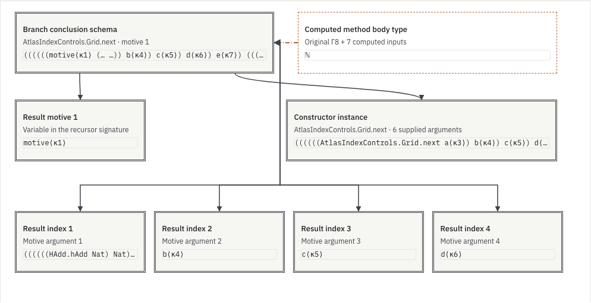

# Constructor conclusions of recorded recursor methods

A computed method body type can hide the generic motive application that
determines its branch. **Inspect branch conclusion** adds that structure to the
existing method-wire view: the result motive, ordered inductive indices and
constructor instance remain separate from the recorded computed body type.
It is a projection of existing checked metadata, not new recursor coverage.

## Rule

Locate the selected minor's domain in the recorded recursor type. Open exactly
the method's recorded input telescope. Its literal result is a motive variable
applied to result indices and a constructor instance:

```text
signature context κ, method inputs ⊢ motive j₁ … jₖ (Constructor parameters fields)
```

The projection resolves that motive variable in the signature's own context,
checks its argument arity and major inductive, and checks the constructor
identity. Mutual-family metadata determine the owning recursor and selected
motive. The enclosing proof call and the constructor-rule owner can differ;
neither is inferred from a declaration-name suffix.

Natural-number recursion has zero inductive indices. Its `n` is the major value:
the recursive premise may have type `P n`, while the branch concludes at
`P (Nat.succ n)`. An indexed family instead has additional index arguments,
such as a vector's length, before its constructor instance. These are distinct
ports. A method whose actual result is a function still stops after the recorded
input count; no extra source or eta binders are added.

The existing natural/product calibration uses identical computed method graphs
and result text, but the generic conclusions contain `Nat.succ` and `Prod.mk`
respectively. The computed type alone does not identify that constructor
structure. This is a follow-up use of the existing calibration, not a novelty
or human-comprehension claim.

## Provenance and navigation

Signature expressions use `kernel-signature`, with their original method
evidence hash, source query, minor, recursor, rule owner, signature root and
exact child route. Reduction RHS expressions remain `kernel-rule`; original
proof occurrences and computed eta inputs keep their existing namespaces.
Signature binders use κ, rather than the proof's original Γ.

The diagram's dash-dot association identifies the same recorded branch. It
does not instantiate the generic signature with source arguments, identify
the two expressions or add a conversion/typing judgment. A signature binder
can open the corresponding computed input by recorded input position; that
bridge also preserves both expressions and namespaces. Computing a checked
signature-instantiation bridge remains separate work.

Selecting a signature card opens its actual constructor payload, ordered fields
and lexical binder. Application arguments are available four at a time.
Constant name parts and universe payloads are retained. The small preview is
bounded syntax rendering, not recovered Lean source; κ ordinals disambiguate
names and ellipses mark elided display. Selection never changes the original
proof occurrence. Unsupported or missing optional code leaves the original
method interface available.

## Bounds and finite evidence

A conclusion diagram has at most eight cards and seven links, with four result
indices per page. Selection exposes at most three structural fields and four
application arguments. Routes are capped at 512 slots; application spines at
128 arguments, motive signatures at 129 inputs, and a scene/selection at
256 KiB. The selected existing native query/type graphs remain fully resident
under their original limits. The projection fetches no additional source or
native data; these are component bounds, not a whole-browser memory theorem.

The [model check](model-check.json.gz) covers 65 method frames in 23 profiles:
the Riccati proof, authored dependent/indexed/mutual/function-result controls,
three publisher-attributed AI-source proofs and the existing large method
fixture. It checks 144 diagram windows, 2,000 signature selections, 658 lexical
binder targets, 318 computed input-position bridges and 392 constructor-argument
selections. Five frames have different enclosing and owning recursors; four
have function-valued computed results. Fifty-seven frames agree through paged
source/query delivery in 30 calls, without complete-archive fetches on that path.
The native records and source packets are unchanged; no new Lean extraction
or kernel replay is claimed.

Independent type-telescope and lexical walks compare every selected address
with the original metadata. Refusal checks cover forged owners, namespaces,
roots, routes and diagram contents. AI attribution and dependency-cache
qualifications remain those of the original records; generation provenance
and an independent dependency rebuild are not verified here.

The [browser check](browser-check.json.gz) and [compatibility records](evidence.json.gz)
retain current production-rendered interactions and their source hashes. The
browser audit covers all 65 methods, plus a repeated Riccati method through the
complete-data elimination reader: 66 frame starts, 241 signature-card selections,
158 field selections, 73 signature-binder jumps and 60 computed-input position
jumps. Source selection is preserved at all 66 starts. Four desktop/phone and
light/dark accessibility audits report no violations in the tested component.
Missing-code and delayed-load controls preserve the existing method view.
The original method-flow, mutual-family, manual, local-reader and synchronized
article regression suites also pass; their reports are linked in the aggregate
evidence. These are finite navigation checks, not user-comprehension results.
Model counts concern overlapping interface views, not unique mathematical
premises. General elimination, semantic compression and improved human
comprehension remain open. The blog is unchanged. This research branch is
not merged or deployed.



The phone viewport retains the same diagram in its scrollable pan/zoom area;
**Fit method wires** gives an overview. [Phone, dark theme](branch-conclusion-phone-dark.png).

## Inspect and reproduce

In the manual's recorded method experiment, load a control, show method
dependency wires and choose **Inspect branch conclusion**. The complete and
paged proof readers use the same method renderer. Select the constructor or
an index to inspect fields and scope. The computed body-type card returns to
the existing type-reference view.

```sh
node research/proof-atlas/branch-conclusion/check-model.cjs
# After building and serving the actual production site; Playwright required:
ATLAS_ORIGIN=http://127.0.0.1:8866 \
  node research/proof-atlas/branch-conclusion/check-browser.cjs /tmp/branch-conclusion
node research/proof-atlas/branch-conclusion/evidence.cjs --check
```

Completed static reports and figures are synced to the local preview after
verification. Application assets come from the production build.
