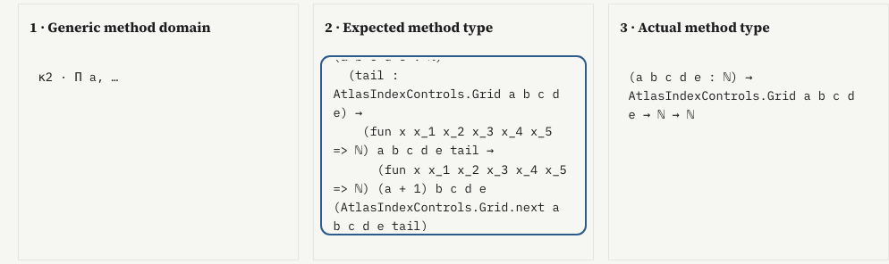

# Literal instantiation of recursor method domains

A generic branch conclusion and an actual computed body type have different
contexts. A position bridge between their inputs does not instantiate the
signature. This rule checks the intermediate **entire expected method type**.

For a selected minor at prefix position `k = parameters + motives + minor`,
extract its domain `D` from the already universe-instantiated recursor signature.
Substitute the first `k` original recursor arguments simultaneously:

```text
signature κ ⊢ D
original Γ ⊢ σ(D) = recorded expected method type
recorded actual method type ≡ recorded expected method type
```

The first equality is a literal, capture-avoiding structural comparison. Original
source arguments are lifted beneath the binders of `D`. Binder domains do not
acquire their binder; lambda/Pi bodies do; a let's body acquires its binder while
its type and value do not. Metadata, names, levels, field order and the let's
nondependent flag remain exact. The second relation is the **previously recorded
native kernel conversion**, with its original evidence owner. No new kernel
conversion is inferred from equal text.

The comparison uses the complete input telescope. It does not substitute the
generic result alone into the actual method's computed context, identify κ with
Γ, normalize motive applications or make the generic conclusion equal to the
computed body type. Function-valued results and mutual rule ownership retain
their previous boundaries. The earlier dash-dot branch association therefore
remains an association.

## Geometry and inspection

In the existing branch conclusion inspector, choose **Verify signature
substitution**. The three endpoint cards distinguish generic domain, expected
method type and actual method type. Their relation labels distinguish literal
substitution from recorded kernel conversion. Up to four referenced prefix
arguments can open their original occurrence-qualified source addresses at a
time. Signature selections keep the original proof selection unchanged; source
actions deliberately navigate to the selected original argument.

## Bounds

The runtime compares the generic/source expression pair against the resident
recorded expected graph. It never constructs the substituted expression or
retains a complete argument subtree. An LRU memo holds at most 1,024 pairs;
the frontier at most 4,096; a comparison at most 262,144 visited pairs and a
binding depth at most 1,024. Prefixes are capped at 128 arguments and receipts
at 256 KiB. Eviction repeats work and cannot change a successful result.
Exceeding a bound refuses the check. Cancellation and retired page leases
also refuse; there is no full-archive fallback.

Source rows come from the existing authenticated page cursor in paged mode.
Its page cache and retained source paths have their own prior bounds. The
selected native/type graphs remain resident. These are component bounds,
not measured browser memory or a whole-proof memory theorem.

## Finite evidence

The [model audit](model-check.json.gz) covers 65 recorded methods in 23 profiles,
including Riccati, indexed and mutual authored controls, function-valued results,
three publisher-attributed AI-source proofs and the existing large fixture.
All reconstructed domains match their recorded expected types. Fifty-seven
methods also agree through paged source/query delivery in 30 calls, without
requesting full source/native archives. There are 160 referenced prefix bindings.
The observed maxima are 240 memo pairs, 40 frontier entries and 240 visited pairs;
these measurements do not replace the enforced upper bounds.

A separate recursive materializer reconstructs the finite outputs. Another
256 structural controls exercise open arguments, shadowing, shared variables
under different depths, binder domains and let fields. Reduced memo capacity
preserves each recorded result. A 1,025-node shared argument represents
\(2^{1025}-1\) occurrences; it compares in 1,026 pairs with one memo and one
frontier entry. This is a constructed DAG stress control, not an AI proof
benchmark. Refusals include captured variables, modified
payloads, forged/cloned receipts, work/byte limits, cancellation and retired
source cursors.

[Lean primitive replay](primitive-check.json.gz) compares those outputs with
Lean 4.33.1's `Expr.instantiateRev`, including exact reserialization: 322 positive cases and 16 capture negatives. It imports
Lean core only. This is a substitution/serialization check on expression ASTs;
synthetic expressions may be ill typed. It is **not new kernel typing evidence**
for the recorded proofs. Original compiled packets, native method records and
their cache/provenance qualifications remain unchanged. Generation provenance,
semantic compression and improved human comprehension remain unmeasured.

The browser audit passes 66 entry-point checks, including 66 exact generic-domain
jumps, two argument-window changes, one intentional original-source jump and
four desktop/phone, light/dark accessibility audits. Source selection is preserved
by all substitution checks. Existing method-flow, mutual-family, manual and
synchronized-reader suites also pass.



[Phone, dark theme](branch-instantiation-phone-dark.png). Long type blocks have
keyboard focus and scroll with arrow keys.

The [browser audit](browser-check.json.gz) and [aggregate evidence](evidence.json.gz)
record production-built interactions and source hashes, including explicit source
argument navigation, bounded argument pages, optional-module failure/retry,
retired asynchronous requests and keyboard access to long type blocks. Blog unchanged;
research branch only, not merged or deployed.

## Reproduction

```sh
node research/proof-atlas/branch-instantiation/check-model.cjs
python3 research/proof-atlas/branch-instantiation/verify-primitive.py \
  --lean /path/to/lean-4.33.1/bin/lean --workdir /tmp/new-substitution-replay
# After building and serving the production site; Playwright and axe-core required:
ATLAS_ORIGIN=http://127.0.0.1:8877 \
  node research/proof-atlas/branch-instantiation/check-browser.cjs /tmp/substitution-browser
node research/proof-atlas/branch-instantiation/evidence.cjs --check
```

Completed reports and figures may be copied to the local preview after checks;
application assets come from the actual production build.
