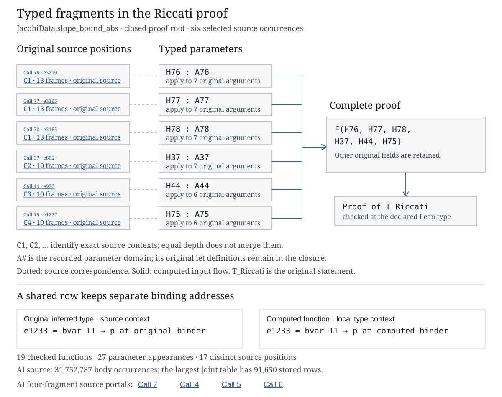

# Typed source frontiers on compiled proofs

Nineteen functions now have fresh kernel judgments on the complete compiled Riccati bound and one released AI-source proof. Seventeen cases replace one recorded fragment; two replace deterministic nonoverlapping sets of six and four fragments. Every function is checked at a type ending in the original declared Lean theorem statement. The 27 parameter appearances retain 17 distinct original source positions.



[Open the SVG and its source portals](corpus-frontiers.svg) · [PNG](corpus-frontiers.png) · [Native inventory](native-check.json.gz) · [Model report](model-check.json.gz) · [Current evidence](evidence.json.gz).

This extends the [authored frontier controls](../frontier-functions/README.md). The two earlier structural candidates have the same literal function terms in this native run. Their previous record remains frozen at commit `82e0c7572`; its unavailable typing is superseded by these new judgments. The interactive application and blog are unchanged.

## Construction and judgments

The original [source-frontier rule](../frontier-functions/README.md#rule) closes a selected fragment over its actual lambda/let context and replaces only that occurrence with an application of a new typed parameter. The supplied order determines the parameter telescope. Literal dependent-type substitution, exact context paths, original let definitions and source fields remain intact.

Here the selected root is the entire closed proof body. New parameters are outside the original proof's telescope. The native producer checks the transformed body, the complete function in an empty local context, and its inferred function type. It then builds a second function type with the same parameter domains and the **original declared theorem type** as the result. Both the function at that expected type and the conversion between the two function types pass kernel checks.

Supplying the original closed fragments must recover the original inferred result type, pass kernel conversion to the original proof and admit a typed equality witness. Literal source-hole reopening and parameter-type recovery are checked separately. An independent de Bruijn construction reproduces every whole function term and all 27 parameter domains. Conversion and proof irrelevance alone do not establish source correspondence.

The function's return type is literally the original inferred type in all nineteen cases. Its raw comparison with the declared statement differs in all nineteen. A comparison that erases only metadata agrees in all nineteen; the complete native graphs retain that metadata. The declared-goal bridge is an explicit kernel judgment, rather than an inference from the metadata-erased comparison.

## Coverage

| Compiled declaration | Single-fragment cases | Multi-fragment set | Stored source rows | Expanded body occurrences |
|---|---:|---|---:|---:|
| `JacobiData.slope_bound_abs` | 9 | `76,77,78,37,44,75` | 3,251 | 165,594 |
| `lean_workbook_plus_6206` | 8 | `7,4,5,6` | 91,424 | 31,752,787 |

The seventeen positions are all previously recorded result ports of these two selected proofs. The multi-fragment sets are selected by descending source-route depth, then call number, accepting only nonoverlapping occurrences. No failed case is replaced with an easier selection. This is not coverage of every source subterm, application-region boundary or proof in the corpus. AI-generation attribution remains that of the dataset publisher. [Dataset notice](/public/data/proof-atlas/goedel-sample/NOTICE.txt).

## Shared storage, separate scopes

Each native case exports one shared `ExprDAG/1` table. Named components identify its function term, inferred and declared-goal function types, source observations, closed fragment terms/types, original inferred fragment types and parameter domains. The largest table has **91,650 stored rows**; the largest function-term component has 91,432. These are finite stored sizes, not semantic-compression measurements.

The components have different scopes. Complete functions and closed fragments use the empty context. An original inferred input type uses that input's exact original source context. A new parameter domain uses the earlier parameter prefix. A shared row ID never identifies a binding by itself. The model validates all 222 component owners and produces sixteen witnesses where one stored bound-variable node has an original source-binder target in one component and a computed local-binder target in another. Component names, paths and context namespaces remain part of the address.

The JavaScript adapter shares the table arrays while exposing component roots to the preceding constructor model. It does not duplicate the large arrays for each view. Literal syntax hashing now memoizes by stored node. Shifted subgraphs retain their scope-aware states, with unaffected subgraphs reusing their literal keys. A separate bottom-up reference checks 856,960 stored-row appearances and all 222 roots; 534 finite shift comparisons agree with the preceding implementation. Binding resolution remains separate from syntax hashing.

The earlier separate-component export completed eighteen cases and stopped on the four-input AI case with a compiler allocation exception. That is a resource failure with no kernel-negative verdict. The shared export completes the same planned case under the same limits, while adding declared-goal checks. All 164 component-root comparisons from the eighteen earlier outputs preserve their literal syntax, occurrence counts and scope requirements. [Finite export comparison](export-comparison.json.gz) · [Hash audit](hash-check.json.gz).

## Evidence and limits

- [Native inventory](native-check.json.gz) and its nineteen content-addressed case files bind the source, original queries, graph components and fresh judgments.
- [Model audit](model-check.json.gz) reconstructs all nineteen function terms and 27 parameter domains, checks original query types, component scopes and declared-goal structure, and rejects forty changed source/order/scope inputs.
- [Figure and presentation](presentation-check.json.gz) bind the schematic to real source/type roots. The SVG source portals retain exact occurrence routes.
- [Production checks](production-check.json.gz) cover the actual documentation build, static delivery, responsive/theme accessibility and exact source-portal selection in the existing library. Existing application files remain unchanged.
- [Aggregate fingerprints](evidence.json.gz) keep native checking, constructor reconstruction, source identity and presentation as separate evidence layers.

Fresh checks use Lean 4.33.1. Dependency binaries are individually hash-verified and attributed to the pinned Mathlib cache revision, not independently rebuilt. The Riccati check reuses the three previously hash-checked support modules; its original declaration type and entire body match the public packet structurally. The original AI declaration/module and private Riccati modules are absent from AI checking. Private proof scripts, support binaries, compiler entries and raw logs are not published.

Each case has one native process with a 6,144 MiB compiler allocation limit, 8 GiB monitored RSS ceiling, 120-second timeout, 64 MiB output limit and the existing free-space guard. One raw output is retained at a time. Graphs retain the 131,072-row cap; selected paths retain their 512-depth and 65,536-visit caps. These are component guards, not a whole-program memory theorem. The offline audit retains complete source/computed graphs. The new joint records are not yet paged into the interactive reader.

The rule still requires a nonoverlapping source-tree frontier. An arbitrary application-region boundary, automatic type-dependency normalization, minimal premises, mathematical strategy extraction and measured human comprehension remain outside this result. The general research program stays active. No blog update, merge or public deployment accompanies this record.

## Reproduction

```sh
node research/proof-atlas/corpus-frontier-functions/prepare.cjs /tmp/new-corpus-frontiers
python3 research/proof-atlas/corpus-frontier-functions/verify.py \
  --lean /path/to/lean-4.33.1/bin/lean --cache /path/to/hash-inventoried-runtime \
  --support /path/to/previously-checked-riccati-support --workdir /tmp/new-corpus-frontiers
node research/proof-atlas/corpus-frontier-functions/check.cjs --freeze /tmp/new-corpus-frontiers
# Frozen structural checks:
node research/proof-atlas/corpus-frontier-functions/check.cjs
node research/proof-atlas/corpus-frontier-functions/check-hashes.cjs
node research/proof-atlas/corpus-frontier-functions/figure.cjs --check
node research/proof-atlas/corpus-frontier-functions/evidence.cjs --check
```

The runtime follows `use-sites/verify.py:recovered`. Native producer hashes and both pre/post binary inventories must agree. The resource-comparison record uses the preserved earlier workdir; it is historical evidence, separate from a fresh successful replay. Presentation requires Playwright and axe-core. Final static reproduction records may be refreshed after the production build; tested application assets and HTML remain actual build outputs.
