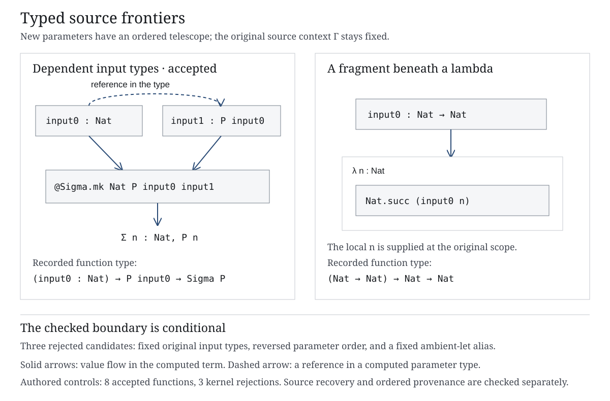

# Typed functions over source frontiers

Eight authored examples now have a kernel-checked function over selected source fragments. Its parameters retain their source occurrences and local scopes. A dependent parameter type can refer to an earlier parameter; the resulting function specializes back to the original source when supplied with the original fragments. Three other candidates are rejected by the kernel.



[PNG](frontier-functions.png) · [Native observations](native-check.json.gz) · [Independent reconstruction](model-check.json.gz) · [Current-file evidence](evidence.json.gz).

This extends the earlier output-tuple experiment toward typed inputs. It is a **source-tree frontier**, not an arbitrary application-region boundary, and does not complete the latter problem. The existing interactive reader and blog are unchanged.

## Rule

Choose an exact source root at an original binder prefix Γ. Select an ordered, nonoverlapping set of descendant occurrences. Each selected fragment has its own suffix context Δ. Close that fragment and its inferred type back to Γ, preserving original let definitions and closing lambda/forall frames as function inputs. This uses the preceding [scope-closure rule](../region-result-closures/README.md).

Introduce new parameters in the supplied order. For each parameter type, replace literal occurrences of earlier **closed fragment values** with their new parameters. Matching uses exact Expr structure, including names, levels and payloads, rather than kernel conversion or printed text. If equal original closed values have several positions, the first earlier match wins; this explicit policy does not establish a unique semantic interface. The independent model implements the replacement using de Bruijn lifting.

Replace only the selected source occurrences in the source body. At an occurrence beneath Δ, apply its new parameter to the intervening original lambda variables. Source lets keep their original values and are not extra independently supplied arguments. Traverse the selected path trie and preserve unaffected subgraphs. Bind the new parameters around the resulting term.

The kernel must check the complete new function and its dependent function type after the parameter declarations have been removed from the ambient context. Its result type is inferred from the transformed body; the rule does not assume the original goal remains unchanged for arbitrary new inputs. Applying the original closed fragments must have the original result type, convert to the original source term and admit a typed equality witness.

Literal checks remain separate: every closed fragment must reopen to its exact source expression, and each generalized parameter type must recover its original type when the original fragments replace the new parameters. The model independently reconstructs the whole function term and every parameter domain. It does not infer arbitrary Lean types; the result type and conversions remain native kernel judgments.

The computed function has namespace `source-frontier-function`. Its term/type roots are in the new graph, relative to Γ. Original ports retain their original packet, node and complete route. Neither a shared source node nor equal closed values removes a port.

## Observations

The nine authored declarations have eleven cases:

| Case | Native result |
|---|---|
| An argument beneath `Nat.succ` | Accepted: `Nat → Nat`. |
| A fragment beneath a lambda | Accepted: `(Nat → Nat) → Nat → Nat`. |
| A selected let value | Accepted, retaining the let in the new body. |
| Proof-valued function head and proof argument | Accepted: `(P → Q) → P → Q`. |
| Dependent index and value | Accepted: `(input0 : Nat) → P input0 → Sigma P`. |
| The same index/value with fixed original input types | Kernel rejection at the candidate body. |
| The same parameters in reverse order | Kernel rejection at the candidate body. |
| A dependency hidden behind a fixed ambient let alias | Kernel rejection at the candidate body. The literal rule does not unfold it. |
| Two proof inputs with the same proposition | Accepted; their original positions remain distinct. |
| One stored variable expression beneath two different lambda occurrences | Accepted as two independently supplied function parameters. |
| A type-valued result | Accepted: `(Unit → Type u) → Type u`. |

The eight accepted functions have twelve selected source positions. The largest function-term DAG has twenty rows. In the proof-pair control, permuting the inputs changes the literal function body but still passes kernel typing, conversion and the equality-witness check after specialization. The independent ordered reconstruction rejects that wrong function. Thus native conversion alone is insufficient for the required source correspondence.

Three separate fresh native processes reject a wrong source node, a foreign same-depth context and overlapping occurrences. All fail with the expected ordinary input error, without a resource stop. The independent model rejects 35 source, context, closure, order, namespace and function mutations, including the kernel-convertible proof permutation. It reconstructs all eleven candidate terms and their eighteen parameter domains, including the rejected candidates.

## Corpus scale probes: typing unavailable

The same pure constructor algorithm builds one-fragment candidates for the entire compiled Riccati proof body and the earlier largest AI-source example. Both retain an exact source-addressed inverse. Their original fragment types come from the pinned earlier native record. **The new functions and their closures at the new root have no native typing judgment.** They are not added to the interactive reader as checked constructions.

| Source | Stored source rows | Expanded body occurrences | Candidate-term rows | Path-trie visits |
|---|---:|---:|---:|---:|
| `JacobiData.slope_bound_abs` | 3,251 | 165,594 | 3,221 | 59 |
| `lean_workbook_plus_6206` | 91,424 | 31,752,787 | 91,374 | 42 |

The trie count covers selected-path reconstruction, not total graph work. Unaffected subgraphs, parameter domains and source references are processed through memoized DAG operations. The offline probe retains complete source/computed graphs; it is not a paged-browser or whole-process memory result. The counts do not establish semantic compression. [Structural candidates and unavailable boundaries](corpus-candidates.json.gz).

## Limits and reproduction

Fresh native checks use Lean 4.33.1 and its core environment. The original fixture declarations/modules are absent from each replay environment; the packets are decoded and their closed roots checked. Authored source and tooling are public. Original private Lean scripts and dependency caches are neither read nor published. The toolchain version/executable, compiled fixture module, runtime inputs and producer files are fingerprinted. This is not an independent compiler rebuild or an original-extraction-environment identity claim.

Requests allow at most 64 holes, path depth 512 and 65,536 trie visits. Packet and model construction have a 131,072-row bound; model reference hashing has a separate 262,144-state bound. Native processes retain the existing allocation, RSS, output, timeout and free-space guards. These are component limits, not a proof of bounded total memory. The native producer and JavaScript reconstruction have finite test coverage, not a general verified compiler theorem.

The rule requires nonoverlapping source-tree occurrences. It does not yet construct an interface over every position of the displayed graph-region boundary. It does not normalize type dependencies, automatically find a valid parameter order, generalize the ambient Γ, establish minimal premises, type-check the large corpus candidates or measure comprehension. These remain work toward the active program goal.

```sh
# Fresh native run; use a new directory.
python3 research/proof-atlas/frontier-functions/verify.py \
  --lean /path/to/lean-4.33.1/bin/lean --workdir /tmp/new-frontier-functions
node research/proof-atlas/frontier-functions/check.cjs --freeze /tmp/new-frontier-functions
# Frozen evidence checks:
node research/proof-atlas/frontier-functions/check.cjs
node research/proof-atlas/frontier-functions/check-corpus-candidates.cjs
node research/proof-atlas/frontier-functions/figure.cjs --check
node research/proof-atlas/frontier-functions/evidence.cjs --check
```

`render.cjs` uses Playwright and axe-core to produce the PNG and a static presentation check. This is a notation schematic with recorded source/computed addresses in SVG metadata. Reproduction records may be refreshed in the local static preview after the production build; application assets are unchanged. Research branch only; no merge or public deployment.
