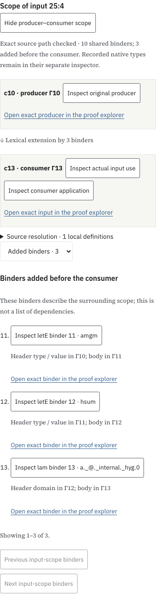
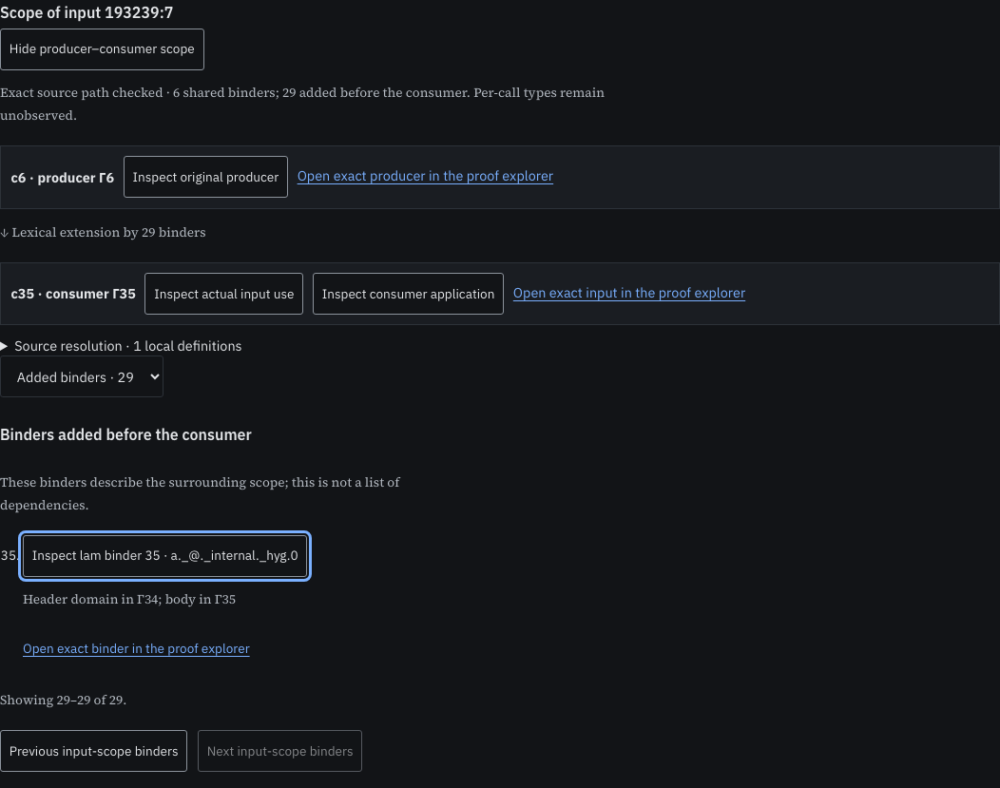

# Producer and consumer scope at an application input

The call-context tree locates retained result occurrences. An input can come from an earlier source occurrence with fewer enclosing binders. This extension uses the same lexical-prefix rule to connect those two contexts, keeping the actual input use and local-definition path separate. It does not construct a common-context typing judgment for the region.

## Rule

1. Authenticate the selected call's rank against the pinned paged call inventory. Check its complete row against the supplied selection and retain the actual input position, including function slot zero.
2. Check the literal ordered source input and its definition-resolution path against authenticated source pages. Producer/input/binder/value occurrences keep the source packet, declaration, root, ordered route and node. Definition nondependency annotations and resolution limits remain explicit.
3. Derive the ordered original binders at the producer and consumer. The former must be an exact prefix of the latter. Contract unary runs as in the existing context tree; the two endpoints need at most three visible context vertices, including the empty context where needed.
4. Keep all shared and additional binders recoverable through four-row pages. Header domains and let values stay in the preceding context; bodies enter the newly bound variable. Source actions and direct proof-explorer links retain the original occurrences.

Additional binders describe lexical nesting. They are not a dependency list or a minimal set of assumptions. The native producer type, its lifted version and the expected input type retain the existing separate computed addresses and native owner. This source rule requests no native type graph and does not infer proof/value roles. A source-only input retains unobserved per-call types.

The implementation uses two private focus keys while applying the shared context-tree codec. They are removed from the public bridge scene. Public call/input identifiers are the authenticated original inventory numbers; public expression addresses are original source occurrences. Context vertices are derived display objects, with their own namespace and derivation hash.

## Riccati examples

Input `25:4` uses the AM–GM result from Γ10 in consumer Γ13. Its three additional binders are the original `amgm` and `hsum` lets and an internal lambda. The source use resolves through `amgm`; the other two added binders are not thereby classified as dependencies.

Input `76:6` uses the product identity from Γ9 in Γ13. The four-frame extension starts at `bprod`, followed by `amgm`, `hsum` and the internal lambda. Its definition path and nondependency annotation remain separate from this four-binder extension.

In the [paged application reader](/projects/proof-atlas/manual/paged-network/), inspect an input and choose **Show producer–consumer scope**. The scope control is mounted before native input loading finishes and remains available if that optional type load fails. Scope loading itself uses the call index and source pages. Selecting a source uses the existing inspector when its window is available; the public-corpus links provide a direct route independently of native type loading. Changing inputs retires the old scope controls. Selecting a computed type preserves the scope bridge.

## Bounds and evidence

The canonical lookup uses the existing four-row call leaf and two branch records; its transport is disposed after checking one call. Source verification retains at most 4,096 path rows and 4 MiB of serialized row tuples, with a separate 256-row fetch cache and two source index records. The witness rows are released before deriving the context tree. That second phase has the same 4,096-row / 4 MiB bounds. The final public scene is capped at 4 MiB. The temporary context-tree lease and source cursor are disposed before returning the completed bridge. These are component bounds, not a measured total browser heap.

The source resolver stops after sixteen local-definition hops. A remaining definition boundary stays explicit. Unsupported paths, exhausted work bounds, corrupt pages and mismatched inventory/source witnesses fail without a complete-source or native-batch fallback.

- [Model checks](model-check.json.gz) compare all 877 inputs at 201 calls in 42 native profiles with original source/native archives whose decoded hashes are verified. Exactly 37 inputs extend their producer context: 26 by one binder, five by two, one by three, two by four, two by five and one by thirteen. Forty baseline source-only inputs have no inferred type. A complete census of the large proof’s 201,340 call rows records 32 context-changing inputs among 699,453 inputs. All 32 positive cases then pass independent source-page checks. The largest adds 29 binders at input `193239:7`; its native type remains unobserved.
- The model checks every shared/added frame page, original definition paths, 63 nondependent annotation appearances, source-only behavior, captured input snapshots, canonical-rank mismatches and cancellation. Re-hashed false inventory controls are checked against the unchanged source; role metadata alone supplies no source-layer proof classification.
- [Inventory census](inventory-check.json.gz) uses bounded depth-first page traversal: one four-call leaf and at most four index frames on this input. The census authenticates every call-index row and checks its schema; source membership remains the producer’s attestation until a witness is checked. It is not an independent source audit of every one of the 699,453 inputs.
- Production-browser checks cover live Riccati source/type selections, input changes, retired controls, source-only behavior, optional type-data failure, corrupt/delayed source data, desktop/phone and both themes. They also exercise four pages of the native thirteen-binder extension and eight pages of the source-only twenty-nine-binder extension. Both examples follow one definition. Scope size and definition-hop count remain separate. [Browser record](browser-check.json.gz), [compatibility records](network-compatibility.json.gz) and [evidence hashes](evidence.json.gz) retain their finite scopes.

The large source-only inventory has at most one definition hop per input. A live source-resolution path exceeding four hops has not yet been exercised by these checks; the sixteen-hop protocol bound is not a corpus-coverage claim.





This is a source-preserving composition rule. General typed region composition, semantic abstraction and measured human inspection benefits remain open. The blog is unchanged; no merge or deployment is part of this iteration.

## Reproduction

```sh
node research/proof-atlas/input-contexts/check-inventory.cjs
node research/proof-atlas/input-contexts/check-model.cjs
# Build and serve the production site locally; Playwright/Chromium required.
ATLAS_ORIGIN=http://127.0.0.1:8866 node research/proof-atlas/input-contexts/check-browser.cjs /tmp/atlas-input-contexts-browser
node research/proof-atlas/input-contexts/verify.cjs --check
```

Only compiled term metadata, derived source views and verification records are added. Original Lean/tactic scripts and private raw execution logs are excluded. The general geometric-language goal remains active.

Completed static evidence and figures are copied into the local preview after verification. Application scripts remain the byte-checked production build.
