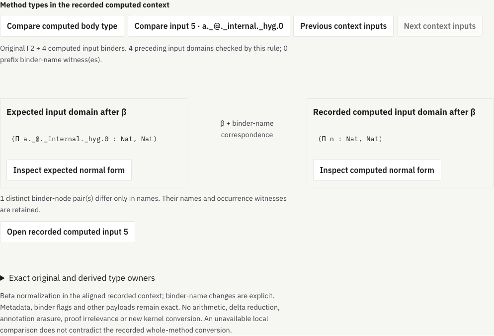
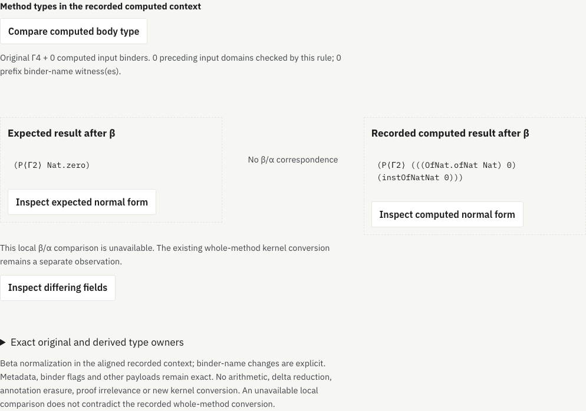

# Method types in a recorded computed context

The previous rule checks literal substitution into a recursor method's entire
expected type. A selected computed input or body has a larger context. This rule
opens that expected type's recorded number of inputs and compares the selected
port in the corresponding context.

```text
Γ ⊢ σ(generic method domain) = recorded expected method type E
Γ, y₁:A₁, …, yⱼ:Aⱼ ⊢ expected port after β  ~  computed port after β
```

The first equality is checked by the existing signature-substitution receipt.
Before the second comparison, **every preceding input domain must also match**.
The prefix records expected telescope names and binder flags separately from
computed η-binder names, flags and addresses. It does not identify generic κ
binders with original Γ binders. A function-valued result remains a result after
the recorded input count; it does not acquire extra method inputs.

## Relation and boundaries

Direct lambda applications reduce by capture-avoiding substitution. Reduction
also traverses types and binder bodies; binder domains and let type/value fields
retain their original scope. Let expressions are retained, not expanded. Names,
universe payloads, metadata, binder flags and nondependent-let flags remain
attached to their constructors.

There are three outcomes:

- **Identical β-normal forms.** Ordered fields and all payloads agree.
- **β plus explicit binder-name correspondence.** Only binder names differ;
  de Bruijn positions, domains, bodies, flags and other payloads still agree.
  Distinct binder-node pairs retain names, structured name parts and one
  occurrence witness each. This does not enumerate every expanded occurrence
  of a shared binder.
- **Unavailable under this rule.** A differing constructor/payload or an
  unestablished prefix prevents a local correspondence. The two forms and
  their first differing field remain inspectable. Exceeding an operational
  bound also refuses the comparison.

Arithmetic, delta reduction, annotation erasure and proof irrelevance are not
performed. An unavailable local result does not contradict the previously
recorded whole-method kernel conversion. No new kernel typing or conversion
judgment is claimed.

## Geometry

After **Verify signature substitution**, choose **Compare in computed input
context** in the existing branch inspector. Four input choices per page and a
fixed body choice select one comparison. The two cards show expected and
recorded computed forms, with their relation stated between them. The common
context states the original Γ size and checked computed-input prefix.

Each card opens a bounded field inspector. Routes stop at 512 child slots;
previews stop after 96 visits, depth 12 or 1,400 characters, with explicit
ellipses. They are syntax previews, not recovered Lean source. Derived expressions use a separate
`beta-method-type` namespace, with evidence owner, query, minor, side, root and
exact child route. They never become original proof occurrences. A variable
links to its original Γ binder, recorded computed input or local derived binder,
as appropriate. Γ, ι and ν labels distinguish those three scopes. Native type
roots and the expected-type projection remain separate from derived roots.
Source/binder actions are deliberate navigation; inspecting derived fields does
not change the selected proof occurrence. Retired controls and delayed optional
code cannot replace a new method selection.

## Finite result

The [model audit](model-check.json.gz) covers **171 ports in 65 methods and 23
profiles**: 106 input domains and 65 body types. There are **164 exact β-normal
form matches, one explicit binder-name correspondence and six unavailable body
comparisons**. All 106 input domains and 59 body types therefore have this local
correspondence. The audit also checks 213 preceding-domain obligations, 1,132
field selections and 131 lexical binding targets.

The six unavailable results are the two natural-number dependent-recursion
control branches and four body types in the two attributed AI-source profiles
`lean_workbook_plus_6206` and `lean_workbook_plus_62755`. The first pair includes
natural-number presentations beyond β reduction; other differences include
metadata/proof expressions. These are limitations of this rule, not failed Lean
proofs or measured semantic inequivalence. Exact mismatch records are retained
in the audit.

Complete and paged delivery agree on 153 ports in 57 methods over 30 selected
calls. Context normalization fetches no additional source data. Original packets
and native observations remain unchanged. The Riccati proof, indexed/mutual and
function-result controls, three publisher-attributed AI-source proofs and the
previous large fixture retain their original provenance qualifications.

Another 48 structural controls exercise capture, shadowing, binder-name changes,
binder flags, metadata and nondependent lets. Untyped omega is required to stop
at a resource bound; it is not sent to an unbounded native normalizer. The
[Lean-core replay](primitive-check.json.gz) independently checks 219 finite
normalization/classification cases and 545 direct β-step witnesses, including
exact serialized normal forms. Synthetic expressions may be ill typed. This
uses Lean 4.33.1's substitution primitive without importing original proof
modules; it is not fresh kernel typing of the proof corpus.

## Bounds and verification

Only one selected pair of derived forms remains in the component. Each normalization’s scratch
table is capped at 16,384 cells. Interned constructor keys have a 4 MiB aggregate
cap, key processing has a 16 MiB byte budget, and stored occurrence counts have
a 524,288-digit aggregate cap. Each of five LRU caches and the comparison memo
holds at most 4,096 entries; the comparison frontier also has a 4,096 bound.
The complete prefix plus selected-port comparison shares a 262,144-operation
budget. Call depth is capped at 512, β traces at 1,024 steps, binder-name
witnesses at 64, and a receipt/selection at 256 KiB. The observed maxima in the
recorded sample are 173 derived cells and 11,326 total operations for a selected
port including its prefix. Resident native graphs retain their existing limits.
These are component bounds, not a whole-browser memory theorem.

The [browser audit](browser-check.json.gz) and [aggregate evidence](evidence.json.gz)
record production-built navigation, failure/retry, retired controls, themes and
phone/desktop accessibility. Earlier frozen bundles retain their original
checkpoint hashes; fresh compatibility records live in this directory.
The browser audit passes 173 port inspections through 66 method entry points,
including a repeated complete-reader case. It checks 172 field actions, 56 binding
links, intentional source/input jumps, missing-code retry and retired controls.
Four phone/desktop, light/dark accessibility audits pass.



[Phone, dark theme](method-context-phone-dark.png).



The second figure preserves the numeric mismatch rather than declaring the
original proof invalid. [Phone, dark theme](method-context-numeric-boundary-phone-dark.png).
The [figure-state checks](figure-check.json.gz) add four accessibility audits on
these two control states.

Human comprehension, semantic compression, broader recursor coverage and
conversions beyond this β/α rule remain open. The general goal stays active.
Blog unchanged; research branch only, not merged or deployed.

```sh
node research/proof-atlas/method-context/check-model.cjs
python3 research/proof-atlas/method-context/verify-primitive.py \
  --lean /path/to/lean-4.33.1/bin/lean --workdir /tmp/new-method-context-replay
# Build and serve the production site; Playwright and axe-core required:
ATLAS_ORIGIN=http://127.0.0.1:8877 \
  node research/proof-atlas/method-context/check-browser.cjs /tmp/context-browser
node research/proof-atlas/method-context/evidence.cjs --check
```

Completed reports and figures can be synced to the local preview after checks;
application assets come from the actual production build.
