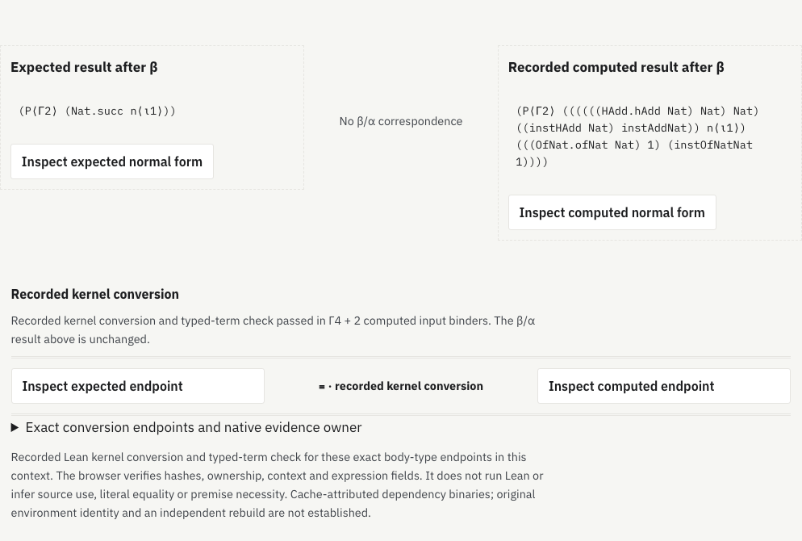

# Recorded kernel conversion as a method-type relation

The method-type view shows a recorded **≡** link between its expected and
computed beta-normal-form endpoints. This link has its own native evidence
owner and the exact original Γ plus computed ι context. Each endpoint opens the
existing bounded field/binder inspector. The beta/alpha result remains visible
and unchanged.

Six body-type pairs have [fresh native evidence](../method-conversion/README.md):
two dependent-recursion control branches and four branches in two attributed
AI-source proofs. The browser verifies the selected source packet hashes,
original method evidence owner, exact query/minor, original context and computed
input count, preceding-domain checks and both ordered expression graphs.
It does not run Lean. Matching printed types or an old whole-method conversion
cannot supply this link.

The native graph is separate from the private derived graph. Matching retains
constructor payloads, metadata, names, flags, child order, scope requirements
and occurrence counts. Native and derived root identifiers stay distinct.
The link establishes recorded definitional equality in this context; it does
not merge source occurrences, assert literal syntax equality or create a
source-use or premise-necessity relation.

## Delivery and boundaries

The native component and inventory load only on an explicit action. A matching
record is one independently hashed gzip file, bounded to 256 KiB decoded and
2,048 graph rows. Endpoint comparison has 8,192 pair/frontier limits. No native
record cache is retained by the component. The current three files contain
only compiled data and native verification metadata. The original source
scripts remain unpublished.

Unrecorded body/input ports state that no separate native record exists.
A failed optional script, inventory or data fetch leaves beta/alpha inspection
available and can be retried. Changing the selected port or method aborts its
native data load; retired controls cannot alter the new selection. The bridge
uses labeled endpoint buttons and a double rule, with one-column phone layout
and the existing light/dark site tokens.

The native binaries are attributed to a mathlib cache and individually hashed.
Original extraction-environment identity and an independent source rebuild
remain unestablished. The new relation inherits those qualifications and the
finite six-pair scope. It does not extend native coverage to arbitrary ports or
establish semantic compression or improved human comprehension.

## Reproduction

```sh
node research/proof-atlas/method-conversion-view/build-data.cjs
node research/proof-atlas/method-conversion-view/check-model.cjs
# Build the production site and serve it, then use Playwright and axe-core:
ATLAS_ORIGIN=http://127.0.0.1:8877 \
  node research/proof-atlas/method-conversion-view/check-browser.cjs /tmp/kernel-bridge-browser
node research/proof-atlas/method-conversion-view/evidence.cjs --check
```

The data builder pins the native bundle to commit `084440e69`. The model audit
rechecks all 171 prior ports, 153 paged correspondences and 219 frozen Lean-core
normalizer cases, without rewriting the earlier evidence. It validates six
native bridges (four also through pages), 59 unrecorded bodies and 106
unrecorded inputs. Native typing is inherited from the pinned six-pair bundle;
it is not rerun during these browser/model checks.

The [model audit](model-check.json.gz) rejects 150 altered records/endpoints and
201 foreign ownership attempts. Another 42 refusals check graph/byte limits,
malformed or unreachable rows, invalid roots, cancellation and oversized
gzip delivery. The [browser audit](browser-check.json.gz)
checks six manual links, four paged peers and 20 endpoint actions, with four
failure/retry controls, three retired-control cases and four accessibility
checks. A separate compatibility run covers 173 port inspections in 66
complete/paged/manual/stress entry points. Existing wire, mutual-recursion,
constructor-manual and twelve reading-task browser suites also pass.



[Phone, dark theme](kernel-link-phone-dark.png). The two [figure-state checks](figure-check.json.gz)
isolate the actual type pair and native relation; site navigation is hidden only
for these component captures. Both additional accessibility checks pass.

[Aggregate evidence and unchanged compiled inputs](evidence.json.gz). The six
native typing results are inherited from the pinned previous bundle; the new
checks establish delivery and exact visual endpoint binding. Human task
performance and broader conversion coverage remain unmeasured.

Completed model, browser and compatibility reports live in this directory.
Blog unchanged. Research branch only; not merged or deployed.
