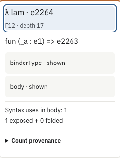

# Exposed and folded references in a source cut

The existing **Syntax use counts** layer now splits a retained binder's body
count into exposed source-variable constructors and references still inside
folded source regions. It uses the existing authenticated body total and the
current exact cut; it loads no additional source subtree or native type table.
The original graph, source accounting, lexical links and typing records are
unchanged. The annotation contributes zero source occurrences.

## Rule and scope

For a binder retained in the cut, its complete original body is partitioned by
that cut. Let `N` be its exact source-syntax body count and `V` the retained
bound-variable occurrences whose binding target is this original binder:

```text
N total = V exposed + (N - V) folded
```

Binding targets use both the stored node and its complete original route.
Equal names or shared variable nodes cannot identify two binders. The split
applies only to binders retained in the cut. A binder outside the selected cut
does not acquire a count for that smaller region from its whole-body total.

This is an application of the separately kernel-checked
[source-reference partition and refinement laws](../source-reference-laws/README.md).
An actual refinement transfers references from folded to exposed while keeping
the total fixed. Changing controls can also reselect a cut; the annotation does
not label every such change as refinement.

The two supported layouts are:

- Raw occurrence windows: retained variable constructors contribute to `V`.
  The existing source binding links identify their exact target.
- Typed introduction/definition frames: retained source positions are binder
  constructors, so `V = 0`. Their domains, values and continuation remain
  folded source regions. Type and expression previews do not become retained
  variable constructors merely because their text is visible.

Counts include all expression fields inside the original body, including
annotations. They are not counts of recorded typing judgments, distinct DAG
nodes, runtime evaluations or necessary mathematical premises. `forallE`
remains a source type binder. Unavailable totals yield no split; an unavailable
optional projection preserves the independently checked total.

## Provenance and trust boundary

[The projection](../../../public/js/proof-atlas-reference-partition.js) accepts
an already source-validated cut and an authenticated complete syntax total.
It checks the bounded position trie, ordered fields, exact constructor masses,
disjoint frontiers, selected original binder/body and nonnegative reference
mass. These structural checks do not authenticate arbitrary caller-supplied
JSON or establish lexical correctness from a hash alone. In the reader, the
existing complete/paged source and frame providers supply those inputs; the
existing count consumer validates the immutable count metadata.

Raw cuts keep their `sourceSha256`; typed frames keep their distinct
`sourceGraphSha256` and edition. The projection does not alias these fields.
Every result retains the packet index, original binder/body routes, count
manifest and model hashes, plus a derivation hash of the normalized source cut
and its binding links. It has `typing: not-queried`; no native observation is
created. Count provenance displays the total and cut projection together.

Annotated source cards have space for the constructor, ordered fields and
count at the same time. Their extra row spacing is a presentation choice.
Toggling the count layer preserves the selected occurrence, exact source cut
and recorded-use overlay.

At most 32 retained constructors and 65 frontiers enter a projection, with an
8 MiB metadata bound. Routes keep the existing packed-address limits. The
projection fetches zero source rows; it retains only the bounded normalized
cut while computing the annotations and is then disposed. Count delivery keeps
its existing one-page cache and pending-request bound. These are component
bounds, not a measured whole-browser memory limit. No new count corpus or
original mathematical/tactic source is published.

## Finite checks

The [model audit](model-check.json.gz) checks all 2,118 library/AI packets as an
input inventory. Of these, 2,051 contain stored binders. It selects the first,
middle and last stored binder when distinct, using one representative original
route for each: 5,934 starts and 23,736 cuts at four budgets. These are not all
occurrence routes or all cuts. It checks 38,731 source annotations.

All 269 public mixed-frame starts and 60 definition-frame starts add 1,622
annotations. For every one of the 40,353 annotations, a separate original-route
walk resolves the target index and the unchanged sparse-vector evaluator
recomputes each folded frontier coefficient. This agrees with both exposed
and folded counts. The audit includes 108,366 frontier terms, 4,597 positive
exposed counts, 29,497 positive folded counts and 8,646 zero totals. These are
overlapping appearances, not independent mathematical premises.

Fourteen refusal controls cover source/body/count changes, broken cuts,
cancellation and disposal. An asynchronous input-mutation control checks the
captured cut. Scenes and native observations remain unchanged. The offline
oracle keeps complete source DAGs resident; that is separate from paged browser
delivery. The AI attribution is inherited from the dataset publisher, without
independent generation-provenance verification.

The [production-browser check](browser-check.json.gz) compares the actual
Riccati source/frame annotations with independent frontier counts. It checks
an exact source-body jump, complete/paged agreement, optional-component
failure/retry, delayed loading after the layer is disabled, an unavailable count
and four accessibility audits. A large working-snapshot source view checks
paged delivery without requesting its full source archive. The separate
[compatibility report](compatibility.json.gz) retains the full existing
269-start count-reader suite, including recorded-use separation and the seven
earlier scalar-counter refusals.

The large browser case represents 462,476,271 source occurrences in its
121,568-node packet. That selected view retains 480 source-cache rows under
the existing 4,096-row limit and one 5,001-byte count page. This is a bounded
view of a large project proof, not an AI-generation or whole-browser memory
benchmark. The attributed AI sample remains part of the separate model corpus.

These checks establish a finite implementation comparison. They do not prove
the JavaScript, source authentication, arbitrary elimination coverage, semantic
compression or improved human comprehension. The blog is unchanged and the
general research goal stays active. This branch is not merged or deployed.

## Inspect and reproduce

In the compiled library, enable **Syntax use counts** on a source cut or typed
context frame. Each retained binder shows its total and exposed/folded split.
**Count provenance** retains exact integers and addresses when a compact label
abbreviates a large value. Existing body and binder controls keep source
navigation; there is no new proof viewer.

In the [checked Riccati example](/projects/proof-atlas/library/?view=occurrence&loading=paged&counts=syntax&levels=6&edition=published-15&proof=JacobiData.slope_bound_abs#occurrence=0dec5212099b579b1f2c3a0411d7b9e2fcd827f19142a595da0dbf13401779aa.1.17.VaWqFAE),
source lambda `e2264` has one body use. With one source node it is folded;
with 32 source nodes it is exposed. Its original binder, body and total do
not change.



[Phone and dark-theme rendering](riccati-source-phone-dark.png).

```sh
node research/proof-atlas/reference-partition/check-model.cjs
# Build and serve the actual production site. Playwright/Chromium and axe-core:
ATLAS_ORIGIN=http://127.0.0.1:8866 \
  node research/proof-atlas/reference-partition/check-browser.cjs /tmp/reference-partition
ATLAS_ORIGIN=http://127.0.0.1:8866 \
  node scripts/test-proof-atlas-syntax-counts-browser.cjs
node research/proof-atlas/reference-partition/evidence.cjs --check
```

The [evidence bundle](evidence.json.gz) pins the projection, reader, immutable
count catalogue, current model/browser reports and prior general-law record.
The runtime assets come from the production build. Completed static evidence
and technical notes are synced to the local preview after verification.
