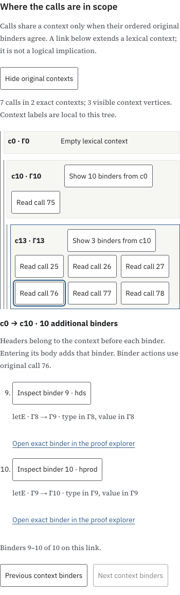
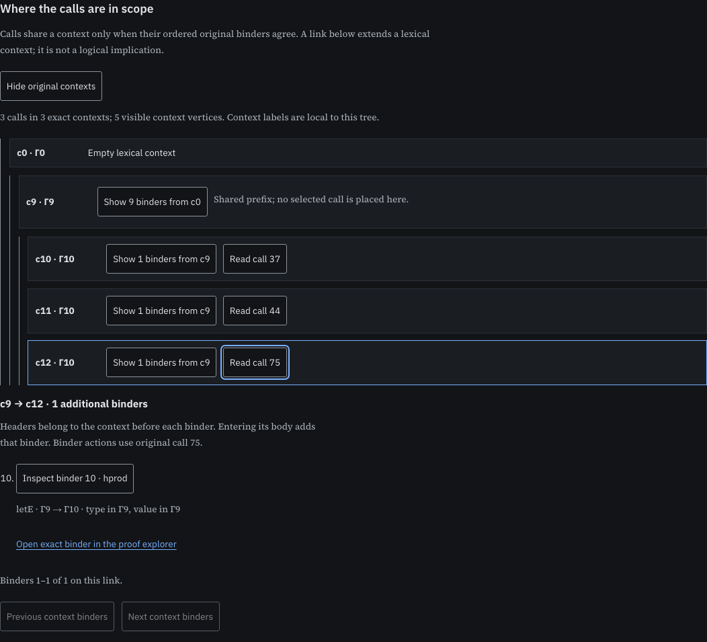

# Lexical context trees for application regions

The research question is how to compose proof views across lexical scopes without identifying different hypotheses or claiming a new typing judgment for a combined region. This iteration adds a source-based context tree to the existing application-region reader. The general geometric-language goal remains active.

## Observation and rule

Context length does not identify a context. In the recorded Riccati inventory, calls 37, 44 and 75 each have ten enclosing binders, but their ordered original binder lists differ. Across the 42 native profiles there are seven depth/profile combinations containing more than one context. This is a presentation ambiguity in the earlier depth labels, not a new mathematical theorem.

The rule assigns each selected call its exact lexical binder sequence. Two sequences share a prefix only when their packet-qualified binder occurrences agree, in order. Binder names, printed propositions, depth and stored node IDs alone are insufficient. The source packet, declaration, root, ordered child route and binder node remain attached to every frame. Reused stored nodes under different routes remain distinct occurrences.

An edge enters the body of a lambda, forall or let. Lambda/forall domains, let types and let values retain the preceding context. Header addresses remain separate from the binder address. The tree shares prefixes, then contracts a run of unary nodes that contains no selected call. Expanding its edge recovers all the original frames, four per page. Selecting a call reads its original result; selecting a frame opens that exact source binder through an in-scope call's existing inspector.

The root, branch points and contexts occupied by selected calls remain visible. For k nonempty selected-call occurrences the compressed tree has at most 2k vertices: every retained non-root node either holds a selected context or branches, and the number of branching-only nodes is bounded by the number of leaves. The implementation checks the bound and the finite inverse. This explanation is not a Lean-checked general theorem or a proof of the JavaScript implementation.

The current tree places the retained calls at their consumer/result occurrences. External input producers are not added as extra vertices. Their original contexts remain separately available in the input inspector; they are not identified with the consumer context.

Context labels such as `c10` are local display identifiers. They do not create Lean expressions or identify contexts across different trees. Full source addresses determine identity. A context-extension line records lexical nesting; it adds no logical implication, common-context sequent, premise-necessity result or typing judgment for the region. Native types keep their original owners and contexts.

## Riccati case and reader

Open the [paged application reader](/projects/proof-atlas/manual/paged-network/), load the default AM–GM cut, expand its connections and fold the seven-call region. Choose **Show original contexts**. The region has two exact contexts and three visible context vertices. Call 75 is in the ten-binder prefix. Calls 25–27 and 76–78 are in the thirteen-binder extension. The additional frames are the original `amgm` and `hsum` lets and an internal lambda. Their compiled names and routes are retained; no tactic history is inferred.

The shared prefix and the added frames have independent four-row pages. Reading a call updates the existing result and boundary sheet. Binder actions select an exact source occurrence while leaving its call's native observation unchanged. A direct proof-explorer link on each public-corpus frame remains independent of native type loading. A later type selection preserves the context tree. Retired frame buttons and cancelled loads cannot change the current selection. Missing or corrupt context data leave the original source region available.



The separate three-context picture is an isolated rendering control using bounded source-path tuples for the actual Riccati calls 37, 44 and 75. It does not claim these calls form a connected foldable region.



## Bounds and evidence

The runtime reads authenticated source pages, with one 256-row cache and two index records. It retains at most 4,096 distinct source-path rows and 4 MiB of serialized row tuples while deriving the context tree, then releases those rows and the source cursor. The resulting scene has a separate 4 MiB cap, at most eight call placements and at most sixteen visible vertices. Edge lists retain binder metadata and qualified source/header routes, not expression subtrees. These are component bounds, not measured total browser memory.

The low-level `derive` function accepts a supplied row reader. It checks traversed constructor shape, paths and contexts; its caller is responsible for source authentication. The browser's `open` wrapper validates the original region and uses the hash-checked source-page cursor. Complete-source membership and original kernel checks remain the source producer's attestations. No native type graph is requested by the context loader. Unobserved per-call types remain unobserved in source-only mode.

- [Model report](model-check.json.gz): all 201 recorded call contexts compared with the original source and native archives, whose decoded hashes are checked. The bounded loader is exercised on 106 cuts across 42 native profiles. Reordering preserves the scene; 170 subset checks preserve each retained call's ordered context. The seven ambiguous-depth cases remain distinct.
- Authored structural controls cover shadowing, one stored binder under different occurrence routes, lambda/forall domains, let type/value/body scope, metadata/projection paths, cancellation and explicit work bounds. They assert no native typing. A 512-binder control has two visible vertices and 128 frame pages; its source path is not expanded into a proof tree.
- [Production browser report](browser-check.json.gz): live Riccati call/binder selections and context paging, detached controls, stale/corrupt source loads, missing-component behavior and four responsive light/dark accessibility audits. The three-context and source-only cases are explicitly isolated fixtures; source-only context loading makes zero native type requests.
- [Manual notation checks](manual-check.json.gz): twelve constructors, 27 semantic fields, eighty cuts, sixty scope links and 81 refusal controls.
- [Network compatibility](network-compatibility.json.gz): 162 native call selections, 101 source wires/type selections, eleven large source-only call selections, stale/corrupt native type loading and four accessibility audits.
- [Current source/report hashes](evidence.json.gz). Earlier transport evidence remains pinned to its original revision; its presentation fingerprints are not relabelled as current checks.

Semantic abstraction, a kernel-checked composite region type and measured human inspection benefits remain open. The blog is unchanged. This is a feature-branch iteration, without a merge or deployment.

## Reproduction

From the repository root:

```sh
node research/proof-atlas/region-contexts/check-model.cjs
# Build the production site and serve it locally; Playwright/Chromium required.
ATLAS_ORIGIN=http://127.0.0.1:8866 node research/proof-atlas/region-contexts/check-browser.cjs /tmp/atlas-region-contexts-browser
ATLAS_NETWORK_STREAM_SCREENSHOTS=/tmp/atlas-region-contexts-network node scripts/test-proof-atlas-network-streaming-browser.cjs
node research/proof-atlas/region-contexts/verify.cjs --check
```

The production page and application scripts are the tested Jekyll build. Completed static reports, screenshots and this README are copied into the local preview after verification; application code is not overlaid.

The browser commands produce temporary reports and screenshots. The committed gzip records are their checked copies. `verify.cjs` checks their fingerprints against the current runtime and production files.
