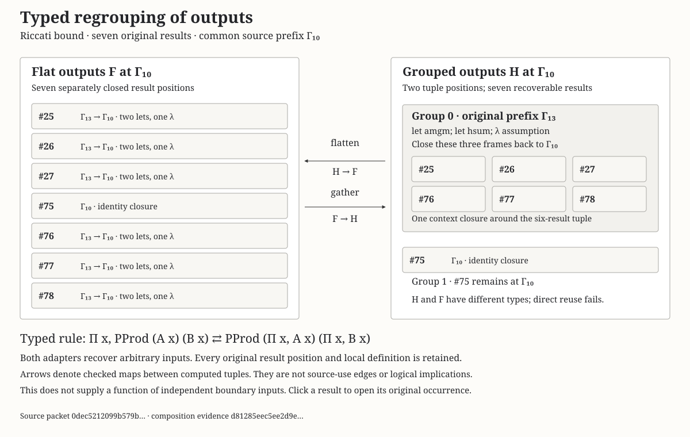

# Typed regrouping across source scopes

The output-closure rule now has explicit **typed adapters between flat and grouped output collections**. Fresh Lean checks cover 27 regrouping cases in eight compiled packets. Both adapters recover arbitrary inputs at the exact common source prefix. All 108 computed term/type graphs match an independent de Bruijn reconstruction.

[](output-composition.svg)

[Full SVG with exact source links](output-composition.svg) · [PNG](output-composition.png). This is a static notation experiment with source portals, not a new interactive application mode. The existing reader and blog are unchanged.

## Why an adapter is needed

Closing each field separately and closing their tuple produce different types:

```text
flat:     PProd ((x : X) → A x) ((x : X) → B x)
grouped:  (x : X) → PProd (A x) (B x)
```

Four general theorems in [Laws.lean](Laws.lean) check the standard dependent-function/product distributivity maps, both inverse laws, and the two field/application laws. All four proofs are reflexivity, with empty transitive axiom lists. The families may depend on `x`, and each output has its own universe. This is a standard mathematical law used as a visual composition rule, not a claim of a new mathematical theorem or a theorem about the JavaScript implementation.

The diagram's adapter arrows denote typed maps between computed output objects. A local-context extension remains a different relation. Neither is a source-use edge, logical implication or mathematical proof strategy.

## Native rule

Keep the ordered original result occurrences and their exact common binder prefix Γ. Partition their positions without deletion or duplication; subgroup and local field orders may differ from the original order. Each subgroup uses its own exact longest common source prefix Γ, Δ. Build its local result tuple, then close that tuple back to Γ. Assumptions become lambda/Pi pairs. Source lets retain their original domains, values, names and nondependency flags.

`flatten : H → F` projects a subgroup, supplies only the intervening original lambda arguments, projects its local field, then closes that field at Γ. `gather : F → H` projects the original fields, instantiates them at the subgroup prefix, and repackages and closes the subgroup. Canonical source-based component types remain explicit even when inference could unfold lets.

The native checker verifies both adapter types, both applications to the actual source tuples, and both round trips on **arbitrary** flat/grouped inputs. Typed equality witnesses are checked by the Lean kernel. Every newly closed candidate also has a separate literal reopening check. Subgroup positions must match the original source bindings exactly; proof irrelevance cannot justify changing that correspondence.

Seven of the 27 cases reject direct reuse of the grouped source tuple at the flat type. This is a finite counterexample to treating regrouping as an untyped redraw. Other cases can have equal types while field order changes, so type equality alone still does not identify original ports.

The Riccati AM–GM example has seven flat fields at Γ10. Six original results share Γ13, with the original `amgm` and `hsum` lets and one lambda. The grouped form closes their six-field tuple once and keeps result 75 separately at Γ10. The flat and grouped types are not convertible; both explicit adapters pass. This is an output representation, not a function over the region's independent boundary inputs.

## Coverage and independent checks

The nine supplied collections are the two earlier Riccati selections, eight results from `lean_workbook_plus_6206`, three earlier authored collections and three new authored collections. Each has whole-group, exact-context-fibre and interleaved/reversed partitions: **27 cases, 93 port appearances and 30 distinct original occurrences**. The AI source stores 91,424 nodes and represents 31,752,787 body occurrences; only its eight selected results are tested here.

The new dependent-family control has original types `P n` and closed types `(n : Nat) → P n` under distinct source binders. A second retains a local let in each dependent family. A third combines type-, proof- and value-valued results, with separate universe levels. The new mixed collection's proof output is an original variable occurrence; it is not relabelled as an application.

- [Native package](native-check.json.gz): four general laws, 27 adapter pairs, source-tuple recovery and arbitrary-input round trips; three deliberately damaged source bindings/context prefixes reject in fresh native processes.
- [Strict type-comparison audit](strict-comparison.json.gz): all 27 comparisons return an explicit kernel result; seven return non-conversion and none return an error. Comparison errors are fatal in this audit, rather than counted as negative results.
- [Independent model](model-check.json.gz): reconstructs all four graphs per case, including adapter bodies and expected types, from original packets, raw type observations, exact contexts and recorded universe choices. It checks 30 nontrivial subgroup scope extensions and rejects 270 position, binding, context and graph mutations.
- [Separate public replay](public-check.json.gz) and [verification](public-verification.json.gz): 21 cases and 63 appearances, with no private Riccati support supplied. All seven native output files match the corresponding complete-run files byte for byte. Original proof declarations/modules remain absent.
- [Port scenes](scenes.json.gz): 27 bounded notation scenes, with computed and source addresses kept separate. Ports preserve both original and hierarchical projection paths. These are counts of interface positions, not Expr occurrences.
- [Figure binding](figure-check.json.gz), [presentation check](presentation-check.json.gz) and [aggregate current-file evidence](evidence.json.gz).

The original exploratory direct-reuse counter is corroborated by that separate strict audit. The model reconstructs literal syntax rather than reducing proofs to a shared proposition. Its complete-source and computed-graph references are resident in the offline audit. It does not claim a browser memory measurement.

## Provenance and limits

The baseline is the compiled result-closure package at `e22691381fa67123d67c33a19ff172c1ed6dce8c`. Fresh checks use Lean 4.33.1. Riccati support binaries are reused only after checking their source and module hashes against the earlier pinned rebuild. This iteration does not rebuild the private support again. The imported Riccati declaration's type and entire body must match the public packet structurally. The other original declarations/modules are absent. Original private source scripts, support binaries, generated native entries and raw logs are not published.

Dependency binaries are hash-verified and attributed to the recorded Mathlib cache revision. Original extraction-environment identity and an independent dependency rebuild remain unverified. AI-generation attribution remains that of the dataset publisher. Only the new authored fixture source, compiled observations and reproduction tooling are added.

The producer accepts at most eight results and eight groups; packet/graph decoding retains its 131,072-row bound. The largest observed computed graph has 2,437 stored nodes. Each native process has a 6,144 MiB compiler allocation limit, an 8 GiB monitored RSS ceiling, a 120-second timeout and the existing output/free-space limits. These component limits and finite sizes are not a whole-program memory bound.

Arbitrary graph quotients, cyclic scopes, independent boundary substitution, minimal premises, semantic compression and measured human comprehension remain outside the result. The generic proofs establish the standard typed maps; the native and independent-model checks supply a finite implementation bridge. The general research goal remains active. No merge or public deployment is included.

## Reproduction

Public structural checks need only Node and the checked-in compiled data:

```sh
node research/proof-atlas/region-output-composition/check.cjs --check
node research/proof-atlas/region-output-composition/check-public.cjs --check
node research/proof-atlas/region-output-composition/scene.cjs --check
node research/proof-atlas/region-output-composition/figure.cjs --check
```

For a fresh native replay, use new work directories and the hash-inventoried dependency runtime accepted by `use-sites/verify.py:recovered`:

```sh
python3 research/proof-atlas/region-output-composition/prepare-controls.py \
  --lean /path/to/lean-4.33.1/bin/lean --workdir /tmp/new-composition-controls
node research/proof-atlas/region-output-composition/prepare.cjs \
  /tmp/new-composition-run /tmp/new-composition-controls
python3 research/proof-atlas/region-output-composition/verify.py --scope public \
  --lean /path/to/lean-4.33.1/bin/lean --cache /path/to/recovered-runtime \
  --workdir /tmp/new-composition-run
```

Complete mode omits `--scope public` and supplies `--support` pointing to the earlier checked result-closure workdir containing `private-modules.json` and the three pinned private support modules. `check.cjs --freeze COMPLETE_WORKDIR` and `check-public.cjs --freeze PUBLIC_WORKDIR` bind fresh outputs to the independent audits. After freezing the complete native package, run `python3 research/proof-atlas/region-output-composition/strict-compare.py --lean LEAN --cache CACHE --support CHECKED_SUPPORT --workdir NEW_WORKDIR` for the strict audit. It uses separate Riccati and public-only invocations; the complete 27-case audit requires the checked private support. `scene.cjs`, `figure.cjs` and `render.cjs` regenerate notation and presentation records; rendering requires Playwright and axe-core. `evidence.cjs --check` verifies the final artifact fingerprints. Routine records stay here, not in the blog.
