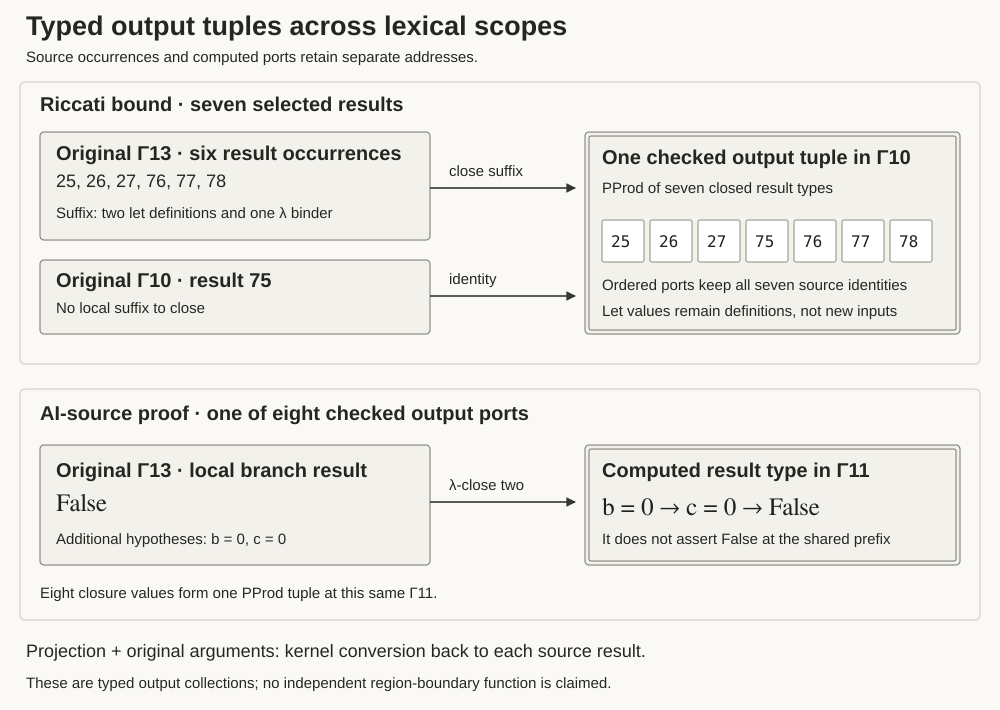

# Typed output tuples across lexical scopes

Six selected result collections now have a **kernel-checked output tuple in
one exact original context prefix**. The check covers 24 output-port appearances
at 23 distinct source occurrences in the Riccati bound, one attributed AI-source
proof and three authored controls. Each projected tuple field, instantiated
with its original local arguments, converts back to its original source result.
Literal reopening is checked separately from kernel conversion.



[PNG](output-tuples.png). This is a native/model experiment and a static notation
schematic. The interactive reader and blog are unchanged.

## Rule

Choose at most eight source result occurrences in one immutable compiled packet.
Compute the longest common prefix Γ of their ordered **original binder
occurrences**. Constructor IDs, context depth and repeated binder names do not
identify a context. Each source result has a suffix Δᵢ:

```text
Γ, Δᵢ ⊢ tᵢ : Tᵢ
Γ     ⊢ closeTerm(Δᵢ, tᵢ) : closeType(Δᵢ, Tᵢ)
Γ     ⊢ B : PProd C₁ (PProd C₂ … Cₙ)
```

Here Cᵢ is the closed result type. Source lambda/forall headers become a lambda
in the term and a forall in its type. A local definition remains a let with its
original domain, value, name and nondependent flag. It is not generalized into
an independently supplied argument. Domains and let values retain their
pre-binder scopes. Every suffix frame remains present, including unused frames;
this rule does not compute a minimal context.

The tuple is a new computed object in `common-prefix-result-tuple`. Its ordered
fields remain attached to distinct source routes. Type and value graphs use
the common prefix; original result types retain their full source contexts.
A field’s source portal must not be relabeled as an occurrence of the tuple or
of its projected closure. `PProd` packages values whose types can differ; the
output tuple is not itself a newly proved conjunction of independent premises.

The native checker removes suffix declarations from the local context before
checking the closure at the prefix. It checks tuple formation, every projection
at its expected closure type, and application of only the non-let arguments at
the original source. Kernel conversion and a typed equality witness check
recovery. The separate literal reopening uses original binder identities and
must reproduce the original expression structurally; proof irrelevance alone
cannot satisfy that check.

## Compositional law

[Laws.lean](Laws.lean) proves, for arbitrary header/result types and a supplied
wrapper operation, that closing a concatenated list of headers equals closing
its inner list and then its outer list. The generic theorem’s transitive axiom
list is empty. The two `Lean.Expr` corollaries apply it to the actual term/type
wrapper definitions; their recorded axiom list is `[propext]`. The native driver
kernel-checks all three theorem values and requires those exact axiom lists.

This is a general **syntactic wrapper-composition law**, not a general typing
preservation theorem for arbitrary contexts. The bridge to the implementation
is finite: all 24 source ports pass two-stage structural term/type comparisons
and kernel typing at both prefixes. Fourteen have a nontrivial intermediate
prefix. Source frame validity, typing and original occurrence authentication
remain separate obligations.

## Cases and limits

| Collection | Port appearances | Common prefix | Local suffix |
|---|---:|---:|---|
| Riccati AM–GM region | 7 | Γ10 | One result needs no closure; six retain two lets and one lambda. |
| Riccati equal-depth diagnostic | 3 | Γ9 | Three distinct depth-ten contexts; one lambda and two distinct lets. |
| `lean_workbook_plus_6206` | 8 | Γ11 | Two lambda frames per result. |
| Authored dependent control | 2 | Γ4 | One result needs no closure; one retains a let. |
| Authored proof-result control | 2 | Γ4 | One lambda per result. |
| Authored sibling-value control | 2 | Γ3 | One lambda per result. |

Call 75 occurs in both Riccati collections, accounting for the difference
between 24 port appearances and 23 distinct original occurrences. The AM–GM
collection is the existing seven-call region. The other Riccati collection is
a scope diagnostic, not an assertion that those calls form a connected region.
The operation is defined on a supplied result collection; it does not infer
region membership from types.

The AI-source case shows why local statements cannot be moved unchanged to the
shared prefix. Call 0 has type `False` under two local hypotheses. Its checked
closure type is `b = 0 → c = 0 → False` at Γ11. The other original variables and
assumptions remain in that prefix. The source packet has 91,424 stored nodes
and its proof body represents 31,752,787 expanded occurrences. Eight selected
results are checked; this is not per-call coverage of the entire proof.

In both sibling controls, two different source contexts use one stored source
node. Their closed term/type graphs are identical, but their original routes
and input instantiations remain distinct. Storing a computed graph once does
not permit deleting either source port.

The current tuples have at most 1,764 stored term/type nodes. Their closures
retain 27 lambda and 15 let-frame appearances. No expanded source tree is
materialized. These are measured finite sizes, not a whole-program memory
bound or a semantic-compression result. The existing decoder bounds each source
packet at 131,072 rows and currently supports exact Boolean metadata; other
metadata encodings and unresolved closed-root objects are not covered by this
experiment. Native runs retain the existing process/time/free-space limits.

**A checked output tuple does not make the region’s boundary inputs independent.**
Common-prefix assumptions and closed local-definition values remain embedded.
This experiment supplies no function over exactly the displayed boundary sheet,
no typing-preserving substitution of an arbitrary graph quotient and no
comprehension result. Those remain separate research requirements.

## Evidence and provenance

- [Native package](native-check.json.gz): fresh checks for five closed source
  packets, six tuples and 24 projection/instantiation pairs; every deliberately
  wrong `Bool` projection type is rejected. The general laws and their axiom
  lists are retained.
- [Model audit](model-check.json.gz): independent constructor-level reconstruction
  of all closures, tuples and complete native-output fingerprints from the
  immutable source packets. It checks staged closure, exact contexts, ordered
  source bindings, and rejects 30 source/prefix mutations plus 24 dropped,
  duplicated, reordered or misattributed result bindings.
- [Public replay](public-check.json.gz) and [verification](public-verification.json.gz):
  the 14 AI/control ports are freshly rechecked in a separate workdir containing
  no private source/module copies. All four native output hashes match their
  corresponding complete-run outputs. Original proof modules and declarations
  remain absent in this replay.
- [Figure metadata](figure-check.json.gz) and [presentation check](presentation-check.json.gz):
  data-bound schematic, label bounds and SVG accessibility checks.
- [Aggregate hashes and unchanged application evidence](evidence.json.gz).

Riccati checking rebuilds only the pinned private `Jacobi`, `Identities` and
`Riccati` support modules. Their source hashes match the published snapshot
inventory, and the imported theorem’s type and body must exactly match the
published packet. Original scripts, source copies, compiled support binaries
and raw logs remain private. Only their hashes and derived compiled observations
are included here. The other four original proof modules are absent from their
native checking environments.

Dependency binaries are individually hash-checked and attributed to the
recorded mathlib cache revision. This is not an independent dependency rebuild
or verification of identity with the original extraction environment. The AI
source retains its dataset-publisher attribution; this work does not establish
its generation history. The native/model implementation is not a proof of all
executions of the JavaScript checker.

## Reproduction

Offline reconstruction needs only Node and the existing public compiled data:

```sh
node research/proof-atlas/region-result-closures/check.cjs --check
node research/proof-atlas/region-result-closures/check-public.cjs --check
node research/proof-atlas/region-result-closures/evidence.cjs --check
```

For fresh native checking, use Lean 4.33.1 on macOS and a hash-inventoried runtime
cache in the format accepted by `use-sites/verify.py:recovered`. Each native
process is monitored under the existing 120-second and 8-GiB RSS limits and
30-GiB free-space reserve. Dependency caches are inputs, not published proof
projects. Start with fresh control and work directories:

```sh
python3 research/proof-atlas/region-result-closures/prepare-controls.py \
  --lean /path/to/lean-4.33.1/bin/lean --workdir /tmp/new-closure-controls
node research/proof-atlas/region-result-closures/prepare.cjs \
  /tmp/new-closure-controls /tmp/new-public-closures
python3 research/proof-atlas/region-result-closures/verify.py --scope public \
  --lean /path/to/lean-4.33.1/bin/lean --cache /path/to/recovered-runtime \
  --workdir /tmp/new-public-closures
```

This public mode checks four collections and fourteen ports without a private
snapshot. A complete run uses another fresh workdir, omits `--scope public` and
adds `--snapshot PATH`, where `PATH/SE2Conjugate/` contains the three pinned
private source files. The complete run checks six collections and twenty-four
ports. `check.cjs --freeze WORKDIR` creates a new complete evidence generation;
`check-public.cjs --freeze PUBLIC_WORKDIR` checks the independent public replay.
Native requests, packets, producers and reused support hashes are checked
throughout; failed runs cannot retain a successful aggregate verification file.

`figure.cjs` regenerates the schematic. `render-figure.cjs` requires Playwright
and axe-core and produces the static PNG/presentation audit. The application and
blog are unchanged. Research branch only; no merge or deployment.
