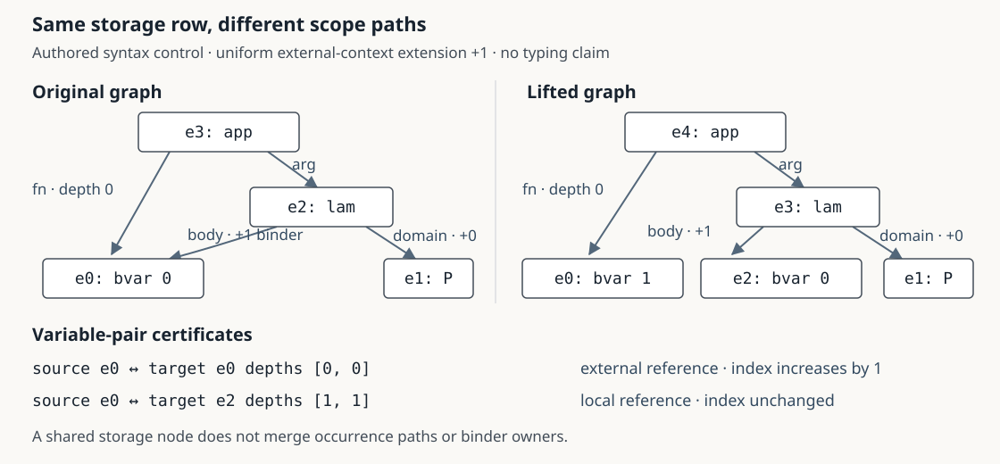

# Scope ranges for shared-term comparison

Status: checked rule with candidate integration in the production reader's complete and paged weakening gates. This record changes neither the recorded native judgments nor the public deployment. Browser and compatibility checks are recorded separately below.

## Representation problem

An original producer type can occur in a longer consumer context. The application interface must check the recorded literal extension before presenting the producer-to-input type bridge. Following every `(left row, right row, local binder depth)` can exhaust the comparison budget even when the two stored graphs are small. Treating a shared row as one occurrence is also wrong: two paths to it can pass through different binders.

The proposed annotation belongs to a **paired storage row**, not to a source occurrence or binder. It records the range of local binder depths along all coupled paths to that pair. Original occurrence paths and original context owners remain separate.

[](scope-sharing.svg)

The figure is generated from a checked, authored syntax control. Source `e0` occurs as the application's function at depth zero and as the lambda body at depth one. Under extension by one, the first becomes `bvar 1`; the second stays `bvar 0`. The source storage row is shared, but its two target pairs and scope paths remain distinct. [Exact figure data and certificate](scope-sharing.json.gz) · [Figure producer](diagram.cjs). This illustration has no mathematical typing claim or original corpus address.

## Exact rule and its boundary

Let a fixed uniform context extension have size `s ≥ 0`. At local binder depth `d`, a source de Bruijn index `i` becomes

```text
indexAt(s, i, d) = i + s  if d ≤ i
                  i      otherwise.
```

Couple the original ordered constructor fields. Lambda and forall **bodies** add one to the depth; let **bodies** add one. Domains, let values, application fields, metadata bodies and projection subjects add zero. Retain the complete constructor payload; universe arguments are not expression child ports.

For a variable pair with attained minimum and maximum depths `lo` and `hi`:

| Extension | Required target index `j` | Scope condition |
| --- | --- | --- |
| `s = 0` | `j = i` | All depths |
| `s > 0`, unchanged local reference | `j = i` | `i < lo` |
| `s > 0`, shifted external reference | `j = i + s` | `hi ≤ i` |

These conditions are necessary and sufficient at every reached depth, even when that set has gaps. A positive shift cannot preserve one target index when the same pair straddles the local/external threshold. The transformed graph may therefore need distinct target rows, as in the figure.

This rule requires **uniform extension of the same external context**, with the caller's original source-context identity and prefix checks. Context lengths alone do not establish it. The comparator checks syntax; it does not reconstruct or certify the context-owner relationship.

The restriction is substantive. For an injective external index map `0 ↦ 2, 1 ↦ 0, 2 ↦ 4`, a source `bvar 2` reached at depths `0, 1, 2` maps to indices `4, 1, 4`. The endpoints agree while the interior differs. Both the injectivity and the counterexample are Lean-checked. Endpoint agreement is therefore insufficient for arbitrary reordered contexts.

## General formal result

[Ranges.lean](Ranges.lean) defines literal weakening on actual `Lean.Expr`, retaining every payload. It proves the exact endpoint/depth-set criterion, narrowing, compositional soundness over all twelve constructors and the root weakening judgment. [Graph.lean](Graph.lean) interprets a postorder graph of coupled constructors and proves that valid local range-cover certificates imply the same root judgment. Shared rows need not be unfolded into an occurrence list.

All **13 theorems** pass Lean 4.33.1 using core only. Their axiom sets are subsets of `propext` and `Quot.sound`; no admitted proofs or new axioms occur. Five syntactically valid mutations fail: replacing the minimum by the maximum in the local-reference condition, dropping a lambda-body binder, adding a binder to a let value in either model layer, and reversing the upper range-cover condition. [Theory report](theory.json.gz) · [Complete theorem and refusal diagnostics](theory-diagnostics.json.gz).

This proves the abstract certificate rule. It does **not** prove a general refinement of the JavaScript implementation, JSON decoder or Lean's optimized native weakening implementation. It supplies no new typing judgment, kernel conversion or theorem about the underlying mathematics.

## Implementation and finite bridge

[model.cjs](model.cjs) constructs reachable ordered row pairs, then propagates exact extrema in parent-before-child order. Every source child has a strictly smaller stored row index. Optional certificates retain each original left/right row, its range and its ordered child pairs. [certificate.cjs](certificate.cjs) independently checks the local hypotheses: source/target fields and payloads, postorder children, root range, range covers and direct variable-index evaluation at both endpoints. It does not trust the producer's traversal or how ranges were computed.

The supplied graphs must already satisfy the application's validated payload contract. Canonical payload comparison uses the existing compiled-data vocabulary, including universe transport payloads. This module does not assign a source address to a computed row or identify different original contexts.

[check.cjs](check.cjs) retains native owner/source/input identities and compares against the earlier checker and a separate depth-sensitive Merkle oracle. The current finite results are:

| Check | Result |
| --- | ---: |
| Recorded native input weakenings | 877 in 42 profiles |
| Inputs with nonzero context extension | 37 |
| Largest native paired-row count | 28,681 |
| Deterministically generated positive cases, all selected roots and shifts | 12,288 |
| Generated mismatches with independently followed failing occurrence paths | 6,198 |
| Positive local certificates checked, including native and scale cases | 13,168 |
| Total rows in those certificates | 84,677 |
| Incorrect scope/binding controls refused | 5 |
| Damaged certificates refused | 4 |
| Invalid arguments/cyclic graph controls refused | 8 |

The generated syntax covers all twelve constructors. These finite payload checks do not replace the separate general codec/refinement obligation. The native cases reuse pinned compiled observations; this iteration adds no native typing replay or new original proof extraction. [Model report](model.json.gz).

Three scale controls each have **1,026 source rows** and a 155-digit expanded occurrence count. Targets have 1,026, 1,538 and 1,026 rows for a closed constant, a mixed local/external `bvar 0`, and an always-external `bvar 512`, respectively. The preceding depth-tracking comparator exceeds its 262,144-state work budget on all three. The range comparator and independent certificate gate pass using 1,026, 1,538 and 1,026 pairs. An eight-pair limit returns unavailable. These are shared syntax graphs, not kernel-typed mathematical proofs or an AI-generation benchmark.

## Bounds and remaining work

For `P` reachable row pairs, the implementation retains `O(P)` pair/edge/range state and sorts in `O(P log P)` time, excluding payload comparison cost. `P` can be as large as the product of the two graph sizes. This is not a claim of linear complexity in their combined size.

Current limits are 65,536 rows per already resident input graph and 262,144 paired rows. Indices, shifts and propagated depths must be nonnegative safe JavaScript integers. A budget exhaustion returns unavailable. Mismatch occurrence witnesses have a separate 512-port path limit; two boundary controls check a located 512-port path and an explicitly unavailable 513-port path. Source delivery, native graph residency, payload costs and total browser heap remain separate limits. There is no complete-proof memory bound here.

## Complete and paged reader integration

The candidate [production engine](/public/js/proof-atlas-scope-comparison.js) shares its paired-row/range state between complete arrays and asynchronous row reads. It retains ordered pair edges and variable indices, rather than fetched expression payloads or complete type-graph arrays. The complete application gate and paged type-operation gate call this same engine. The original context-prefix/source-owner checks still run before it; kernel typing and conversion remain independent recorded observations.

[Runtime checks](check-runtime.cjs) compare all 877 recorded inputs against the frozen reference model and independently check their 49,065 certificate rows. A foreign producer-context owner is refused by the actual source gate even though its unchanged type graphs still compare equal. Three scale controls pass through the actual hash-checking type-page cursor with one 64-row cache and no whole-table archive request. They use the same 1,026–1,538 pair counts as the complete rule. An eight-pair budget is unavailable, missing rows fail, and cancellation during a row read propagates. The test harness runs with a 256 MiB V8 heap flag; this is a finite run, not a total process-memory guarantee.

The native inventory has a specific gap: among its 37 nonzero extensions, 36 contain shifted external references and one has no bound-variable reference. None exercises a preserved local reference under a nonzero extension. That case is covered by the general Expr theorem and authored structural controls, not by this native sample. Additional kernel-typed dependent controls are needed before claiming native coverage of both sides of the rule.

The page cache can still churn when the two selected sides occupy different pages: these controls record about two page loads per stored pair. Bounded comparison state does not imply fewer page requests or a general speed improvement. The `bvar 512` fixture exercises the row comparator beyond the application's separate 512-entry context limit; it is not an admitted native-port observation. All three scale fixtures remain syntax data without mathematical typing attestations.

Fresh compatibility checks retain the existing 207 complete application windows, 877 native paged ports and 10,524 type cuts. The existing bridge inventory remains 792 structurally equal pairs and 85 structurally different pairs with recorded conversion. Browser evidence checks the network, individual and library presentations, including sixteen desktop/phone and light/dark accessibility audits of both folded and nonzero-extension layouts. [Runtime report](runtime.json.gz) · [Integration evidence](runtime-evidence.json.gz). These reports distinguish locally tested code from public deployment.

General decoder/implementation refinement, paged pair-state delivery beyond the retained pair budget, arbitrary context maps and human tracing/error-localization measurements remain open. The geometric-language program stays active.

## Reproduction

```sh
node research/proof-atlas/scope-comparison/check.cjs /private/tmp/atlas-scope-model.json
node research/proof-atlas/scope-comparison/diagram.cjs /private/tmp
node research/proof-atlas/scope-comparison/check-evidence.cjs
node research/proof-atlas/scope-comparison/check-evidence.cjs --runtime
node --max-old-space-size=256 research/proof-atlas/scope-comparison/check-runtime.cjs /private/tmp/atlas-scope-runtime.json
```

Use the official Lean 4.33.1 macOS ARM release from the URL and SHA-256 pinned in [prepare_core.py](prepare_core.py). Given a downloaded archive, extract the core runtime without Mathlib, static libraries or unrelated tools:

```sh
python3 research/proof-atlas/scope-comparison/prepare_core.py \
  --archive /private/tmp/lean-4.33.1-darwin_aarch64.tar.zst \
  --output /private/tmp/atlas-scope-core
python3 research/proof-atlas/scope-comparison/verify_theory.py \
  --lean /private/tmp/atlas-scope-core/bin/lean \
  --workdir /private/tmp/atlas-scope-theory
```

Use fresh output directories. The theorem verifier checks a 20 GiB free-space reserve before work and after each command, and a 256 MiB aggregate scratch ceiling after each command. It sets Lean's internal memory limit to 2 GiB, a 120-second command timeout and a 64 MiB OS file-size limit. These are not a continuously enforced aggregate disk quota or a total process-RSS bound. On macOS the compiler has no network access and writes only inside its scratch directory. `--publish` records compressed technical evidence. Temporary compiler artifacts can be removed after verification; no dependency cache or private mathematical proof project is needed.

## Scientific value and prior work

The supported result is an exact scope summary for one operation in the visual language, with a general compositional certificate and a counterexample delimiting its use. It removes a demonstrated comparison-state failure on the stated controls. It does not establish semantic compression, improved comprehension or a new general sharing-equality complexity bound.

Sharing-aware equality is established work: Condoluci, Accattoli and Sacerdoti Coen give a linear algorithm for alpha-equality of shared lambda terms in [Sharing Equality is Linear](https://arxiv.org/abs/1907.06101) (PPDP 2019). Range-based dataflow sits within the older abstract-interpretation framework of [Cousot and Cousot (1977)](https://cs.nyu.edu/~pcousot/COUSOTpapers/POPL77.shtml). This prototype applies a restricted exact range criterion to Proof Atlas's provenance-sensitive literal weakening gate; a mathematical novelty claim has not been established. No blog post is added.
