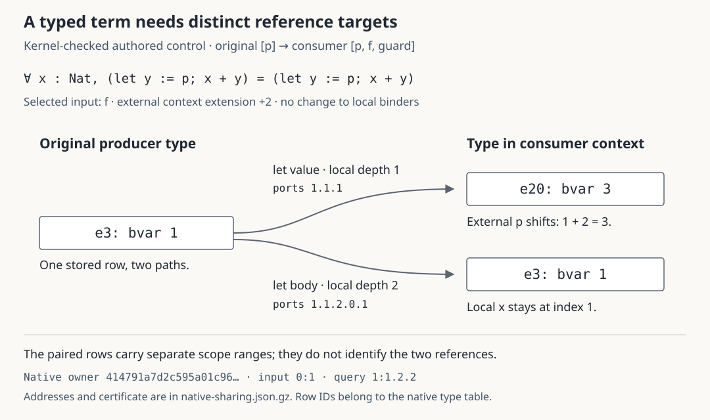

# Kernel-typed scope extension controls

Status: three authored Lean-core controls pass declaration typing and source-free application-input replay. The complete and paged weakening checks pass all nine inputs. Two complete application scenes pass; the shared scale control still exceeds a separate formal-dependency scan budget. No public deployment or blog post is included.

## What these controls add

The preceding [877-input check](../README.md) had 37 nonzero context extensions, but none of those extended types contained preserved local references. These controls fill that finite native test gap. They do not change the earlier corpus inventory or establish corpus-wide coverage.

| Authored control | Original producer type | Nonzero extension test |
| --- | --- | --- |
| `dependentDomain` | `∀ x : Fin (p+1), x.val = x.val` | The forall domain refers to external `p`; its body refers to local `x`. |
| `dependentLet` | `∀ x : Nat, (let y := p; x+y) = (let y := p; x+y)` | Each let value refers to external `p`; each let body refers to local `x` and `y`. |
| `sharedLocal` | `P₀ := ∀ x : Nat, x=x`; `Pₙ₊₁ := Pₙ ∧ (∀ _ : Unit, Pₙ)` | A closed, shared type retains the same local reference at depths 1 through 513. |

Each declaration defines `f` under the original binder `p`, then introduces a local `guard` and calls a two-argument function with `f` and `guard`. The producer type of `f` is compared with its literal form in the consumer context `[p, f, guard]`, an extension by two. The guard input adds an extension by one. All declaration types and values are checked by Lean's kernel; their collected axiom sets are empty.

The cases are deliberately small logical controls. They are neither independently sourced mathematical theorems nor AI-generated proofs.

[](native-sharing.svg)

The figure is generated from `dependentLet`'s native type table. Its source `bvar 1` is reused for external `p` at depth one and local `x` at depth two. Their target indices are 3 and 1. The graph paths, original contexts, native owner, computed namespaces and certificate are retained in [the figure data](native-sharing.json.gz). These computed type rows are not original proof-expression addresses.

## Checks and current boundary

[verify.py](verify.py) first checks all three declarations, then replays the compiled packets in a separate environment without their original declarations, module or private mathematical project. The existing application observer checks original and consumer context typing, source uses through lets, literal weakening, input domains, normalized types and kernel conversion. A deliberately ill-typed declaration is refused. [Native verification](verification.json.gz) · [Compiled inventory](inventory.json.gz).

[check.cjs](check.cjs) performs these finite checks against the actual production modules:

| Check | Result |
| --- | ---: |
| Recorded application inputs | 9 across 3 profiles |
| Nonzero context extensions | 6 |
| Extended inputs with preserved local references | 3 |
| Extended inputs with shifted external references | 2 |
| Extended inputs without variable references | 3 |
| Independently checked certificate rows | 3,212 |
| Paged comparisons through the actual hash-checking type cursor | 9 |
| Altered original context owners refused | 9 |
| Wrong variable shifts refused | 7 |
| Complete application scenes | 2 |

The local/external counts overlap. The paged checks use one 64-row cache, retain the original native owners and release their fetched rows on disposal. The checker keeps its complete reference graphs for comparison; this is not a total-memory measurement.

The shared type `P₅₁₂` has 1,545 distinct reachable type rows and a **156-digit** expanded occurrence count. Its local reference has exact depth range `[1, 513]`. The preceding depth-indexed weakening checker exceeds its 262,144-state budget; the range checker and independent certificate checker pass with 1,545 pairs. The native declaration and its nine-input package are well typed; the shared control itself contributes three of those inputs.

The **complete application scene for this control remains unavailable**: its separate formal-dependency scanner exceeds the work bound while scanning the first argument's domain, despite that argument having no earlier arguments. The weakening comparison succeeds, and must not be reported as an end-to-end reader success. This is a concrete remaining composition problem. [Runtime check and exact boundary](runtime.json.gz).

These checks extend the native applicability of the existing scope rule. They establish neither a general implementation/decoder refinement nor improved human comprehension, semantic compression or performance on massive AI-generated proofs.

## Reproduction

The following Node check uses only the recorded compiled controls:

```sh
node --max-old-space-size=256 research/proof-atlas/scope-comparison/native/check.cjs /tmp/scope-native.json
node research/proof-atlas/scope-comparison/native/diagram.cjs --check
```

For fresh kernel replay, use the official Lean 4.33.1 macOS ARM archive pinned by the parent [core preparer](../prepare_core.py). Add executable IR **and its `.ir.sig` signatures** using the same archive; no Mathlib cache is needed:

```sh
python3 research/proof-atlas/scope-comparison/prepare_core.py \
  --archive /private/tmp/lean-4.33.1-darwin_aarch64.tar.zst --output /private/tmp/scope-core
python3 research/proof-atlas/scope-comparison/native/prepare_runtime.py \
  --archive /private/tmp/lean-4.33.1-darwin_aarch64.tar.zst --core /private/tmp/scope-core
python3 research/proof-atlas/scope-comparison/native/verify.py \
  --lean /private/tmp/scope-core/bin/lean --workdir /private/tmp/scope-native
```

Use a fresh verifier output directory. The driver checks a 20 GiB free-space reserve, a 256 MiB aggregate scratch ceiling after each command, Lean's 2 GiB internal memory limit, a 180-second command timeout and a 64 MiB OS file-size limit. The compiler has no network access and writes only to its scratch directory. These are operational bounds, not a total-RSS guarantee or continuously enforced aggregate disk quota. No original private mathematical source or extraction log is published.
