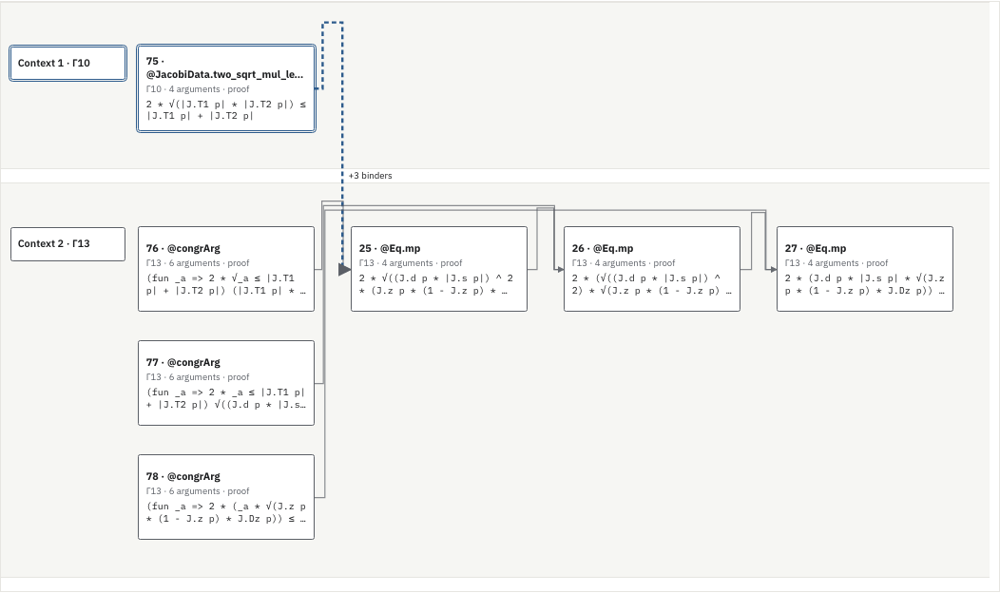
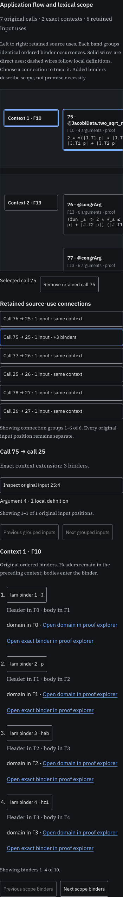

# Application flow in exact lexical scope bands

Status: experimental layout with an optional renderer in the existing paged application reader. The blog is unchanged. The preceding model-only commit and report remain in repository history.

The existing raw application cut places calls by source-use rank. This model adds a second coordinate: the exact ordered lexical context at each original call. Calls with identical binder occurrence sequences share a band. Equal depth or equal binder names do not identify a context. Horizontal rank still follows the original retained source uses; distances have no mathematical meaning.

Each retained wire is checked through the existing input-context source witness. Its endpoints, actual ordered input, added lexical binders, local-definition hops and unresolved definition boundary remain separate. Wires may be bundled by original producer, consumer and source-use relation, but every input position remains in the bundle. Other boundary inputs and outgoing uses remain in the original cut accounting. The model creates no composite region, common-context typing judgment or logical implication.

## Finite checks

The [current model check](check-model.cjs) compares 55 cuts with original checksum-verified compiled archives. These cuts contain 212 call appearances and 89 retained use appearances, including all 201 calls in the 42 installed native profiles. Original native context records provide an additional oracle. The checks compare ordered binder occurrences, context groups, each bundled input position, source-use direction, nonoverlapping card coordinates and exact original cut recovery. Equal-depth distinct-context pairs remain separate. The current run has 115 rejection/lifecycle checks, including changed source identities, changed call records, invalid accounting, duplicate records, pre-aborted and interrupted source requests, and use after disposal. An additional adversarial case changes hidden calls and input counts together so the cut remains self-consistent. It is rejected against the authenticated inventory counts. The preceding model-only version checked local consistency but omitted this inventory-count equality; its report remains unchanged.

- The seven-call Riccati cut has two contexts and six retained uses. Input `25:4` crosses three lexical binders and follows one local definition.
- The four-call source-only cut contains the actual use `6241` → `193239:7`. It crosses 29 binders and follows one definition. Its per-call native types remain unobserved.

The runtime retains at most eight call records, capped at 4 MiB. Source context derivation and the sequential input witnesses use their existing bounded source-page protocols; no complete source archive or native type graph is fetched by the model. The independent test oracle reads complete compiled archives directly. The largest completed scene in this test is 129,812 serialized bytes; the observed source fetch cache reaches its 256-row bound. These component counters are not a total heap measurement. The full scene is capped at 8 MiB.

`open` authenticates call records and source witnesses before returning a scene. `restore` recovers the original call cut from retained records and accounting; it does not independently authenticate modified layout coordinates or recheck source pages. The report pins the tested implementation hashes. Original source packet, native owner, inventory header and occurrence routes remain distinct.

These are model and coordinate checks. They do not measure proof-inspection performance or semantic compression. Earlier research records are unchanged.

## Integrated view

Load a raw cut in the [paged application reader](/projects/proof-atlas/manual/paged-network/#ns-lab), then choose **Show lexical scope bands**. The same original calls remain selectable. Up to eight connection groups are drawn at once; a selected group exposes four original input positions per page. Context buttons expose four ordered binders per page. Call and input selections use the existing source/type inspector. Changing the layout alone preserves its selected source or computed type.

Binder headers keep their original domain/type/value addresses and preceding context. They can lie outside the selected native input window. Public-corpus headers therefore have direct links to the exact occurrence in the proof explorer; they do not acquire new native type evidence. Authored controls without a public explorer retain an explicit inspection boundary. Binder selection itself uses the original source inspector.

Source checks are independent of optional native type delivery. Loading is cancellable; changing the cut, profile or abstraction retires the old layout. A missing component or corrupt source page leaves the raw application cut available. The canvas supports local scrolling, keyboard pan, background dragging and the existing zoom controls. Native cards show their recorded result text; a selected crossing labels its total added binders directly in the diagram. Source-use wires run through band gutters; no edge is inferred from visual proximity.

The [production-browser check](check-browser.cjs) exercises real Riccati inputs, the two-position native control, and the large source-only 29-binder crossing. A separate display-only fixture exercises pagination beyond the sizes present in the finite native controls. That fixture supplies no source or typing evidence. The [integration evidence](view-evidence.json.gz) pins current sources, browser reports, compatibility checks and figures separately from the immutable model report. These tests do not establish improved comprehension. A generally useful geometry for arbitrary elimination and measured inspection tasks remain open.

The final production checks pass four accessibility audits for this view and eight in the existing network/input-scope suites. The network regression covers 162 native calls and 101 separate source uses; the input-scope regression retains its independent source/type selections and failure controls. This is finite browser coverage, not coverage of every possible proof or browser.



The dashed highlighted wire is the original use `25:4`. The three added binders are lexical scope; the inspected source path follows one local definition. Result previews are clipped in the cards; the original statements and type components remain available through the inspector.



## Reproduction

```sh
node research/proof-atlas/scoped-applications/check-model.cjs
# Build the production site and serve _site_production locally. Playwright required.
ATLAS_ORIGIN=http://127.0.0.1:8866 node research/proof-atlas/scoped-applications/check-browser.cjs /tmp/atlas-scoped-applications-browser
ATLAS_ORIGIN=http://127.0.0.1:8866 ATLAS_NETWORK_STREAM_SCREENSHOTS=/tmp/atlas-scoped-network node scripts/test-proof-atlas-network-streaming-browser.cjs
ATLAS_ORIGIN=http://127.0.0.1:8866 node research/proof-atlas/input-contexts/check-browser.cjs /tmp/atlas-scoped-input
node research/proof-atlas/scoped-applications/verify-view.cjs --check
```

The [current compressed report](integration-model-check.json.gz) contains the finite checks, two complete example scenes and implementation hashes. The [preceding report](model-check.json.gz) is preserved from commit `273eab264`; its source hashes refer to that historical implementation. It contains compiled term metadata, not original Lean or tactic scripts. The general geometric-language research goal remains active. This iteration does not merge or deploy the feature branch.

Completed static reports and figures are copied to the local preview after verification. Application assets are tested from the actual production build, without runtime overlays.
