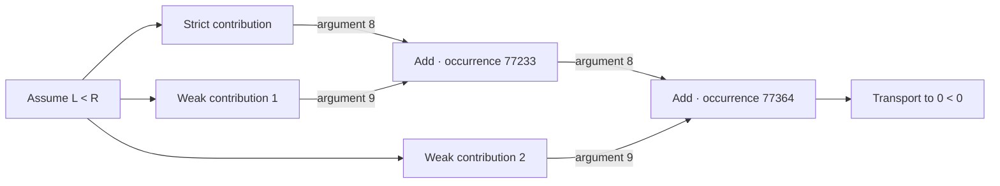

# Reading a construction through its result and input uses

The compact region diagram identifies application occurrences and exact input-use wires. A name such as `Eq.mp` does not state the proposition at that occurrence. The reader now keeps a selected call's recorded result summary beside the diagram, together with navigable incoming sources and consumer inputs.

## View rule

Selecting a graph node, result portal or boundary input updates the same call readout. Reading a result brings its statement into view, including on narrow screens. Unfolding and refolding retains the active call and any existing source/computed-type selection. **Open original result** selects that call's exact compiled occurrence. An internal connection has two actions: read the original source/consumer result, or inspect its exact consumer input slot. These are different selections. A link through a recorded local definition retains its hop count and original producer/consumer contexts.

The readout preserves each input position. Repeated uses of the same producer in two slots remain two rows. Function slot zero remains a function input. The selected call's total input count is the sum of its internal input positions and its boundary positions; the existing boundary sheets retain the latter. Consumer lists describe this retained region, with inventoried outside counts stated separately. Selecting a retained call outside the region clears the region-local use lists.

At most four incoming and four outgoing positions are displayed at once. The view uses only the existing retained call records and source-use edges. It adds no type inference or source-graph fetch. Opening an original result or input uses the existing bounded inspector. The selected recorded summary is bounded by the existing 1,024-character call-summary contract; the original result/type inspector remains available for the underlying observation.

Source-only calls have no native result summary. The reader displays their original occurrence and source-use links with **per-call type unobserved**. An empty local list is not a statement that a proof has no other uses. Each call and port retains its own original context; this view does not construct a common-context typing judgment.

## Riccati case

In the seven-call Riccati region, call 75 records

    2 * √(|J.T1 p| * |J.T2 p|) ≤ |J.T1 p| + |J.T2 p|

Its result feeds input `25:4` through one recorded local definition, from original Γ10 to consumer Γ13. Call 25 also receives the equality from call 76 at input `25:3`. Reading result 25 displays the resulting inequality with the product identity substituted under the square root. The subsequent result uses are `25 → 26:4` and `26 → 27:4`; equality helpers 77 and 78 feed their third arguments. All six connections are original source-use witnesses, rather than arrows added from a mathematical narrative.

The statements are the existing native display summaries. They are not independently generated prose, normalized replacements for original expressions, or a minimal mathematical premise set. The native observation owner is `7a995a4a5559be0a3f1778357ac9a9b696cc0bf446e7513f6a3d52822035af35` in the `published-15` edition of `JacobiData.slope_bound_abs`. Complete source, native-owner and inventory identities remain in the report.

## Checks and limits

The [browser checker](check-browser.cjs) separates isolated view tests from real-reader selections. The isolated tests render all 106 selected cuts from 42 native profiles, comparing 282 native result-summary appearances. Each retained result summary, role, context and occurrence anchor is compared with its pinned native observation before rendering. Node/result selection, ordered source-use windows and exact input callbacks are checked against the original records without modifying them. A partial diamond tests outside-region selection; an eight-call source-only fanout tests paging beyond four consumer positions without inventing types.

Real-reader checks traverse the Riccati constructions through the live inventory gate and original native inspector. They check all seven results, the six original connections, two repeated input positions, the source-only boundary and stale-profile clearing. Desktop/mobile and both themes have accessibility and document-overflow checks. These are finite source/interaction tests. They do not measure improved human comprehension, proof-inspection speed or semantic compression.

- [Production-browser and native-summary report](browser-check.json.gz).
- [Existing region, proof-input, rule-head and inventory compatibility checks](compatibility.json.gz).
- [Earlier boundary preservation laws](../boundary-kernel/README.md) and [native source/role checks](../rule-support/README.md).

The production build precedes the final static report copies; application assets are checked byte for byte against the tested source. Historical reports retain their original hashes. This is a local prototype; no blog result or public deployment is claimed.

## Coverage of article-linked calls in the occurrence-type manifest

In the published-15 article index, 24 application anchors identify a callee across 16 passages. This includes the individually indexed And.intro occurrence. Matching the declaration, packet hashes, node and full occurrence path against the occurrence-type manifest gives one complete checked application trace. Two other anchors have a native declaration record without a checked trace at the selected call. The remaining 21 have no declaration entry in this manifest. Other evidence collections are outside this count.

The matched call is the AM–GM helper in the scalar slope proof. Its first two inputs are implicit real values. The third and fourth inputs, at nodes 1224 and 1226, prove nonnegativity of the two absolute values. The result is at node 1227. All four argument routes agree with their positions in the original application spine. This establishes an answer key for locating the premises of this call. Reader accuracy and search time remain unmeasured.

[Per-anchor report](article-call-traces.json) · [Reproduce from the repository root](check-article-calls.cjs)

[Open the ordered input index for all 24 calls](article-inputs.md). Reconstructing each call from its enclosing declaration gives 92 exact argument positions. Of these, 67 are direct bound-variable references, each linked to the binder at its original occurrence. The generator checks the number of intervening binding bodies against the stored de Bruijn index. In the Riccati proof this identifies J and p as the two inputs to the product identity and J, p, hab, hz1, hd and hs as the six inputs to the common-sign lemma. These links remain available when the native manifest has no type trace at the selected call. [Reproduce the index](article-inputs.cjs).

For the 25 inputs that are not direct bound variables, the reader index follows the function fields of each application to its head. This yields 22 constant heads, two bound-variable heads and one lambda. The λ links to its body, and each bound-variable head links to its binder. For the AM–GM helper, inputs 1 and 2 are headed by abs, while inputs 3 and 4 are headed by abs_nonneg. In the cumulative-count proof, inputs 3 and 4 of two_per_cell_of_ne apply the local functions hL and hR. Following only declaration names would miss these two connections. The [browser check](check-input-links.cjs) opens every link in the generated index and compares the reader selection with its edition, declaration, expression number and occurrence route.

[Follow the result of each of the 24 article-linked calls](article-consumers.md). Twenty results enter an application directly, three supply local definitions and one is the body of a lambda. Each of the three local definitions has one bound-variable use in its body. The generator counts uses by occurrence, including beneath nested binders, and resolves each use back to the exact introducing binder. For AM–GM the path goes from result 1227 through local definition 3240 to use 37 at argument 4 of Eq.mp (application 3221). This gives a source-backed answer to where this inequality is used. It measures immediate compiled uses in this article sample. Mathematical necessity and reader comprehension require other evidence.

Regenerate with `node research/proof-atlas/step-reading/article-consumers.cjs`. Passing `--json` includes the owner, packet digest, routes and node numbers.

### Can a shared application row identify its consumer?

Across all 20 Goedel sample theorem bodies, 16,240,679 occurrences are applications at the end of a function spine (intermediate function prefixes excluded). Of those, 16,236,908 occur directly in another application's argument field. This includes type, instance and value terms inside the proof body. The count describes syntax and gives no estimate of the number of mathematical inferences.

Of 80,824 distinct rows occurring at such endpoints (summed within declarations), 31,222 enter at least two different immediate parent-row/field pairs. Together these account for 7,833,155 endpoint occurrences. Selecting only the shared row therefore leaves even the immediate destination ambiguous for these occurrences. Repetitions of a single parent-row/field pair can have different enclosing routes too, so this is a lower bound on occurrence ambiguity. A folded glyph can represent a shared expression, but following a particular consumer requires a selected occurrence or a choice of destinations.

[Per-proof counts and packet identities](ai-call-destinations.json). Run `node research/proof-atlas/step-reading/call-destinations.cjs` from the repository root. The checker weights edges by path multiplicity while holding one proof packet at a time, verifies the total against the packet's expanded body size, and checks its destination counts against explicit enumeration of one bounded subterm per proof. A shared-row control exercises the same expression as both a function prefix and two separate arguments.

### How much enclosing context identifies one occurrence?

Fix a declaration and a shared application row. Restrict its candidate occurrences to endpoints of function spines inside the theorem body. Reveal the exact parent row and field, then the grandparent row and field, continuing outward. Count a selection as resolved when exactly one candidate has that suffix. An exact parent row is more specific than a displayed lemma name and argument number.

| Enclosing fields revealed | Occurrences still ambiguous, out of 16,240,679 |
|---:|---:|
| 0 | 16,206,339 |
| 1 | 16,097,207 |
| 4 | 15,472,515 |
| 16 | 5,818,631 |
| 32 | 447,890 |
| 64 | 842 |
| 69 | 3 |
| 70 | 0 |

The 20 Goedel proofs have a substantial tail of repeated contexts. Even the exact immediate parent and slot identify only 143,472 occurrences uniquely. A compact reader can display a short context for orientation while carrying the full occurrence route through every interaction. Resolving the route from the visible labels alone would require arbitrarily choosing among candidates in many of these cases. These numbers apply to compiled expression occurrences, including type and instance terms. They measure uniqueness under this particular suffix rule; a human may recognize a mathematical step with less information.

[Per-proof depth curves](ai-context-depth.json) · [Reproduction script](context-depth.cjs). A fixed field suffix beneath a particular ancestor repeats once per occurrence of that ancestor. The calculation weights suffix counts by these multiplicities and retains two successive depth layers for one declaration at a time. Direct enumeration on a bounded subtree of each proof reproduces its entire depth curve. Depth is counted in kernel fields, including the function fields inside curried applications.

### Grouping an application changes how many enclosing steps a reader needs

Treat a complete application as one call with a function port and an ordered port for every argument, including implicit ones. Keep the original fields for all other constructors. On the same 16,240,679 endpoints, the following number of enclosing steps identifies each indicated fraction uniquely. Each step supplies the exact enclosing row and occupied port.

| Fraction identified | Kernel fields | Grouped call ports and other fields |
|---|---:|---:|
| 50% | 13 | 9 |
| 90% | 25 | 16 |
| 99% | 40 | 25 |
| 100% | 70 | 40 |

The change helps most at greater depth. One whole-call port still leaves 16,069,418 occurrences ambiguous. Grouping shortens an exact navigation path while retaining the need to carry the selected occurrence. These are logical steps in a representation. The experiment does not compare screen area, reading time, or comprehension.

[Per-proof grouped curves](ai-whole-call-depth.json). Reproduce with `node research/proof-atlas/step-reading/context-depth.cjs --whole-calls`. For each proof the checker compares endpoint multiplicities row by row before and after grouping, replays every argument and head against the original function spine, and compares the grouped depth curve with explicit enumeration for a bounded subterm. The ungrouped command still reproduces the earlier report byte for byte.

### How many argument ports must a group show?

At a call, expose its last *k* arguments in order and give the remaining function prefix one separate port. Following the prefix repeats the rule. Thus a group with *k* = 3 has at most four outgoing choices. This groups consecutive fields without discarding implicit arguments. The unbounded case exposes every argument at once and reaches 18 ports in this sample.

| Argument limit | Median depth | 90th percentile | 99th percentile | Maximum | Mean extra steps vs. unbounded |
|---:|---:|---:|---:|---:|---:|
| 1 | 13 | 25 | 40 | 70 | 5.27 |
| 2 | 10 | 18 | 27 | 40 | 1.40 |
| 3 | 9 | 16 | 25 | 40 | 0.30 |
| 4 | 9 | 16 | 25 | 40 | 0.16 |
| 8 | 9 | 16 | 25 | 40 | 0.02 |
| All | 9 | 16 | 25 | 40 | 0 |

Three is the smallest tested integer limit matching the four reported depth thresholds of whole calls. The full distributions differ. Summing unresolved counts over depths gives the total minimum identifying depth across occurrences; dividing its difference by 16,240,679 gives the final column. This comparison measures an explicit width/depth tradeoff for this AI sample. Port labels, layout and retrieval time remain untested.

[Arity counts and grouped results](ai-call-widths.json). Reproduce with `node research/proof-atlas/step-reading/context-depth.cjs --compare-widths`. Each grouping preserves all endpoint multiplicities row by row and is checked by explicit traversal on a bounded subterm of every proof.

### Does the width result transfer to the SE(2) proofs?

Applying the same six argument limits to all 561 published SE(2) theorem bodies gives 9,800,418 application endpoints. At the corpus median, 90th percentile, 99th percentile and maximum, three arguments per group and unbounded calls both require 8, 14, 23 and 42 enclosing steps respectively. With two arguments per group the depths are 9, 16, 24 and 43. Three arguments cost 0.34 extra steps per endpoint on average compared with unbounded calls (0.30 in the Goedel sample).

The corpus thresholds conceal individual differences. Of 490 theorem bodies with at least one call, 295 agree at all four thresholds. The other 195 differ on at least one. The remaining 71 bodies have zero endpoints and their quantiles are undefined. In the Riccati proof, the median and 90th percentile agree at 6 and 10. The 99th percentile and maximum increase from 12 and 14 for whole calls to 13 and 15 for bounded groups. The width rule is a candidate for compact presentation with a measured local cost.

[Per-declaration results](se2-call-widths.json). Run `node research/proof-atlas/step-reading/context-depth.cjs --published --compare-widths`. The checker independently counts endpoints from the leaves upward in each packet and checks the count against the forward path-multiplicity traversal. Each grouping also has a bounded expanded-tree check. Counts include value and type expressions occurring inside proof bodies.

In the complete occurrence reader, choose **Proof constructions → Group applications**. Each group now shows up to three retained argument stages. **Earlier application** opens the original partially applied function. **Show all retained arguments** restores the full grouping within the same construction cut. The URL retains this setting and the cut keeps its original size and depth limits. The [browser check](check-group-width.cjs) opens the four-input AM–GM application, follows all four compact ports and all five expanded ports, and checks that switching width preserves the selected fourth argument at 360 and 1280 pixels. This interaction check covers one recorded construction and does not measure reading speed.

Grouped argument ports also show the formal parameter name when the recorded function type at that exact application stage has a single named binder component. In the Riccati AM–GM call the labels are x, y, hx and hy at slots 1 through 4. These identify parameters of the function being applied. The caller can supply an expression of any complexity at the linked input. Generated multipart names and anonymous binders keep the positional label. The [label check](check-parameter-labels.cjs) covers 500 named stages among 684 recorded applications in published-15, 163/241 in working-26, 814/1,176 in the Goedel sample and 56/58 in recursion controls. These denominators describe the native application records available in the tested profiles.

A grouped port carrying a recorded proof argument shows its proposition beneath the argument label when the recorded display text is at most 120 UTF-16 code units. Longer statements have an action opening the original argument type. Of 417 recorded proof-argument stages across the four collections, 380 fit inline. The two Riccati AM–GM proof inputs display the distinct nonnegativity statements for T1 and T2. The browser check follows both in compact and expanded diagrams and opens a longer proposition from the AI proof lean_workbook_20418, checking its recorded type root and original occurrence. The display text comes from the recorded argument type; no new type inference or proof reconstruction is performed.

The paged construction diagram reuses the selected argument's verified type caption on its incoming application port. It copies short recorded native text only when the child has proof role and the caption belongs to the current cut. Missing captions, constructor summaries, budget-truncated text and strings over 120 UTF-16 units leave the original port label in place. No additional lookup is issued for the port. Browser checks compare both Riccati statements and origin keys with the original child cards, follow both ports to their exact routes, and check that this visit requests no full SE(2) declaration index. A longer AI premise remains selectable without an inline excerpt.

[Follow article inputs into the called lemma](callee-uses.md). For 84 of the 92 supplied argument positions in the article index, the edition contains the callee body and a corresponding leading lambda. In the proof of the AM–GM helper itself, the third parameter (hx) has two bound-variable occurrences and the fourth (hy) has one. The index links the caller input, callee binder and first callee use under their respective declaration owners. Every reported count agrees between direct occurrence traversal and an independent memoized de Bruijn count. A reference in a type contributes to these totals; they do not establish that a hypothesis is mathematically necessary. Regenerate with `node research/proof-atlas/step-reading/callee-uses.cjs`.

[Inspect the receiving calls inside each lemma](callee-consumers.md). In the compiled AM–GM helper, the nonnegativity proof hx feeds argument 2 of Real.sqrt_mul and argument 2 of Real.sq_sqrt. The other proof hy feeds argument 2 of a separate Real.sq_sqrt occurrence. Across the 21 available called bodies, 80 leading binders have 38,934 references in 363 groups of receiving positions. Repeated article calls to the same declaration are counted once here. Each group links one receiving expression and its exact bound-variable occurrence. The generator replays every application suffix and checks each representative against its original binder. Grouping by receiving position describes direct compiled uses and does not identify independent mathematical ideas. Reproduce with `node research/proof-atlas/step-reading/callee-uses.cjs --consumers`.

In a grouped published-15 construction, **Follow arguments into …** opens the indexed callee's leading parameters and their first bound-variable occurrences. Each link switches declaration owner and uses the callee's original proof route. The grouped reader checks the constant's name components, edition and destination index digest. It requests the 9,868-byte parameter index on first expansion. This version covers 80 parameters in 21 compiled declarations. Other indexed-edition declarations with a body report missing parameter-use evidence when opened. Regenerate the public index with `node research/proof-atlas/step-reading/callee-uses.cjs --reader-index`. The browser check follows hx from the Riccati caller into the helper body and exercises a missing-record control.

### Which calls can cross a declaration boundary?

In the 20 Goedel theorem bodies, all 16,240,202 maximal applications headed by a constant refer to declarations outside that edition; 477 more have nonconstant heads. None calls an available body in the same snapshot. A separate count restricted to recorded proof-producing application stages finds 747 constant-headed stages across 34 external names and 13 nonconstant stages. The most frequent external head there is sub_eq_zero_of_eq (100 stages). These stages are a selected set of native observations, not a random sample of proof steps.

In published SE(2), 376 of 561 theorem bodies contain at least one call to an available declaration body. There are 444,113 such maximal application occurrences among 9,800,418. Only 41 of these have a head in the current 21-declaration parameter-use index. The native proof-result sample includes 79 application stages calling available bodies, including 10 with indexed heads, and 219 calling external declarations. Indices curated around article passages cover a small portion of the formal development. For this AI sample, enlarging the index solely within its edition cannot improve cross-declaration coverage. An external body needs its own version-matched compiled evidence; an imported name or signature alone cannot supply body-use links.

[Full counts](callee-coverage.json) · [Reproduce the census](callee-coverage.cjs). Body availability includes local definitions as well as theorems. Maximal-call counts use original occurrence multiplicities and include expressions in types. Recorded stages require proof role, a proof-body route and an application construction. The two denominators answer different questions.

### Callee parameters across the complete published edition

The grouped reader now covers all 715 available declaration bodies in published-15. The index contains 2,763 literal leading lambda parameters. Of 733,210 supplied argument occurrences at maximal calls to these bodies from the 561 theorem proofs, 551,168 have a corresponding leading binder. Of these, 551,166 also have a bound-variable use. Two reach a binder with zero references. The remaining 182,042 positions lie beyond the literal lambda prefix. The reader reports this boundary explicitly. The native proof-result sample has 1,815 matched slots among 1,821 supplied to local bodies. Counts include implicit inputs.

Each parameter count was checked by direct occurrence traversal and memoized de Bruijn counting. The reader requests one of 16 index files on disclosure, selected by the callee packet digest. File sizes in this edition range from 13,393 to 39,688 bytes (400,190 combined). No callee packet is needed to display the links. The earlier 21-declaration artifact remains the article baseline. Regenerate the files with `node research/proof-atlas/step-reading/callee-uses.cjs --all-bodies` and the [coverage report](all-body-coverage.json) with `node research/proof-atlas/step-reading/callee-coverage.cjs --all-bodies`. The AI edition still has no calls to local declaration bodies.

### Declaration types cover most positions beyond the body parameters

For each indexed callee, the reader can also link argument *i* to the *i*th literal forall binder at the root of its compiled declaration type. Opening that link selects root 0; body parameters and their bound-variable uses select root 1. Of the 182,042 local-call argument occurrences beyond the leading body lambdas, 181,989 reach a declaration-type binder. The remaining 53 lie beyond both literal prefixes across eight declarations, listed in the coverage report. This adds access to the declared interface without asserting any new proof-body uses. It leaves six unmatched local slots in the sampled proof-result stages. The browser check follows argument 2 of JacobiCore.eps from JacobiCore.E_pos to the exact binder at row 2, route 0:1. With the additional binder rows, the largest index file is 41,128 bytes.

All 53 remaining local-call slots occur after a declared result headed by one of four monotonicity predicates: StrictMonoOn (15), StrictMono (9), StrictAntiOn (20) or Monotone (9). These are counts of supplied argument occurrences. At this boundary the grouped reader now links to the exact declared result, obtained by following the body fields of the literal forall prefix in the callee's type. For example, the call to JacobiCore.eps_strictMono inside JacobiCore.E_pos links to StrictMono at type row 11. The link preserves the residual result expression; matching each extra argument to a binder inside the predicate would additionally require version-matched unfolding evidence.

### Call-site evidence past a named result

Three distinct recorded application stages in published-15 lie beyond both literal callee prefixes. All occur in the same application of JacobiCore.eps_strictMono in JacobiCore.E_pos. Compiled slots 2 and 3 take real values; slot 4 takes the proof of 0 < J.K. Each native record contains a Pi node, its expected domain, the actual argument type and passing function, domain and result conversion checks. These three stage observations concern one application spine. The earlier 53-slot census counts expanded occurrences over all theorem bodies, so the counts have different units.

At this boundary the complete grouped reader offers the recorded caller argument type alongside the callee's declared result. In the browser test, slot 4 opens computed type row 68 at its caller argument occurrence; the separate result link opens source type row 11 of the called declaration. No source binder inside the imported predicate is asserted. [Recorded stages and owners](residual-stages.json) · [Reproduce](residual-stages.cjs).

### Unfolding the four monotonicity interfaces

[Four Lean theorems](MonotonicityInterfaces.lean) check the binder order of Monotone, StrictMono, StrictMonoOn and StrictAntiOn by definitional reflexivity. Lean 4.33.1 accepted all four and reported no axiom dependencies. The check imported Mathlib.Order.Monotone.Defs from the local build of Mathlib revision 0df444a360eaa60ab8c11dca51a86af692955474. Its source file matched the pinned upstream file byte for byte (SHA-256 7a443757a778d0ce5047be0441060dd2b9dcc8a81432330dc3a7dcc66496018e). Recheck with `lake env lean /absolute/path/to/MonotonicityInterfaces.lean` in the matching Mathlib environment.

The [compiled-term census](monotonicity-slots.cjs) checks the exact constant and argument count at the end of each of the eight affected signatures. Counting maximal calls by occurrence, the 53 additional slots comprise 26 point arguments, 14 membership proofs and 13 order premises. For restricted predicates the first point's membership precedes the second point. StrictAntiOn reverses the order of the images in the conclusion. [Counts by callee and role](monotonicity-slots.json). These are positions in the unfolded declared result; the checks give no additional bound-variable uses inside the eight proof bodies. The corpus count runs separately from the four generic Lean proofs.

The grouped reader displays the role of a retained argument in the unfolded result beside its caller-side type action. The index generator requires the named predicate, its two universe levels and a complete application of the predicate before attaching roles. The [occurrence index](monotonicity-links.md) links all 53 argument positions to their caller inputs and declared results, including positions outside the recorded construction diagrams. Regenerate it with `node research/proof-atlas/step-reading/monotonicity-slots.cjs --links`. In the native JacobiCore.E_pos example, the browser check opens the original type for each of the three labels and checks the type root and caller occurrence at both viewport widths.

### A proof argument can cross a declaration without a body binder

The 100 recorded proof-role stages headed by sub_eq_zero_of_eq in the Goedel sample form **20 complete five-input calls in eight proofs**. The [caller check](imported-equality-calls.cjs) matches each stage to its enclosing complete call by packet digest and full occurrence route. Every recorded stage occurs in exactly one chain. [Complete calls, equality inputs and original caller routes](imported-equality-calls.json).

In the pinned Mathlib environment, sub_eq_zero_of_eq declares five inputs but its compiled body begins with only four lambdas. After those lambdas the term is Iff.mpr with three supplied arguments. Its third argument is the equivalence sub_eq_zero applied to the four original parameters. Applying the fifth caller input, a proof of a = b, supplies the fourth argument of Iff.mpr and yields a proof of a − b = 0. A visual expansion should carry that input to the returned function. Drawing a fifth lambda binder inside sub_eq_zero_of_eq would invent a source occurrence.

The [Lean check](ImportedEquality.lean) inspects the imported expressions, checks the body at its declared type with the kernel, and tests the literal heads and arities. [Compiled terms, leading binders and use routes](ImportedEquality.json). Run the file with Lean 4.33.1 in the Mathlib checkout at 0df444a360eaa60ab8c11dca51a86af692955474, the revision attributed to the Proof Atlas replay environment. The caller inventory and imported-body inspection are separate checks. This does not replay all 20 specialized calls or establish the binary identity of the AI publisher's original environment.

### Imported functions in the AI recorded stages

In the same Lean 4.33.1 replay environment, [inspect all 34 external declarations](ImportedInterfaces.lean) referenced by the 747 recorded constant-headed proof-role stages. Lean checked the 25 theorem and four definition bodies at their declared types. The other five declarations are constructors. In particular, Or.casesOn and Eq.ndrec here are definitions that return applications of Or.rec and Eq.rec respectively.

Of the 747 stages, 594 supply an argument to a literal leading body binder, 113 supply a further argument to a returned constant or constant application, 20 supply an argument to a returned projection, and 20 apply constructors. For example, the Mathlib tactic wrapper for sub_nonpos_of_le returns the root lemma with six arguments already supplied. Its seventh caller argument enters that returned lemma. For Iff.mpr the extra input goes to a function projected from the equivalence. A diagram that gives every supplied input its own binder in the imported body would misrepresent these cases. The receiving slot is the number of already supplied arguments plus the caller position minus the leading body binder count. No reductions inside the returned head are assumed.

[Observed slot histogram](external-stage-slots.json) · [Lean body shapes](ImportedInterfaces.json) · [Joined evidence](imported-interface-coverage.json). From the repository root, regenerate the histogram with `node research/proof-atlas/step-reading/external-stage-slots.cjs`, run the Lean file with the pinned Mathlib libraries on LEAN_PATH, then run `node research/proof-atlas/step-reading/check-imported-interfaces.cjs`. Counts are recorded application stages, including partial applications; 13 nonconstant-headed stages are outside this external-declaration join. This checks imported body shapes and caller positions separately. It does not specialize and recheck each caller term in an imported binder context.

### Selecting distinct uses of a folded input

The [Riccati example](riccati-common-sign.html) opens the five uses of the third input to the common-sign lemma. Two links have the same expression number. Their field paths distinguish them.

The [occurrence selector](ranked-binder-uses.cjs) counts uses of a chosen binder within its body. Counts are memoized by expression number and de Bruijn index. To select use number *k* in field order, it skips each child whose count fits entirely before *k*. The index holds the compiled term and the reached expression/index pairs. It does not store one path per use.

The [corpus check](check-ranked-corpus.cjs) covers the literal leading lambda parameters of every available theorem body in three editions. Later binder domains are included. It independently counts incoming paths through the shared term, then streams the expanded tree in field order and checks the exact first, middle and last occurrence paths. A parameter with zero uses must reject selection. The two SE(2) snapshots overlap.

| Corpus | Theorem bodies | Leading parameters | Unused | Parameter uses | Distinct ranks checked |
|---|---:|---:|---:|---:|---:|
| SE(2), published | 561 | 2,076 | 52 | 697,014 | 4,958 |
| SE(2), working | 1,083 | 4,022 | 54 | 7,094,467 | 9,482 |
| Goedel AI sample | 20 | 93 | 6 | 692,587 | 250 |

In the AI sample, 58 parameters returned the same expression number at two or more distinct sampled ranks. All selected paths resolved to the original binder. This tests occurrence identity through sharing. Human interpretation of a folded step requires separate evaluation. [Machine-readable counts](ranked-corpus.json). Reproduce with `node research/proof-atlas/step-reading/check-ranked-corpus.cjs` from the repository root.

The library reader exposes direct ordinal selection under **Show binding references** when the bounded source count succeeds. Enter a one-based reference number to open either the variable occurrence or the expression receiving it. The existing sequential navigation remains available. In the [AI example](https://moiseevigor.github.io/projects/proof-atlas/library/?edition=goedel-sample-4331&proof=lean_workbook_plus_6206&route=1%3A1.1#expr-91421), reference 48,463 of 96,925 is e159 in argument 5 of `HPow.hPow`. The local browser check also followed reference 5 in the Riccati example to its own occurrence of e382.

#### Baseline with a single 65,536-state work and storage limit

The [original reader audit](https://github.com/moiseevigor/moiseevigor.github.io/blob/137bbe5f5beedafd0cec2da85d4a16359e08b5fc/research/proof-atlas/step-reading/ranked-corpus.json) on the same theorem bodies gives two different coverage measures. Counting parameters measures how often a selected binder can be inspected. Weighting each parameter by its number of uses measures how much of the expanded proof remains accessible by reference number.

| Edition | Parameters counted | Uses under counted parameters | Sampled reader paths matched |
|---|---:|---:|---:|
| Published SE(2) | 2,076 / 2,076 | 697,014 / 697,014 | 4,958 / 4,958 |
| Working SE(2) | 4,015 / 4,022 | 2,813,605 / 7,094,467 | 9,461 / 9,482 |
| Goedel AI sample | 93 / 93 | 692,587 / 692,587 | 250 / 250 |

Under that policy, seven parameters in `JacobiConcrete.AmplitudeChart.midpoint_polynomial` exhaust the 65,536-state counting budget. They account for 60.34% of the working snapshot's leading-parameter uses. These references remain in the compiled term. The original numbered lookup was unavailable for their binders. Each available first, middle and last address was checked against the expanded traversal. Counts cover literal leading parameters of theorem bodies, including references inside later parameter domains. The test invokes the reader model in Node and does not measure browser latency.

#### Numbered lookup with bounded cache replacement

The binding panel now retains at most 65,536 scoped counts. When a new count needs space, it evicts the oldest entry. During ordinal selection, a missing count is recomputed under the same per-query work allowance as the initial count. The reader permits at most 262,144 computed states per query. Repeated computations consume that allowance. If selection exhausts it, the reader returns an unavailable result without an occurrence link. The entry bound applies to the count cache. The compiled declaration, support masks, eviction queue, and traversal stack also occupy memory.

The seven midpoint parameters now have independently verified counts covering 4,280,862 uses. The first, middle and last distinct ranks matched the expanded traversal for each parameter. Across the three editions, those sampled ranks matched for every used leading parameter. This verifies sampled navigation and exact totals. Other ordinal choices can have different recomputation costs. [Updated measurements](ranked-corpus.json).

A located variable now exposes the application that receives it. The function and numbered arguments link to their own occurrence paths. The selected position links to the same address as the variable reference. Applications with up to seven arguments show all positions. Wider calls retain the function, first and last argument, and the selected argument’s two nearest neighbours on either side. Selecting a gap reveals up to five arguments and keeps the original reference highlighted. Focus moves to the first newly shown input. A variable used directly in a constructor field links to that field’s parent. The Riccati example includes both a let value and application arguments. [Browser check](check-receiving-ports.cjs).

In the AI theorem `lean_workbook_20418`, reference 49,479 of binder e86584 supplies argument 8 to `Mathlib.Tactic.Ring.Common.mul_pow_mul`. The complete application is e2181 with 14 arguments. The browser check traversed three windows, verified all 14 input addresses and kept input 8 selected throughout. Inputs 3 and 4 share e1932, inputs 6 and 7 share e904, and inputs 9 and 10 share e1936. Each pair has two distinct field paths. At most nine source links are needed per input window, including the function.

### Declared types inside wide applications

The [head census](wide-heads.cjs) reads the checksum-verified proof bodies of the 20 AI sample theorems. Across stored application nodes with eight or more supplied arguments, it found [61 distinct constant heads](wide-heads.json). In their pinned Lean 4.33.1 and Mathlib environment, the [signature extractor](WideSignatures.lean) kernel-checked each declaration type, opened its literal forall prefix, and recorded 595 formal parameters. Each domain lists the earlier bound variables occurring in it before caller substitution. The displayed domain is Lean’s pretty-printed text. Only literal constant heads and this compiled edition are covered.

For the selected eighth argument of `Mathlib.Tactic.Ring.Common.mul_pow_mul`, the formal parameter is `xa₁ : R`. Argument 13 has domain `xa₁ ^ c₁ * Nat.rawCast 1 = c₃`; its link opens the supplied proof in the caller. This relates a value input to an equality premise even when their positions are far apart. Of the 61 heads, only `Eq.ndrec` had observed applications extending beyond its literal declared prefix (10 supplied, 6 binders). Those extra positions have no declaration-binder labels. This experiment checks declared dependencies; instantiating each domain in the caller is a separate operation.

To reproduce, run the census from the repository root and compare its JSON output with `wide-heads.json`. Run `lean research/proof-atlas/step-reading/WideSignatures.lean` in the sample environment (Mathlib commit `0df444a360eaa60ab8c11dca51a86af692955474`). The resulting JSON array equals the decoded reader asset at `public/data/proof-atlas/ai-wide-signatures.json.gz`. The reader verifies the decoded asset checksum before use.

### Substitution at one compiled occurrence

In `lean_workbook_20418`, the 14-argument call e2181 has ten local binders in scope. The [replay driver](replay-call.py) authenticates the published packet and checks the compiler and dependency revisions. The [Lean query](CallerDomains.lean) uses the packet round trip and the existing contextual application judgment. For each supplied argument the kernel checks its type against the function domain after earlier arguments have been substituted. The evidence includes the exact occurrence route and a shared graph of expected and inferred types abstracted over that context.

At argument 13 (e2143), the formal equality `xa₁ ^ c₁ * Nat.rawCast 1 = c₃` specializes to `c ^ Nat.rawCast 2 * Nat.rawCast 1 = c ^ Nat.rawCast 2 * Nat.rawCast 1`. All 14 conversions passed. Thirteen expected and inferred type pairs had the same expression structure. At argument 11, the expected type uses `instMulNat` and the inferred type obtains multiplication from the natural-number commutative semiring through `Distrib.toMul`. Their printed equalities coincide. The kernel conversion check supplies the evidence for that case.

The reader displays these instantiated types only at the replayed call route. To reproduce, run `python3 research/proof-atlas/step-reading/replay-call.py --lean PATH_TO_LEAN --packages PATH_TO_LAKE_PACKAGES --output report.json` with the pinned dependencies. The output matches the decoded [caller-domain packet](../../../public/data/proof-atlas/ai-caller-domains.json.gz).

At the replayed call, **Compare kernel-checked argument types** opens the 14 supplied arguments. Argument 11 is selected initially because its inferred and expected type trees differ. The replay descends through six application fields whose sibling subterms match structurally. At `fn.arg.fn.fn.arg.arg`, Lean separately checked definitional equality of the direct and projected natural-number multiplication instances in the caller’s local context. The panel shows both subgraphs from the type packet. Its argument link opens the corresponding occurrence in the original proof graph. Browser checks covered all 14 source addresses and verified that the neighbouring argument occurrence does not inherit the call’s evidence.

### Equality transport returning a proof with four premises

The widest observed application of `Eq.ndrec` in the 20-proof AI sample supplies ten arguments. At e86574 in `lean_workbook_20418`, the declaration’s six literal binders end at e86570. Lean checked the type of that partial application against its normalized function type in the exact caller context. The first six arguments transport a proof along the equality `1 / 2 = a`. The transported proof takes four further premises.

| Slot | Supplied occurrence | Kernel-checked domain |
|---:|---:|---|
| 7 | e159 | `0 ≤ a ∧ 0 ≤ b ∧ 0 ≤ c` |
| 8 | e86 | `a ^ 2 + a * b = c` |
| 9 | e80 | `b ^ 2 + b * c = a` |
| 10 | e78 | `c ^ 2 + c * a = b` |

The resulting proposition states that the triple is all zeros or all halves. Each of the four inferred premise types shares its expression root with the corresponding expected type. All ten application stages passed the kernel conversion checks. This gives the diagram two levels of structure inside one application chain: the equality transport and the premises consumed by the proof it returns. The reader links to the boundary and each supplied premise. This replay covers the recorded occurrence; other uses of `Eq.ndrec` can return different types.

Pass `--route 111111122211` to the replay command above to regenerate the [second packet](../../../public/data/proof-atlas/ai-ndrec-domains.json.gz). The browser check starts at use 43 of binder e86583, opens its receiving call, follows the four inputs, and checks the returned proof’s boundary.

### Nesting of equality transports in the AI sample

The [census](transport-boundaries.cjs) counts maximal applications headed by `Eq.ndrec`, including calls with fewer than six inputs and references to the unapplied constant. It counts in the 20 theorem bodies, including their internal type expressions. A weighted traversal of the stored graph and an independent enumeration of expanded occurrences agreed. There were exactly 14 occurrences, all with ten inputs in `lean_workbook_20418`, on 14 distinct paths and expression rows. The other 19 theorem bodies had none. This counts one particular Lean constant; other representations of equality reasoning are outside this census.

Kernel replay checked all 140 supplied arguments, all 14 intermediate function types and all 56 premises beyond the declared prefix. The equality supplied in position 6 gives a label for each transport. Two outer transports specialize a to 0 and 1/2. Each contains two specializing b, and each of those contains two specializing c. All 12 parent–child edges follow containment in argument 4, the proof being transported. There are eight terminal paths. This is a projection of one proof’s syntax. A terminal path records a combination considered in the term; it does not assert the equations admit that combination as a solution.

Open **Nested equality transports in this proof** at the proof root or within a replayed call. Selecting an equality opens its exact call. The inventory contains the [addresses and counts](transport-boundaries.json). Regenerate it using `node research/proof-atlas/step-reading/transport-boundaries.cjs`. Pass the fourteen `examples["10"][].slots` values as repeated `--route` arguments to `replay-call.py`, then run `publish-transport.py BATCH.json` to reproduce the per-call reader packets and their index.

### Case splits behind the transport outline

For each pair of sibling transports, the [structural check](transport-cases.cjs) walks both original routes to their lowest common ancestor. All seven ancestors are six-argument `Or.casesOn` calls. Arguments 5 and 6 are lambdas whose bodies are exactly the two transports. In each body, argument 6 of `Eq.ndrec` is `Eq.symm` applied to the equality bound by that branch’s lambda. The check resolves the bound variable to the exact binder path. This explains the reversal from the case assumption `a = 0` to the transported equality `0 = a`, and likewise for the other branches.

All seven scrutinees (argument 4) are uses of three local let-bindings. Kernel replay checked all 42 argument stages, including each disjunction in its occurrence context. The proof uses `h₄ : a = 0 ∨ a = 1 / 2` once, `h₅ : b = 0 ∨ b = 1 / 2` twice, and `h₆ : c = 0 ∨ c = 1 / 2` four times. Each let value applies `Iff.mpr` to `Classical.or_iff_not_imp_left` and a proof of the implication. The proof-root reader links these three facts to their defining expressions and each case split. Each transport links to its parent split and the symmetry operation.

To reproduce, run the structural check from the repository root, pass each `path` in [its output](transport-cases.json) as a repeated `--route` to `replay-call.py`, then run `publish-cases.py BATCH.json`. These checks cover the seven splits in the transport outline of this theorem. They establish exhaustive alternatives from the supplied disjunctions; they do not classify arbitrary nested sibling expressions as case splits.

### Closing the eight branches

The [leaf check](transport-leaves.cjs) follows the fourth argument of each terminal transport and opens four lambdas. In the two uniform assignments the resulting application is `of_eq_true`, with a proof that the specialized conclusion equals True. At all six mixed assignments the head is `False.elim`. Its contradiction comes from an `Eq.mp` call whose last argument resolves to one of the three equation-premise binders. Independent integer arithmetic (in units of one half) checks which equations fail at each assignment. In all six cases, the premise actually consumed by the compiled proof fails. Several assignments violate multiple equations.

For example, the branch (0, 0, ½) uses the first equation, specialized to `0 ^ 2 + 0 * 0 = 1 / 2`. The branch (½, ½, 0) uses the third equation. Although all three equations fail in that last branch, it is the third that the trace identifies. Kernel replay checked all 40 argument stages of the eight closing calls and six equality casts. The reader’s proof-root table links each row to its closing rule and each contradiction to the cast that consumes the equation. This evidence identifies the proof of the mixed cases without attributing semantic labels to unrelated subterms.

Regenerate [the eight routes](transport-leaves.json) with `node research/proof-atlas/step-reading/transport-leaves.cjs`. Replay each row's `closing` and optional `cast` routes in that order as repeated arguments to `replay-call.py`, and package the output with `publish-leaves.py BATCH.json`.

### Conjunctions inside proofs and at theorem conclusions

Run `node research/proof-atlas/step-reading/conjunction-census.cjs` from the site root to reproduce `conjunction-census.json`. A row is one distinct compiled expression within a declaration. Occurrences count its paths from the proof root, including paths through types embedded in the body. The two SE(2) snapshots overlap.

| Edition | Available theorem bodies | And.intro rows / occurrences | Conjunction-to-True rewrite rows / occurrences | Recognized at literal conjunction conclusions |
| --- | ---: | ---: | ---: | ---: |
| Published SE(2) | 561 | 213 / 214 | 1 / 1 | 3 / 17 |
| Working SE(2) | 1,083 | 270 / 1,117 | 5 / 8 | 5 / 23 |
| Gödel sample | 20 | 0 / 0 | 1 / 1 | 0 / 0 |

The last column follows outer forall binders in the theorem type and requires a literal binary And. In the proof it follows leading lambda and let bodies. It counts generated theorems too. A case split, forwarded hypothesis or named lemma may prove both conjuncts without exposing a pair at that location. The JSON records each such conclusion and its actual proof head.

In the working edition, 25 distinct And.intro rows in `JacobiConcrete.AmplitudeChart.source_inverse` account for 479 paths. A multiscale diagram can group these by compiled row while retaining occurrence routes for binder lookup. Row and path counts measure structure; neither estimates the number of mathematical ideas. The census validates each index digest, reconciles expanded body sizes against the manifest and cross-checks positive occurrence counts by summing in both directions through the shared graph.

### Case assumptions and actual references

For each distinct saturated Or.casesOn or And.casesOn row in an available theorem body, count each introduced assumption in the body after opening all branch lambdas. This includes nested type and value expressions. The reader counts on demand, with at most 8,192 cached counts, 16,384 state visits per query and a depth limit of 512. A positive count links to a specific occurrence and checks the enclosing binder route. A traversal limit leaves the count unavailable.

| Edition | Zero | One | Multiple | Outside reader limit |
| --- | ---: | ---: | ---: | ---: |
| Published SE(2) | 30 | 247 | 81 | 0 |
| Working SE(2) | 32 | 277 | 83 | 0 |
| Gödel sample | 0 | 19 | 11 | 0 |

Run `node research/proof-atlas/step-reading/case-assumptions.cjs` from the site root. The previous traversal stopped after 8,192 state visits, leaving six published and ten working-edition counts unavailable. Recycling cache entries recovered all sixteen with a peak of 11,388 visits per query, including locating the first reference. The independent expanded traversal checks both the total and the first occurrence path. Counts measure lexical references. They do not establish that a hypothesis can be removed from the mathematical argument.

The first reference also links to the expression that consumes it. Across nonzero branch assumptions, the first reference occupies an argument, a function position, or an immediate non-application constructor field. The respective counts are 309 / 5 / 14 for the published edition, 339 / 7 / 14 for the working edition and 30 / 0 / 0 for the AI sample. The census reconstructs the reference route from the receiving call and its slot. For example, the branch equality in `CrossingData.branch_range` enters argument four of `Eq.symm`, while in `JacobiFull.cell_roots` the local hypothesis `hpu` itself is applied. These are first syntactic occurrences in field order, including type expressions.

A repeatedly referenced assumption can feed different calls. In the published uniqueness theorem `JacobiCore.Sol.eq_of_eq_at`, the first use enters argument 8 of `JacobiCore.Φ_eq_zero_of_eq`; the second enters argument 3 of `And.intro`. The branch panel accepts any occurrence number in structural field order. It displays one occurrence and its receiving expression at a time.

The independent expansion in `case-assumptions.cjs` checks every ordinal. Published SE(2) has 442 references, with 48 of 81 multiply used assumptions showing more than one receiving role. Working SE(2) has 477, with 49 of 83, and the AI sample has 56, with 7 of 11. A role here groups calls by head kind, displayed head name, argument position and arity, or groups non-call fields by constructor and field. Distinct occurrences can have the same role. These counts establish differences in compiled uses, without assigning mathematical importance or an execution order.

The branch diagram groups repeated references by receiving role and keeps an occurrence link on every row for each member. Within a single assumption, constant-headed calls use the compiled constant row, bound function heads use their enclosing binder occurrence, and other function heads use the head occurrence. The key also includes slot and arity. Non-call roles use the parent constructor and child field. In published SE(2), 195 references to multiply used assumptions occupy 134 rows; in working SE(2), 200 occupy 137; in the AI sample, 37 occupy 18. Groups summarize structural destinations. When opened, a diagram narrower than 480 CSS pixels shows six references per page; wider diagrams show twelve. In the ten-use branch of SBracket.exact_time, browser checks in both SE(2) editions verified all ten links against direct rank selection. At 390 pixels the diagram used two pages (six and four links); at 1440 pixels it used one. The check function is in `check-reference-pages.cjs`. This test covers ten references to one assumption.

### Exact ranks above the safe integer range

A controlled Lean proof takes a binary function on proofs of True and a disjunction. Its left branch starts at the introduced hypothesis and doubles it sixty times by applying the function to two references to the same previous term. Its right branch returns its own hypothesis. Lean 4.33.1 kernel-checked the closed term and its expected type before the ordinary exporter interned it. The resulting 140 rows represent 4,611,686,018,427,387,935 expanded expression occurrences, with 1,152,921,504,606,846,976 references to the left assumption. This measures extreme sharing; proofs with many distinct subterms present a different scaling problem.

From the site root run `python3 research/proof-atlas/step-reading/build-shared-case.py --lean /path/to/lean --output /tmp/shared-case.json`, followed by `node research/proof-atlas/step-reading/check-shared-case.cjs /tmp/shared-case.json`. Nine rank queries took at most 122 scoped state visits each. The independent oracle reads the sixty binary digits of rank minus one as successive left/right choices. The browser check function in `check-shared-case-browser.cjs` mounts the ordinary branch reader with fixture-local links and verifies every displayed path for five selections, including adjacent ranks above 2^53 and the final page. The fixture is separate from the published proof library.

### A branch with over a million distinct compiled rows

The tagged fixture constructs a balanced binary proof with a different local natural-number literal at each leaf. The tags distinguish compiled expressions and have no mathematical role. Lean checks the entire closed term before export. The ordinary branch query exhausts its 16,384-visit limit at both tested depths. An offline prototype splits a failed query at constructor children, adjusting the lexical index on binder entry. Positive subtree counts, local binder indices and exact source paths form a small auxiliary index. To locate a rank, subtract preceding subtree counts and run the existing bounded locator inside the selected subtree.

| Depth | Distinct packet rows | Branch references | Positive regions | Auxiliary JSON bytes | Build state visits | Highest measured lookup visits inside region |
| --- | ---: | ---: | ---: | ---: | ---: | ---: |
| 16 | 458,775 | 65,536 | 32 | 2,043 | 1,015,917 | 8,198 |
| 18 | 1,835,031 | 262,144 | 128 | 9,014 | 4,161,981 | 8,198 |

Repeat the build above with `--tagged-depth 18` and run `node research/proof-atlas/step-reading/check-tagged-case.cjs /tmp/shared-case.json 18`. The check verifies each region's first and last rank, plus interior controls (258 distinct ranks at depth 18), against binary path digits, the leaf's literal tag and the introducing binder. Region lookup scans up to 128 counts in addition to the reported visits. The packet is loaded in memory in this experiment. The auxiliary size excludes the packet, parser and working memory. This is a synthetic structural stress test and an offline index experiment.

### Cold paged lookup on the tagged fixture

The same depth-18 packet produces 7,169 standard 256-row source pages. A finer partition splits at 4,096 expanded occurrences, yielding 1,024 positive regions. The control file, including region counts, paths and the source descriptor, occupies 81,945 bytes. The offline producer loads the full packet. A separate reader process and local Chrome receive only the control file and hash-addressed pages. The control file is a trusted experiment input.

Run `node research/proof-atlas/step-reading/page-tagged-case.cjs /tmp/shared-case.json /tmp/tagged-pages` then `node research/proof-atlas/step-reading/check-paged-tagged-case.cjs /tmp/tagged-pages 18`. Eight cold selections check independent binary routes and leaf tags. The browser function in `check-paged-tagged-browser.cjs` uses the library source cursor and reference counter; serve the generated folder from the same origin. Each browser selection starts with an empty cursor and bypasses the HTTP cache.

| Browser rank | Source page loads | Peak cached source rows | Compressed manifest, index and page bytes |
| ---: | ---: | ---: | ---: |
| 1 | 28 | 4,096 | 87,342 |
| 131,072 | 10 | 2,327 | 27,392 |
| 131,073 | 27 | 4,096 | 83,450 |
| 262,144 | 9 | 2,071 | 27,730 |

The byte column excludes the one-time control file, HTTP headers and application assets. Cached rows measure source residency only. No whole-browser memory measurement or public UI integration is claimed.

### Paged lookup in a compiled AI proof

The largest Gödel sample theorem by distinct declaration rows is `lean_workbook_plus_6206` (91,424 rows; 31,752,787 expanded proof-body occurrences). Its leading binders have 80,812, 91,321, 96,925, 41, 41, 38 and 34 lexical references respectively. The source-page experiment selected the first, middle and last use of each. An independent depth-first walk produced all 21 expected occurrence paths and source nodes.

For large children preceding a sibling, the auxiliary index stores positive counts keyed by source row and lexical depth. The remaining rank determines entry into the final child. Children with at most 64 expanded occurrences can be counted locally. The combined seven-binder index has 102,579 entries and takes 328,612 gzip bytes (1,469,531 raw). The full compiled index takes 506,140 gzip bytes. The auxiliary index therefore has a material startup cost. All 21 cold Chrome selections agreed with the oracle, loaded 2–44 source pages per query and transferred 13,111–107,835 compressed source bytes after the auxiliary index was available. At most 4,096 source rows were cached. These measurements exclude application assets, HTTP headers and the resident auxiliary index.

From the site root run `node research/proof-atlas/step-reading/index-ai-binders.cjs /tmp/atlas-ai-weights.json /tmp/atlas-ai-oracle.json`, then `node research/proof-atlas/step-reading/check-ai-paged-ranks.cjs /tmp/atlas-ai-weights.json /tmp/atlas-ai-oracle.json`. Only the offline producer reads the complete compiled packet; the lookup process accepts the trusted verification metadata and accesses the existing source-page directory. This experiment reuses the compiled proof and adds no Lean theorem.

### Transfer over one 21-query sequence

For the same seven parameters and first/middle/last ranks, keep a single source cursor open. Group rows whose nonzero lexical depths and decimal counts agree; encode each distinct profile once, with sorted node-ID deltas pointing into the dictionary. All 102,579 stored weights round-trip exactly. The 44,836 participating source rows have 9,167 distinct profiles. Gzip size falls from 328,612 to 109,817 bytes.

Including the packed index, the first selection required 122,928 payload bytes. Across all 21 selections local Chrome received 573,413 bytes with HTTP caching bypassed, crossing the 506,140-byte full compiled index on selection 16. With immutable HTTP caching enabled and an initially cleared browser cache it received 262,173 bytes. Both runs retained at most 4,096 decoded source rows in the cursor and returned all 21 expected occurrence routes. HTTP cache storage and the resident profile index are separate. The comparison excludes common app assets and protocol overhead, uses one fixed sequence, and measures bytes rather than latency or comprehension.

After the index producer above, run `node research/proof-atlas/step-reading/check-profile-session.cjs /tmp/atlas-ai-weights.json /tmp/atlas-ai-oracle.json /tmp/profile-index.gz`. The checked-in profile-session.json reports cumulative compressed bytes per selection. Its unique-file column models perfect HTTP reuse; a local Chrome run with immutable headers reproduced the final byte count. The packer and reader are research prototypes.

### Transfer across the complete Gödel sample

Run `node research/proof-atlas/step-reading/check-profile-corpus.cjs` from the site root to reproduce profile-corpus.json. The selection schedule is identical for all 20 proofs: first, middle and last distinct rank of each leading parameter with a reference. Each theorem starts with a cold browser cache and its own packed index. A local Chrome run checked all 250 expected occurrence paths twice and matched the stored per-proof byte totals under each cache policy.

| Policy | Total compressed payload bytes | Theorems cheaper than the full index |
| --- | ---: | ---: |
| One complete compiled index per theorem | 1,570,446 | — |
| Packed index and paged source, immutable HTTP caching | 1,065,722 | 9 of 20 |
| Packed index and paged source, cache bypassed | 1,800,417 | 6 of 20 |

The first lookup alone used fewer bytes than the full index in 16 proofs. By the end of each sequence this fell to nine with HTTP reuse. The two largest declarations contributed 466,619 of the aggregate 504,724 bytes saved. These measurements support paging for selective access to some large packets. They give no universal size cutoff: for example the 2,677-row proof saved bytes while the 3,083-row proof cost more. The workload is synthetic navigation over real compiled proofs. It excludes protocol overhead, app assets, timing and reader behavior.

### Nonnegativity in the largest AI proof

The first hypothesis of lean_workbook_plus_6206 states that a, b and c are nonnegative. All 41 syntactic references pass their selected conjunct to Mathlib.Tactic.Linarith.sub_nonpos_of_le. The left projection supplies a (21 occurrences); right then left supplies b (12); right then right supplies c (8). The library shows one representative per clause both at the proof root and at the hypothesis. The first link selects the projection and the second selects the arithmetic call. Lean replayed one arithmetic call and its immediate consumer per row, yielding the displayed input and output types. The counts describe occurrence paths and do not measure necessity or distinct mathematical ideas.

Run `node research/proof-atlas/step-reading/nonnegative-uses.cjs` from the site root. For each group in order, pass the slots of example.receiver and example.next (concatenated field digits) to replay-call.py in two batches for this declaration. These two reports are the first two arguments to publish-clause-uses.py. The third report comes from the second derivation below.

### Two derivations of the same statement

Across 20 AI proof bodies, two of the 93 leading lambdas have a literal conjunction as their domain. The owners, lean_workbook_20418 and lean_workbook_plus_6206, have structurally equal compiled theorem types (checked recursively including payloads). The diagram therefore transfers between two derivations of one statement. In the former, the three separate projections feed the nonpositive-difference rule 21, 11 and 9 times, and the complete conjunction occurs twice as argument 7 of a ten-argument Eq.ndrec application. One representative per group was replayed. Lean confirms that argument 7 is the first premise of the returned function and has the entire conjunction as its type. In the latter the three projection counts are 21, 12 and 8, with no whole-conjunction references.

Run `node research/proof-atlas/step-reading/conjunct-uses.cjs` to reproduce conjunct-uses.json. For the lean_workbook_20418 entry pass the four groups' target paths, in order, to replay-call.py in a batch. Supply that replay report as the third argument to publish-clause-uses.py. The census retains both the selected clause in the original binder domain and the representative occurrence in the proof.

### A whole conjunction can be unpacked at its destination

Run conjunct-uses.cjs with the edition ID and `--all-lambdas` to include nested lambda domains in the compiled theorem body. The census takes one representative path per distinct lambda row per declaration, counts expanded references relative to that binder, and requires a literal binary And in its domain. Counts include binders inside embedded types. This is not an expansion-weighted census of binder occurrences. Direct projection recognizes both named projection calls and native And projection fields.

| Edition | Distinct lambda rows | With conjunction domain | Unreferenced | Projected uses | Whole uses | Whole into saturated And.casesOn |
| --- | ---: | ---: | ---: | ---: | ---: | ---: |
| Published SE(2) | 6,913 | 143 | 79 | 3 | 63 | 63 |
| Working SE(2) | 15,582 | 173 | 91 | 11 | 95 | 71 |
| AI sample | 464 | 16 | 8 | 82 | 14 | 0 |

The published cases unpack both fields in a joint branch. Counting references after both branch binders gives 49 branches referencing both components, four only the left, ten only the right. The corresponding working counts are 55, four and twelve. All were within the bounded query. A reference can occur inside a type or local definition. Selecting a bound variable in the major-premise position of a saturated And.casesOn now links to the exact split and its explicit branch binders. Two routes to expression 25 in CrossingData.crossing were tested separately.

### Following a conjunction through a named helper

Run `node research/proof-atlas/step-reading/conjunct-uses.cjs working-26 --all-lambdas --follow-helpers` from the repository root. Each transfer records one representative caller route per group, its multiplicity, the receiving declaration and positional lambda, the returned projection route, and both declaration index digests. The test requires a saturated call, a complete leading lambda chain, and a returned term that directly projects the identified parameter. It does not unfold arbitrary definitions.

In the 26-module edition, six amplitude-chart theorems pass a whole conjunction to two generated helpers at 24 counted occurrences. Following the second argument into the compiled helper bodies resolves 12 to the left clause and 12 to the right clause. In each helper the returned projection is the entire lambda body. This permits folding the two calls into labelled clause arrows while retaining both declaration owners for inspection. The same test found zero transfers in the 15-module edition and the 20-proof AI sample. Counts use one representative per distinct lambda row per declaration and include embedded type terms.

The library reader labels saturated calls to these helpers with the clause they return. Its input link stays in the caller. The clause and parameter links open separate occurrences in the helper body. To reproduce the edition-specific table, pipe the working-26 report above into `node research/proof-atlas/step-reading/projection-helpers.cjs` and compare the output with `public/data/proof-atlas/projection-helpers.js`. The reader checks the named helper's index digest against the selected edition.

### One hypothesis with two destinations

Generate one `conjunct-uses.cjs EDITION --all-lambdas --occurrences` report for each of published-15, working-26 and goedel-sample-4331. Pass their paths in that order to `node research/proof-atlas/step-reading/clause-forks.cjs` to reproduce `public/data/proof-atlas/clause-forks.js`. The filter requires a projection on both sides of the outer conjunction. It accounts for every recorded reference to that representative binder. Nested projections follow the corresponding subtree of the binder domain. A use of the whole hypothesis branches directly from the root.

In `JacobiFull.roots_ncard`, the finiteness clause of the induction hypothesis supplies argument 4 of `Set.Finite.union` and argument 5 of `Set.ncard_union_eq`. The equality clause supplies argument 6 of `congrArg`. Both editions contain this example. Two further binders qualify in the working edition, both in `JacobiConcrete.AmplitudeChart.first_stationary_time_unique`. The original immediate-clause filter missed both qualifying AI proofs. Each branch links to its proposition, a projection occurrence and the consuming application. The two finiteness projections in the induction step have the same stored node number and distinct occurrence routes.

In the 20-proof AI sample, two binders qualify under the nested rule. Their type has the form A ∧ (B ∧ C). The three leaf counts are 21, 11 and 9 for lean_workbook_20418, and 21, 12 and 8 for lean_workbook_plus_6206. Both give 41 projection occurrences. Only the first has two additional whole-hypothesis occurrences in the selected binder body, both in argument 7 of Eq.ndrec. Counts are compiled occurrences. Each repeated-use group offers an ordinal selector for the projection and receiving application. Opening either endpoint restores that ordinal from its exact occurrence route. The intermediate B ∧ C link opens its domain subterm. Run `node research/proof-atlas/step-reading/check-clause-forks.cjs` to reconstruct the binder reference behind each arrow and compare the complete set of paths with ranked traversal. This static occurrence table covers the six edition-specific binder examples. Its size grows with their recorded uses.

### Storage cost of selecting a clause use

Run `node research/proof-atlas/step-reading/check-clause-route-language.cjs`. All 96 occurrences across 19 groups retain their original order and both endpoints under two alternative representations. One stores the projection path and the number of fields to ascend to the receiver. The other merges identical suffix subtrees of a field-path trie within each group. Its subtree counts support both selecting an occurrence by ordinal and recovering an ordinal from an exact projection path.

For the route data alone, JSON arrays of explicit pairs cost 567 bytes with gzip. Ancestry offsets cost 359 bytes. The per-group state tables cost 1,690 bytes. These measurements exclude the common graph, labels, node numbers and decoder. A synthetic binary shared subtree with 66 states accepts 2^64 occurrences. Five independently computed binary paths, including the last, round-trip in both directions. That control constructs the shared states directly. The real-data compiler enumerates the supplied routes and does not establish bounded-memory extraction from a massive Lean proof.

### Recovering repeated calls from a selected operand

Given a binder occurrence, a stored receiver row, and the route from that row to a bound-variable operand, `proof-atlas-repeated-receiver.js` counts and selects matching calls directly in the compiled DAG. The operand's de Bruijn index fixes the required number of intervening binders. The search memoizes counts by row and binder depth, skips rows earlier than the receiver in the validated topological order, and stops at a state or recursion budget. Selection follows child counts and reconstructs an exact route in field order.

Run `node research/proof-atlas/step-reading/check-clause-forks.cjs`. Starting from the 32 distinct receiver/operand patterns identified by the enumerated inventory, direct queries reproduce all 96 receiver addresses across six edition-specific binders. Eighteen patterns recur. The largest query memoizes 16,097 states in addition to the resident declaration index. A generated structural control shares one receiver under two binders with 2^64 occurrences each. Five binary ranks per binder recover the expected addresses and resolve to the intended binder. The control exercises scope and sharing only. The method still requires a representative pattern, and different receiver rows can play the same mathematical role.

In the complete-index library reader, select a bound variable in an application and expand “Find occurrences of this call using the same binder”. The lookup uses the selected receiver row and field path. Choosing an ordinal gives links to that call occurrence and its variable operand. Reopening the lookup at an operand recovers its ordinal by summing the counts of preceding siblings. Counts are scoped to the body of the selected binder. The lookup runs on demand and reports when its traversal budget is exceeded.

Run `node research/proof-atlas/step-reading/sample-repeated-calls.cjs` for a deterministic evaluation on every theorem body in the 20-proof AI edition. It selects up to 12 equally spaced midpoint ranks among expanded bound-variable occurrences per body, including embedded type terms. Of 239 probes, 220 had multiple occurrences of the same complete call with the same selected binder and 19 had one. Every proof supplied at least one repeated case. All queries finished within their budgets. For 672 distinct first/middle/last ranks within probes, the receiving application, argument position, variable, binder and inverse ordinal were checked. These occurrence-weighted samples favor terms with many repetitions and do not estimate the proportion of distinct mathematical steps that repeat.

The largest sampled group had 13,141 occurrences. Local Chrome navigation recovered the first and last ordinal for that group and for the 12,592-occurrence group in the other nonnegativity proof. A separate structural control places the same row both as a complete call and as the function of a longer application. The reader excludes the latter so that opening a returned operand preserves the receiving call's arity.

### Counting each distinct call position once

Run `node research/proof-atlas/step-reading/sample-repeated-calls.cjs --all-distinct-ports` for the full 20-proof census, or `--distinct-ports` for at most 12 midpoint probes per theorem. The unit is a pair of a stored complete application row and a function or argument position occupied directly by a bound variable. Include every such pair reachable from the proof body, including embedded types. Choose one complete occurrence for its scope. A top-down multiplicity calculation accounts for which occurrences are complete applications, including rows that also occur in function position. An independent bottom-up count of bound-variable children at application edges checks the expanded denominator for each theorem.

The census found 10,967 distinct pairs representing 696,781 occurrences. Of those pairs, 7,371 occur just once anywhere in their proof body. At the chosen binder occurrence, 3,273 pairs repeat and 7,694 are singletons. All 20 proofs contain a repeated pair. All queries finished within budget. The 16,414 first/middle/last endpoint checks recovered call, port, variable, binder and ordinal. The maximum was 13,571 same-binder occurrences for one pair. The 323 pairs that recur globally but are singletons at the selected scope could have a repeated use in another scope. Thus between 3,273 and 3,596 distinct pairs have at least one scope with a repeated use. These are structural call positions, and multiple positions may serve one mathematical step.

### Same-binder repetition across every scope

Run `node research/proof-atlas/step-reading/sample-repeated-calls.cjs --all-scopes`. For each globally repeated call position, follow incoming structural edges toward the proof-body root. Crossing a binder body consumes one de Bruijn level. At the binding edge, count the paths from that binder to the selected receiver. This count is the same for every occurrence of the stored binder row. Multiply by the number of occurrences of that row to recover the proof-wide total, while keeping different binder occurrences separate. Exclude incoming function-position edges at the receiver so only complete calls contribute. The evaluation checks the partition total against a forward proof-body census and its selected binder count against the forward reader query. The separate `check-receiver-scopes.cjs` control compares the partition with explicit traversal of every occurrence in a shared term containing lambda, forall and let binders.

Of the 323 positions left unresolved by the first-scope census, 18 repeat in another scope and 305 are singletons in every scope. The exact total is 3,291 of 10,967 distinct call positions across the 20 AI proofs. This concerns direct bound-variable arguments and function positions in compiled proof bodies, including embedded type terms.

Displaying one counted edge per occupied binder occurrence, call row and port gives 15,405 groups for 696,781 expanded operand occurrences, a 97.8% reduction in this edge class. Two proofs account for 513,074 of the 681,376 eliminated duplicates. This is a computed display count; it does not measure total proof size, renderer performance or reader comprehension.

### Which call heads account for the folded edges?

Run `node research/proof-atlas/step-reading/folded-call-heads.cjs` to partition the all-scope counts by the exact constant at the head of each complete application. A nonconstant head is labelled by its kernel constructor. Each edition-specific input digest is checked and the totals reconcile with the independent all-scopes census. Positions count direct variable arguments or function uses in compiled proof bodies, including embedded type terms.

Of 681,376 duplicate edges removed by the counted representation, 596,222 (87.5%) enter `HPow.hPow`. Subtraction, multiplication and addition together with powers account for 96.96%. Every measured variable port in a power is argument 5 (the base), including 58 uses in partial applications awaiting their exponent. The most numerous full-call form has an exponent headed by `Nat.rawCast` with target `Nat` and literal operand 1: 256,518 base occurrences fold to 97 scoped groups. This is a structural reading of the compiled term. The census does not simplify powers or classify occurrences as source-level proof steps. The high folding ratio mainly measures repetition of arithmetic operands in this corpus.

### Reading an arithmetic call

A selected six-argument application of `HPow.hPow`, `HAdd.hAdd`, `HSub.hSub` or `HMul.hMul` has an infix formula in the complete-index library reader. The operator links to the whole application. Each operand has its own occurrence route. “Types and instances” provides the head constant and the first four compiled arguments for every displayed operator. Nested operations are parenthesized through three levels. An opaque operand links to its compiled expression number; numeral constructors display the literal inside the selected wrapper. This describes syntax and performs no arithmetic simplification.

Run `node research/proof-atlas/step-reading/check-arithmetic-formulas.cjs`. Among distinct call rows reached by the direct-variable port census of 20 AI theorem bodies, 664 qualified and 159 contained a nested displayed operator. The check walks the operator and all six argument routes at every displayed level. It also checks that 9,881 other call rows receive no formula. Local Chrome checks covered a nested product and both observed forms of a power exponent, with navigation to an operand and an instance.

The same formula grammar covers equality, strict and weak order, division, absolute value and real square root. Each form requires its own compiled argument count. At a statement root the reader can display a relational conclusion beneath its leading binders, with a link to the exact conclusion occurrence. For `JacobiData.slope_bound_abs` both editions have six leading binders. Its inequality compares a product involving a square root to the absolute value of a quotient. The three-level display ends in links to the radicand and both quotient operands. The arithmetic formula check verifies both statement roots and all displayed operand and parameter addresses. In the AI direct-variable census it additionally finds 44 weak inequalities, 62 strict inequalities, 79 equalities, 7 divisions and 20 square roots.

“Expand formula” appears when a recognized operation reaches the three-level display boundary. It extends the current formula to six levels and preserves the enclosing statement. A constant applied to one to three bound variables displays its qualified name and the variables resolved at that occurrence. The name opens the application, and each argument opens its variable occurrence. Expanding the Riccati conclusion exposes the product z·(1−z)·Dz, the sum T1+T2, and the product d·s. All of these fields are applied to J and p. The two uses of z have separate occurrence routes. Both editions passed a check of the seven field occurrences, their 14 arguments, and the original collapsed view. Bounds apply per displayed formula; unsupported terms retain source links.

At a statement root with a recognized relational conclusion, “Parameters and hypotheses” lists the leading binders in order. Each name links to its quantifier and each domain caption links to the corresponding type occurrence. Domain formulas resolve names in their own scope. The Riccati statement has two parameters and four hypotheses: 0 < a·b, z < 1, 0 < d and s ≠ 0, with fields evaluated at J and p. The compiled `Ne` relation is rendered at its three-argument arity. Both editions passed checks of all six binder links and six domain links in Chrome. This is the context declared by the statement; dependence of a particular proof step on a hypothesis requires separate proof-body evidence.

For a relational hypothesis, the statement reader now follows the corresponding leading lambda into its body when every preceding quantifier/lambda pair has the same domain row and binder information. Matching stops at the first discrepancy. Opening a hypothesis counts syntactic references under its proof binder on demand. Up to eight references link to the bound variable and its receiving expression, with a separate link to the proof binder. Counts include references inside embedded types and are subject to the traversal budget.

In both Riccati editions the four hypotheses have 2, 2, 3 and 2 direct references. One occurrence of `JacobiData.T1_T2_same_sign` receives all four at arguments 3–6 in statement order. The other occurrences go to a let value, `sub_neg_of_lt`, `mul_pos`, `abs_of_pos` and `Iff.mpr`. The formula check verifies binder resolution and the identical call route at all four slots. Local Chrome verified all nine reference routes and their receiving routes in each edition.

Selecting a named proof call can show “Hypotheses used together”. Each branch links the condition in the statement to its actual argument occurrence in the proof. The view requires at least two distinct leading hypotheses with recognized relational domains, exact binder correspondence and direct variable arguments. It inspects complete application spines of up to 32 arguments. At the Riccati same-sign call it recovers arguments 3–6 in both editions. Applying the same rule to one representative occurrence per distinct call row in the AI direct-variable census found six further examples across three proofs: four multiplication-positivity calls and two equality transports. The criterion detects common use, including by a transport operation; it assigns no mathematical significance from the number of inputs alone.

“Follow the result” follows the immediate consumer of a displayed hypothesis convergence. For a disjunction used as the major premise of the six-argument `Or.casesOn`, both alternatives link to their compiled conditions and branch methods. If the resulting call is the value of a local definition, the reader links its declared type and first scoped use, with a traversal-limited count. In the Riccati proof, the alternatives give positive a,b and nonnegative T1,T2, or negative a,b and nonpositive T1,T2. The case split constructs the local equality hsum, |T1 + T2| = |T1| + |T2|. Its sole reference supplies argument 6 of congrArg. The formula check confirms the call slots and resolves that reference to the same local binder. Nine links per edition were verified in Chrome.

### Reading local results in proof order

At a declaration root, the local outline follows the leading proof lambdas and then up to sixteen consecutive let definitions. Each row links to the local binder, declared type and defining expression. On demand it counts references from the selected value to each earlier local binder and links the first witness. The last row applies the same test to the remaining body. Counts include embedded type terms. A traversal limit is reported separately from zero references.

For the Riccati bound the six local results are hz, hD, hds, hprod, amgm and hsum. The value of hD uses hz once. The value of hprod uses hz and hD once each. The remaining proof body uses hds twice and hprod, amgm and hsum once each. Run `node research/proof-atlas/step-reading/check-local-outline.cjs` to compare every source/target count, including zeroes, against independent ranked traversal in both editions. Chrome navigation resolved all 26 distinct link destinations per edition. Seven of the 20 AI proof bodies have a qualifying leading let sequence. Their outlines yielded eleven witnessed edges and six source/target counts exceeding the configured traversal budget.

The outline now uses the shared bounded free-variable support index to prune subtrees that cannot contain a reference. It retains the 8,192-entry reference cache and 16,384-visit limit per query. Building the support index is a separate declaration-wide pass over at most 131,072 rows. Independent ranked traversal checks all 37 AI source/target pairs and all 21 pairs in each Riccati edition, including exact zero counts. All six previously unavailable counts in the AI outlines are zero.

In lean_workbook_20418 and lean_workbook_plus_6206 the three leading local results are disjunctions: each of a, b and c equals zero or one half. None of their defining values references a preceding local result. The remaining proof body references those results one, two and four times respectively in both proofs. The formula reader now preserves the conjunction/disjunction tree and the links to its operands. Separate use of the same original hypotheses remains possible. This check establishes independence only with respect to these three local result binders.

“Local results by dependency” lays out two to eight leading local results by longest dependency path. The calculation includes references to earlier local binders in each declared type and defining value, and in the remaining proof body. Rows sharing a level have no such edges between them. Original hypotheses and external lemmas may be shared. The diagram is built on request; a missing count prevents a definitive layout. Each incoming reference links to its first exact occurrence. The ordered outline remains available for longer chains and partial counts.

The Riccati layout starts with hz, hds, amgm and hsum, followed by hD, hprod and the remaining body in successive levels. The two AI disjunction examples each give a row of three results followed by the remaining body. Type-reference counts were checked by filtering ranked reference paths separately for each declared type. Local Chrome checked both Riccati editions and lean_workbook_20418, including 17 incoming links and card overflow at 375 pixels.

Each dependency level can also be inspected by statement hypothesis. For matched leading proof lambdas with a recognized logical or relational domain, the reader counts direct references within each displayed defining value (or remaining body), with scope shifted past the intervening local binders. The first reference links to its exact occurrence. These counts exclude transitive uses and the selected local definition's separately stored type. For the first Riccati level, hab is shared by hz and hsum; hd and hs are shared by hds and hsum; hz1 occurs in hsum alone. The defining value of amgm contains zero direct references to these four binders. In lean_workbook_20418 all four displayed hypotheses occur in each of the three local alternatives. The check compares counts and first witness routes with separately ranked binder references. Chrome verified 26 first-level witness links across the two Riccati editions and this AI example.

Selecting a let occurrence under the proof root opens an outline anchored to that exact path. The remaining-body link continues a sequence past the 16-definition page. Statement hypothesis tracing counts only binding edges between the matched lambda and the selected value. A root search can return up to six representative nested starts, exploring at most 16,384 distinct rows; it does not enumerate all occurrence paths of shared terms.

Run `node research/proof-atlas/step-reading/check-nested-outlines.cjs`. Exhaustive proof-body row reachability finds 48 distinct let rows summed across 20 AI proofs. The 13 proofs without a leading sequence have zero let rows anywhere in their compiled bodies. All 30 rows outside the seven leading outlines belong to one nested consecutive sequence in lean_workbook_plus_54159. In local Chrome the root search opened that sequence and its first 16 definitions; representative links at both ends of the page and its continuation reached the expected occurrences. Local-definition geometry alone therefore cannot cover the other 13 proofs in this sample.

### Closing an order goal by contradiction

Seven of the thirteen AI proofs without let definitions finish by applying `le_of_not_gt` to a lambda. After matching the leading proof lambdas with the statement quantifiers, the reader checks that the two order operands match the declared inequality and that the contrary strict inequality reverses the call operands. It handles both LE.le and GE.ge orientations. In all seven, the lambda body applies `Mathlib.Tactic.Linarith.lt_irrefl` to a proof of a strict self-inequality at zero. The root diagram links the contrary assumption, the evidence for the self-inequality, its operand, the irreflexivity application, the outer closing application and the conclusion. The path from the assumption through the interior algebra is still folded. Ranked traversal verifies that the assumption has one to four syntactic references. The formula check rejects a changed conclusion operand. Local Chrome verified all 42 destinations across the seven proofs.

In each of these seven proofs the contrary assumption enters the derivation through `Mathlib.Tactic.Linarith.sub_neg_of_lt` (argument 7 of 7), converting x < y into x − y < 0. Of the twelve syntactic references, seven pass the negative difference to `Mathlib.Tactic.Linarith.mul_neg` as its negative-factor premise; the remaining five pass it to `le_of_lt`. The root diagram links each variable occurrence, its first receiving call and the immediate consumer of that call. Counts and routes agree with independent ranked traversal, and 36 destinations were exercised in Chrome. These two receiving steps do not exhaust the arithmetic derivation.

Following each of the twelve references outward through the argument slots of its receiving applications reaches the exact occurrence passed to irreflexivity in all seven proofs. The paths contain 4–16 calls (123 positions, counted with multiplicity). Each ends in Eq.mp. The reader exposes the two strict inequalities, the equality proof and the incoming proof separately. In these examples the equality proof is headed by congrArg. The target inequality's right operand occupies a different compiled row from the operand supplied to irreflexivity in every example; both routes retain their original identities. The trace follows one premise at each call. Other premises and the internal algebra of the equality proof remain available as subterms. Local Chrome checked 99 continuation links and 28 rewrite links against their expected occurrence routes and opened all 28 rewrite destinations.

### Which operand did a rewrite change?

At an Eq.mp occurrence, compare the two proposition arguments as bounded operator trees. For two recognized binary operators with the same head and identical implicit argument rows, check whether exactly one explicit operand differs. Require the proposition equality to be a six-argument congrArg whose two input rows are the differing operands in that order. These comparisons occur in the same binder context. The links retain separate occurrence paths for the source and target, the congruence function and the operand equality. The rule uses compiled identities and makes no attempt to recognize further conversions.

An exhaustive walk of the 20 AI theorem bodies, counting each reachable row once per declaration, found 67 fully applied Eq.mp rows. The rule recognized 46 left and four right rewrites across 15 proofs. The seven terminal contradiction rewrites are all left rewrites with an operand equality headed by Mathlib.Tactic.Ring.of_eq. Among the 17 other casts, 13 have False as their target. None received an operand-change diagram. Local Chrome inspected one exact occurrence per cast, checked whether the diagram appeared on the correct side and verified 300 link routes in the 50 recognized cases. Run `node research/proof-atlas/step-reading/check-arithmetic-formulas.cjs` for the corpus walk and all example routes.

### Transfer to SE(2) and reverse rewrites

The cast can run in either direction. Eq.mpr uses the second proposition as its premise and returns the first. In the reader the arrow follows that proof flow. For a congrArg proof wrapped in id, the reader first verifies the two endpoints in the explicit equality type of id. It then links through the wrapper to the actual congruence function and operand equality. A reversed use is labeled on the operand-equality link.

Run `node research/proof-atlas/step-reading/check-rewrite-transfer.cjs` for both editions. The scan verifies each theorem index checksum, walks the rows reachable from the proof root, and checks the exact operator head, fixed arguments, direction and link targets for every match. Counts are distinct compiled rows per theorem, with the editions measured separately.

| Edition | Theorem bodies | Forward matches / Eq.mp | Reverse matches / Eq.mpr | Theorems with matches |
|---|---:|---:|---:|---:|
| Published, 15 modules | 561 | 472 / 631 | 187 / 1,921 | 184 |
| Working, 26 modules | 1,083 | 625 / 829 | 506 / 3,462 | 284 |

In each edition of the Riccati lemma, six of the 34 casts match (four forward and two reverse). Local Chrome checked all six selections in both editions, including the direction labels and 72 occurrence links. The denominator counts only fully applied Eq.mp and Eq.mpr. Other equality eliminators, changes below a displayed operand, and mathematical proof-step boundaries require separate evidence.

The same comparison can descend inside an operand. At each compiled application both trees must agree on the sibling row. Descent stops at the first exact pair of congrArg inputs, at a binder or other non-application, at a fork with two changed children, or after 32 edges. Both endpoint links carry the original occurrence paths. A nested match certifies one changed subterm in this application context. A shared row elsewhere in the proof retains its own occurrences.

On the same published edition this adds 239 nested matches, reaching 898 of 2,552 cast rows across 211 theorems. On the working edition it adds 306, reaching 1,437 of 4,291 across 319 theorems. In each Riccati edition the count rises from six to thirteen of 34. For example, at published row 1768 only the second summand on the right side of the equality gains an absolute value. Corrupting a previously fixed sibling suppressed the diagram for every nested Riccati match. Chrome verified the labels and all 156 link routes for the thirteen matches in each edition.

### Composing consecutive rewrites

Two operand rewrites compose when the inner cast is the outer cast's direct proof argument and the proposition produced by the inner cast is the same compiled row as the proposition consumed by the outer cast. Both comparisons take place in the same binder context. The selected rewrite can show up to eight consecutive steps in proof order. Each intermediate formula and each cast has its own occurrence link. The first premise remains accessible when a preceding inference falls outside the rule.

In the published SE(2) edition, 121 of 898 recognized rewrite rows end a sequence of two or more steps (longest four). In the working edition, 163 of 1,437 do (longest six). Counts are per selected endpoint and include overlapping sequences. In the 20 AI theorem bodies none of 57 recognized rewrites had a directly composable predecessor. The Riccati proof has four eligible endpoints, including two sequences of length three. For both editions Chrome opened all 56 sequence links and checked their selected occurrences. Run the rewrite transfer check above to reproduce the length distributions and Riccati routes.

### Equality transitivity as the input to a rewrite

In the AI sample the immediate premises of the 57 recognized rewrites are 46 linarith helper applications, six Eq.trans applications and five bound-variable references. All six Eq.trans premises occur in lean_workbook_plus_15068. At a fully applied Eq.trans the reader displays the three terms in order, with separate links to the two equality proofs. At an enclosing operand rewrite it shows that chain only when the cast's input proposition is Eq at the same type, start and end rows. A changed endpoint suppresses the combined view.

The transfer check follows all five occurrence routes for each of 819 fully applied Eq.trans rows in the published SE(2) theorem bodies, 4,305 in the working edition and 172 in the AI sample. Among the recognized operand rewrites, 73, 342 and six respectively have this directly matching premise. Counts are per row per declaration. Chrome opened all 60 destinations from the two views of the six AI examples. The other 51 AI premises require separate reading rules.

### Arithmetic supplying a rewrite

Seven linarith helpers account for 46 of the 57 immediate rewrite premises in the AI sample, across 15 proofs. The reader shows the two sign or order premises and the resulting formula, using rule-local letters for the actual argument expressions. Premise labels open their proof arguments; each letter opens its operand. For example, in mul_neg the two proofs give a < 0 and 0 < b, and the product in the conclusion is b × a. The mixed addition helpers have different argument orders and one accepts a bound b ≤ c with a general upper endpoint.

The schematic formulas were transcribed from [the mathlib declarations at the AI replay revision](https://github.com/leanprover-community/mathlib4/blob/0df444a360eaa60ab8c11dca51a86af692955474/Mathlib/Tactic/Linarith/Lemmas.lean). Selection checks the constant name and full arity. The cast view follows its actual proof argument. The displayed schema comes from the helper declaration; the reader does not infer fresh types for the two proof arguments. The transfer check verified operand and proof slots for all 46 AI cases and for 353 and 485 immediate rewrite premises in the published and working SE(2) editions. It also rejected each application with its final argument removed. Local Chrome checked all 398 link routes across the standalone and enclosing views of the 46 AI cases.

### Where a bound rewrite premise comes from

When an operand rewrite uses a bound variable as its proof, the reader follows its de Bruijn index in the selected occurrence's scope. It links to the reference, the introducing binder and its declared type. A let binder also supplies a link to its defining value. The type is rendered in the binder's own context.

Of the five such rows among the 57 recognized AI rewrites, four use lambda-bound premises and one uses a local proof (h₃ in lean_workbook_4274). In lean_workbook_plus_6206 the three lambda premises assert a = 1/2, b = 1/2 and c = 1/2 respectively. Each of the five rows occurs twice under the proof root. Exhaustive route counting and independent scope reconstruction found the same binder occurrence for both uses of each row. Local Chrome opened all 32 destinations across the ten selections. On one representative occurrence per matched row, the published SE(2) edition had 109 bound premises (84 let-bound) and the working edition had 145 (97 let-bound). The 57 AI rows now have direct-premise readings; coverage of recursively nested inferences is a separate question.

### Recursive arithmetic premises

Starting once at the representative premise of each of the 46 AI rewrite rows supplied by an arithmetic helper, follow only the proof-argument edges of recognized helpers. With the original seven rules the traversal reads 561 applications and stops at 607 premise occurrences. Five more rules (mul_eq, sub_nonpos_of_le, sub_neg_of_lt, le_of_le_of_eq and add_nonpos) increase the readable portion to 1,039 application visits, or 1,017 distinct compiled rows summed per declaration. The maximum consecutive depth rises from 28 to 30. Chrome followed all 30 proof-argument links on the deepest path in lean_workbook_20418, checking both row and occurrence route after every click.

There are now 878 boundary visits. Branching exposes additional premises; a larger boundary alone does not indicate lower coverage. Of these, 401 are isNat_lt_true calls that certify positivity of numerals, and 34 are bound references. The profile measures the arithmetic rule family only. In particular, the second premise of mul_eq is present in the application interface although the helper's own proof uses only the zero-factor premise. Counts include that slot.

Run `node research/proof-atlas/step-reading/check-rewrite-transfer.cjs | node research/proof-atlas/step-reading/check-arithmetic-depth.cjs` to obtain per-rule and boundary counts and the longest exact path. Pass `--baseline` to the second command to reproduce the seven-rule control.

### Folding numeral comparisons

On the same 46 arithmetic starts, all 401 visits to isNat_lt_true encode 0 < n. They represent 272 compiled rows summed per declaration in 14 proofs and 221 different inequalities. The comparison is displayed on the receiving premise link. Opening it gives the two literal values, their original terms and IsNat witnesses, the Boolean comparison witness and the ordered type.

Recognition follows the [helper signature at the replay revision](https://github.com/leanprover-community/mathlib4/blob/0df444a360eaa60ab8c11dca51a86af692955474/Mathlib/Tactic/NormNum/Ineq.lean). It requires two isNat_ofNat applications referring to the supplied type, terms and naturals, a comparison witness of the form Eq.refl Bool false, and strict numerical order checked with arbitrary-precision integers. Substituting an unrelated comparison witness or making the two values equal suppressed the reading on each distinct row. The depth check verifies all eight routes on every visit. Local Chrome opened the certificate from its receiving inference in one example per proof and checked 112 evidence links. The other 477 boundary visits lie outside this certificate rule.

### Product and square signs below the arithmetic rewrites

On the same 46 starting premises, exposing the two factor proofs for a product of nonpositive or strictly negative operands also exposes arithmetic below those factors. The square rule has one operand and no separate sign premise. The argument slots follow the [recorded mathlib revision](https://github.com/leanprover-community/mathlib4/blob/0df444a360eaa60ab8c11dca51a86af692955474/Mathlib/Algebra/Order/Ring/Unbundled/Basic.lean); for the nonpositive product the two operands precede four intervening instance arguments.

With these three rules the traversal reads 1,601 inference visits (1,272 distinct compiled rows), up from 1,039. Of the 562 additional visits, 327 use the new rules and 235 use existing rules reached below them. The longest path contains 31 recognized inferences. Of 823 remaining boundary visits, 401 have numeral certificates. All 46 starts still have at least one branch ending outside the sign and numeral rules. Run the depth check with and without `--linarith-only` for the comparison. It verifies the selected operand and premise routes; Chrome also opened the nine destinations of one example of each new rule.

### Logical steps within an arithmetic derivation

For fully applied Iff.mp or Iff.mpr the reader orders the two proposition occurrences in the direction actually used, with separate links to the equivalence proof and the input proof. For And.left or And.right the reader displays the conjunction and the selected proposition, with a link to the proof of the pair.

Following both evidence inputs of an equivalence and the single conjunction proof adds 209 logical visits to the same arithmetic traversal. There are 136 reverse equivalences, 41 right projections and 32 left projections in 11 AI proofs. The reverse equivalences use just two combinations of named inputs. In 119 visits neg_eq_zero is applied backwards to a proof headed by sub_eq_zero_of_eq. In the other 17, Int.add_one_le_iff is applied backwards to a bound premise. These are occurrence visits along the selected derivations; repeated visits can refer to the same compiled row. None of the 46 starts has every branch explained yet. Pass `--arithmetic-only` to the depth check to reproduce the preceding boundary.

The transfer check separately found 428, 568 and 149 distinct fully applied rows (summed per declaration) across the published SE(2), working SE(2) and AI theorem bodies respectively. The forward equivalence case occurred in both SE(2) editions. Chrome followed all 44 proposition and proof links for one representative of each rule present in each edition.

### Equal operands in a negated difference

The reader composes the reverse use of neg_eq_zero with sub_eq_zero_of_eq when the two equality propositions contain the same zero row, the subtraction uses the two operands of the inner theorem in order, and the outer theorem and negation both use that exact subtraction row. The comparison also checks the common carrier and the literal zero. The diagram links a and b, the proof of a = b, the proof of a − b = 0, the final proposition −(a − b) = 0 and the equivalence. Opening the inner theorem shows its own equality input.

All 119 candidate visits in the arithmetic traversal met those structural conditions. They cover 97 distinct rows across ten AI proofs. Across all proof bodies in the transfer check the same rule matches 61 rows in the published SE(2) edition and 93 in the working edition. Reversing the proposition fields or replacing one operand of the inner theorem suppresses the combined diagram on all 97 AI rows. Chrome opened all six destinations for one occurrence per affected AI proof. Separately following sub_eq_zero_of_eq adds 244 readable inference visits; the newly exposed equality evidence is headed by mul_zero_eq in 216 of these visits.

### Folding the extra premise of a zero product

Three linarith helper declarations accept two proofs while their source proofs obtain the zero product from just the zero factor. In mul_zero_eq the second argument proof gives b = 0; in zero_mul_eq the first gives a = 0. Both conclude a × b = 0. In mul_eq the first proof gives a = 0 and the conclusion is b × a = 0. The reader keeps the zero premise visible and puts the other supplied proof in an expandable detail. For the two relation-parametric helpers, that detail also links the relation R. The distinction is based on the [recorded helper definitions](https://github.com/leanprover-community/mathlib4/blob/0df444a360eaa60ab8c11dca51a86af692955474/Mathlib/Tactic/Linarith/Lemmas.lean). It describes these three declarations specifically.

On the same 46 starting premises, the full traversal encounters 216 mul_zero_eq, one zero_mul_eq and 226 mul_eq visits. Passing `--fold-zero` to the depth check skips only the additional proof slot at those helpers. Readable inference visits fall from 2,925 to 2,488, but distinct inference rows summed per declaration fall only from 1,730 to 1,722. Boundary visits fall from 1,005 to 733 (456 to 301 distinct boundary rows). The longest recognized path still contains 31 inferences. The difference measures repeated traversal under these choices, not changes in compiled proof size or measured reader effort. Chrome checked the initial folded state and opened all 14 links in one representative of each helper.

### Scope changes the reading of a shared inference

Resolve each bound reference at its full occurrence route and independently walk the enclosing binders backwards by its de Bruijn index. On the full 46-start traversal, 392 bound-reference visits use 52 distinct variable rows (counted per declaration) and reach 61 introducing occurrences. Nineteen variable rows lead to more than one introduction. For each visited inference row the depth check also compares the binder reached at the same relative proof-input path across occurrences. Three inference rows give conflicting destinations. The folded traversal retains all three conflicts.

In lean_workbook_plus_39831 the last argument of Iff.mpr row 2086 refers to ha at one occurrence and hb at another. Row 2087 inherits the difference two application edges down. In lean_workbook_plus_54159 the two occurrences of row 781 resolve to different binders with the same printed name. These witnesses rule out identifying a displayed hypothesis by compiled row or printed name alone. Counts cover the paths traversed from the sampled starts; other uses of the same rows can require additional contexts.

Direct bound premises now display their resolved name and binder row on their proof links. The occurrence route determines the binder target. Chrome followed the six witness routes through the reference to the introducing binder, checking 14 navigations. Reproduce the scope counts and the paired routes from the scopes field of the depth check.

### Whole-proof contexts of shared premises

For a fixed shared row and fixed bound input, count all routes from the proof root to each potential binder row. A second pass counts paths from its body to the shared row by the number of intervening binders, retaining depths up to the reference's de Bruijn index. Multiplying the two counts gives uses through that binder row. Each compatible prefix is one distinct introducing occurrence. This calculation uses integer path counts on the compiled graph. The current check accepts input paths inside the selected inference that cross no new binder.

In lean_workbook_plus_39831, rows 2086 and 2087 each occur eleven times: seven resolve the tested input to ha and four to hb. The rows nest, so these are two readings of the same eleven paths. In lean_workbook_plus_54159, row 781 occurs twice and resolves once to each of two binders. These counts exhaust the proof-body routes for the three selected inputs.

Whole-body counts for the 19 variable rows identified as ambiguous in the arithmetic traversal cover 57,249 reference occurrences. Eight rows have more distinct binder occurrences than distinct binder rows. For example, row 22 in lean_workbook_20418 has 1,124 uses resolving to 1,117 introducing occurrences across just 48 binder rows. A shared binder row can itself be reached through different enclosing proof contexts. The experiment does not test whether the hypotheses in different contexts are mathematically interchangeable.

Pipe the JSON result of the depth check into `node research/proof-atlas/step-reading/check-shared-premise-contexts.cjs`. An independent control follows every root-to-target path in these fixtures and resolves each binder in that occurrence's scope. It verifies both the number of uses and the number of distinct introducing routes for each binder row.

### Direct access to copies of an introduction

Selecting a bound reference can now open an ordinal picker for occurrences of its binder row under the same root. The picker counts paths on the compiled DAG in child order. To select an ordinal it subtracts whole child-subtree counts, then appends the original binder-to-reference suffix to the selected introduction. Both the introduction and the corresponding reference are navigable. The ordinal is local to this root and binder row. The on-demand scan has a 200,000-row span limit.

The whole-proof context check compared every indexed ordinal with the independent route enumeration: 2,582 introduction selections across the 22 fixtures, counting per fixture. Each returned reference walked to the original variable row and resolved to the selected binder occurrence. A constructed DAG with 128 shared binary branches gives the same binder 2^128 occurrences; the first, second, an interior ordinal above 2^97 and the last were checked against their binary paths. Chrome opened introduction and reference destinations at ordinals 1, 142 and 283 of binder row 2342 in lean_workbook_plus_6206 and checked invalid input. This supports navigating one family of binder copies; it does not identify hypotheses up to mathematical equivalence.

### When row numbers overstate query size

The 200,000-row limit previously applied to the numerical distance from the binder to the selected root. In a constructed DAG, placing a disjoint tree under the other root gives a span of 200,132 while only 129 rows above the binder are reachable from the selected root. The navigator now handles that case and returns exact destinations among 2^129 copies. Connecting the large tree to the selected root instead makes the reachable search exceed the limit; the reader leaves the count unavailable.

An empirical control explains the two traversal choices. Across the 233 binder queries in the existing whole-proof fixtures, all 3,034,294 rows counted across their numerical spans were reachable above the binder. A reachability pass would skip zero rows there. The reader therefore retains the original sequential count for spans up to 200,000 and uses the bounded reachable-row search only for larger spans. This is a synthetic coverage improvement with no measured real-corpus speedup. Pass `--profile` to the shared-premise context check for both controls.

### Statement premises and assumptions introduced inside a proof

A selected proof variable links to its statement quantifier and domain when the leading proof lambdas match the statement binders by exact domain row, binder information and route. For a lambda supplied as a proof argument, the reader instead links its local introduction, domain and receiving call with argument position.

Across the 46 arithmetic starts the full traversal visits 392 bound references. Of these, 355 refer to matched statement binders, 35 to lambdas inside proof arguments, and two to local definitions. The 35 local visits belong to le_of_not_gt (13), Not.intro (12), lt_of_not_ge (four), Or.casesOn (four) and Iff.intro (two). These are reference visits, not counts of distinct statement hypotheses.

Count a start as closed relative to its scope when each traversed branch ends at a recognized zero-premise rule, a checked numeral certificate, a matched statement input or a local lambda assumption. Fourteen starts across nine declarations meet that criterion. None closes if local assumptions must themselves be justified from the statement. The analysis does not count a let reference as a justified assumption. The same 14 starts close when the additional zero-product premises are folded. The depth check reports these results under endpoints; Chrome opened both destinations for a statement origin and the three destinations for each of the five local call forms.

### Reading the inputs of a selected arithmetic derivation

The reader can trace the proof arguments below a selected arithmetic inference on demand. The overview groups explicit bound-premise uses by introducing occurrence, keeping a representative reference, its declared type and its introduction linked. It distinguishes statement inputs from local assumptions. It also links the starting inference and the first unexplained premise when one exists. Traversal includes the additional supplied zero-product arguments. The display lists up to eight distinct inputs; a traversal stopped at 1,024 visits reports that limit separately.

On all 46 arithmetic starts, an independent traversal checked step and certificate counts, unresolved counts and use counts per binder route. No start exceeded 274 visits. Fourteen were traced to inputs in scope, each with one or two distinct introductions. In lean_workbook_56144, 47 inference visits lead to one local assumption as the only explicit bound input. The summary describes the observed proof-argument tree; it does not eliminate the operation instances or declarations underlying those inferences. The other 32 starts retained an unexplained-premise link. Chrome opened all 46 summaries and verified 414 link routes.

### Named theorems at the end of an arithmetic branch

The overview lists recognized calls with no explicit proof premise, group counts by declaration, and links the first visited call in each group. The links retain the instantiated operands and occurrence context. Across the same 46 starts there are 362 uses of sq_nonneg, 119 of neg_eq_zero, 17 of Int.add_one_le_iff and ten of the linarith helper zero_lt_one. These readings stop at the theorem application; they do not expand its declaration body or type-class arguments. For example, zero_lt_one exposes the ordered type. A call of Real.sq_sqrt, by contrast, leads to the explicit proof that its operand is nonnegative.

With those readings and the premise-bearing le_of_lt and neg_neg_of_pos rules, 25 of 46 derivations close relative to the current assumptions (12 AI declarations), up from 14. None closes using statement inputs alone. The 21 partial derivations retain 42 Eq.mp, nine mul_pos and five le_of_not_gt boundary visits, in addition to resolved or locally bound inputs. The depth check compares theorem-use counts and follows the representative link to the actual compiled head. Chrome checked 467 summary link destinations and followed 23 standalone rule links.

### Following equality through a derivation

For a fully applied Eq.mp or Eq.mpr, the reader links the source and target types in transport order, the supplied equality, and the input term. For congrArg and congr it displays the two applications side by side and links the equality evidence for the changed argument or function. The derivation traversal follows the proof arguments of these calls and both premises of Eq.trans.

On the same 46 AI arithmetic starts, enabling these rules raised inference visits from 3,139 to 3,384. The 42 previously exposed Eq.mp visits led to five nested transports. Of the 47 equality witnesses, 37 were congrArg, five were congr and five used the field-simplification theorem eq_eq_cancel_eq. Exactly 25 starts closed relative to their scope in both conditions. The gain is access to intermediate evidence in partially explained derivations. These counts measure visits and can include repeated subterms.

The depth check accepts `--without-transport` to reproduce the comparison on the same input. Local Chrome followed 35 links across the five observed forward-transport patterns, the two congruence forms and a reverse transport in JacobiData.slope_bound_abs, checking the route and selected expression at each destination.

### Reading the first normalization steps inside a transport

The most frequent open theorem call after tracing equality evidence was Mathlib.Tactic.RingNF.add_assoc_rev. Opening its regrouped sum displays both parenthesizations with the instantiated operands. The six displayed operand links lead to the three corresponding arguments of the theorem application. These are links to the substitution used to display the identity. Two further rules expose how denominator cancellation carries an equality under multiplication (derive_trans) and combines two scaled expressions under subtraction (sub_subst).

On the same 46 AI starts the traversal reached 55 regroupings, 28 derive_trans visits and 38 sub_subst visits. Inference visits increased from 3,384 to 3,653. Closure stayed at 25 starts. Two frequent remaining boundaries were IsNNRat.to_eq (60 visits) and CancelDenoms.mul_subst (55). The check compared every displayed operand and premise route against the compiled application spine and rejected partial applications. Local Chrome followed 22 links across one example of each new rule, including all six positions in the regrouped sum.

### Following scaling factors and rational-number witnesses

For a product, denominator cancellation supplies three equalities: one for each scaled operand and one identifying the product of the two scale factors. For a quotient, the second equality establishes that its scaled denominator is one. The reader links all three premises and the instantiated operands for both rules. The nonnegative-rational conversion distinguishes the two natural numbers from their images in the division semiring. The rule for equality of numeral expressions links both witnesses that the operands represent the same natural number. The general reflexivity display opens the operand of rfl or Eq.refl.

Across the same 46 starts, 16 traces in five AI declarations gained steps. Visits increased from 3,653 to 4,280, including 55 product-scaling calls, 32 quotient-scaling calls, 60 conversions from IsNNRat to a quotient equality and 243 reflexivity calls. Closure stayed at 25. The longest traversal inspected 421 occurrences, below the 1,024 visit limit. The remaining numeric evidence includes 119 isNat_ofNat and 87 isNat_mul visits. Witness calls are traced by their compiled arguments; the study does not independently evaluate every numeral certificate. Local Chrome checked 39 operand and premise link destinations across the seven new rule forms.

### Locating the missing premises of a partial derivation

The reader groups unexplained premise visits by the constant at the head of the expression, or by constructor when no constant is found within 32 application nodes. Each group opens an ordered list of links to the original occurrences. Repeated references retain their own routes. Counts cover the visited portion of the existing bounded traversal.

At commit d879f3895, the 21 partial starts contained 1–56 unexplained premise visits each (median 10). Across them, 438 visits landed on 51 distinct expression rows when keyed by declaration and row. Five starts had only one kind of unexplained premise. We tested a reading of each of their three heads on the same corpus. In lean_workbook_plus_16912, tracing the two positive factors at nine mul_pos calls closed the derivation relative to its scope (117 inference visits and five distinct bound inputs). The two Int.emod_eq_of_lt starts exposed two order premises each. The two CancelDenoms.add_subst starts exposed seven missing visits each.

Closure increased from 25 to 26 of 46 starts while unexplained visits increased from 438 to 443. A single unexplained premise can stand for several missing branches, so the visit total alone does not measure progress. No start closed with statement inputs alone. The depth check compared every group and occurrence route with a separate traversal. Local Chrome checked 998 link targets across the final 46 overviews and followed 15 links across the three new rule forms.

### Sharing an unexplained premise across derivations

At research branch revision 952c9d001 the 46 arithmetic starts contained 443 unexplained premise visits at 443 distinct occurrence routes. Grouping by declaration and compiled row gives 53 groups. Four rows have different external binder owners across occurrences. In lean_workbook_20418, row 30290 uses de Bruijn index 8. At one occurrence it refers to the binder at proof route 1:1.1 and at another to 1:1. A reader that reuses the first occurrence's binder link for both would navigate to the wrong assumption.

Keeping the row and the routes of all externally referenced binders gives 61 groups. Keeping the entire enclosing binder prefix up to the largest referenced index gives 63. None of the four conflicts occurs within a single starting derivation in this sample. They matter when sharing across derivations. These counts classify lexical references. Each occurrence still needs its own expansion route for internal binders, and distinct lexical references need not have different mathematical meanings.

Pipe the full output of check-arithmetic-depth.cjs into check-boundary-sharing.cjs. It checks term-index hashes, computes free indices bottom-up across shared rows, checks their inventory independently by descending from each selected row, and resolves a witness reference for each index at each occurrence. The output includes pairs of routes exhibiting the conflicts.

### When a folded row changes binder target within a complete theorem

Run `node research/proof-atlas/step-reading/check-proof-sharing.cjs` from the repository root. The census includes every theorem with a compiled proof body in each manifest. It starts at the proof root and counts a row once per declaration. A conflict means that two occurrences of the same row refer to different enclosing binder occurrences at the same free variable position. Universes, mathematical equivalence and human judgments are outside this test.

| Edition | Proof bodies | Expanded proof occurrences | Rows with conflicts / proof rows | Proofs with a conflict | Proofs with an application conflict |
|---|---:|---:|---:|---:|---:|
| Published SE(2) | 561 | 49,287,630 | 10,386 / 507,968 | 424 | 246 |
| Working SE(2) | 1,083 | 669,273,380 | 20,253 / 1,210,547 | 818 | 421 |
| Gödel AI sample | 20 | 82,340,980 | 6,359 / 268,137 | 20 | 19 |

The two SE(2) editions overlap. In the AI sample, 6,122 conflicting rows are applications. A single binder link attached to one of those folded applications can give a wrong destination when another occurrence is selected.

The first pass computes free indices of each row from its children. The second propagates occurrence counts and binder owners from parent to child. For each used index it retains a unique owner or records that at least two owners were reached. Introducing a variable in a repeated parent immediately gives it multiple owner occurrences. A shared outer binder propagates unchanged through repeated inner paths. This measures whether a conflict exists without enumerating all distinct assignments or expanding the large proof trees.

An independent traversal enumerated every occurrence for each proof with at most 10,000 occurrences (357 published, 734 working, four AI) and recovered the identical sets of conflicting rows. Every proof's occurrence total also matched its compiled manifest. Peak process memory in one local Node run was 345,952 KiB including the small-proof checks. Memory depends on the largest declaration and its free indices.

### Comparing the binder at two occurrences of one application

Open “Compare an outer variable across occurrences” on an application that uses an enclosing binder. Occurrence numbers are in child order under the current root. Each comparison links both applications, the corresponding variable occurrences, and their respective binders. The witness follows the first child path that reaches the outermost binder used by the selected term. Equality of that one binder does not establish equality of all other binder targets. The reader computes counts on demand and reports when the existing 200,000-row search bound prevents comparison.

The boundary-sharing check round-tripped the selected occurrence rank for all 443 boundary visits and compared every available witness against the enclosing scope and the independently resolved reference. Local Chrome compared three pairs of conflicting applications, checked the same-occurrence and invalid-number controls, and followed all 18 destinations, including pairs whose expression row was identical and occurrence route differed.

### A single witness for all external binder targets

For two occurrences of the same compiled row under one root, compare the *nearest enclosing binder used by the row*. If its occurrence route agrees, following the ancestor path from that binder identifies every farther binder. The de Bruijn index differences are fixed by the shared expression. Conversely, changing that nearest target changes at least one external reference. This criterion concerns lexical targets; it gives no equivalence judgment between mathematical assumptions. Closed rows have no external targets.

The farthest-used binder can agree even when a nearer one changes. Of the application rows with conflicts, the farthest binder was constant across every occurrence in 4,530 of 7,239 published rows, 7,487 of 14,452 working rows and 204 of 6,122 AI rows. These counts are rows on which the former comparison missed every conflict. The census checked that the nearest target varied on every conflicting row. The small-proof oracle independently recovered the rows whose farthest target stayed constant.

The interactive comparison now searches for one reference at the minimum free index. It skips closed branches and visits each row at each relevant nesting depth once, stopping early at index zero. After 8,192 inspected states it reports an unavailable comparison if the minimum has not been established. The same relative path is applied to both occurrence routes. The boundary study checked the witness against a full free-index inventory on its 443 visits. Chrome followed all 18 links across examples in CrossingData.crossing, CrossingData.mk.injEq and JacobiCore.Finv_mem in which the farthest target agreed and the nearest differed.

### How many groups preserve the external binders?

For a fixed proof root, group occurrences by compiled row and by the identities of all enclosing binders referenced by that row. The count is exact for this grouping criterion. A closed row contributes one group. For an open row, take its nearest used external index. For every binder row that can supply that index, count all occurrences of that binder under the proof root. Sum those counts over distinct supplying rows. Every occurrence of a supplying binder admits the same downward path to the expression. Different binder occurrences give different groups, and the nearest-binder result accounts for all farther references.

| Edition | Expanded occurrences | Distinct rows | Groups retaining binder targets | Occurrences per group |
|---|---:|---:|---:|---:|
| Published SE(2) | 49,287,630 | 507,968 | 542,307 | 90.9 |
| Working SE(2) | 669,273,380 | 1,210,547 | 1,332,413 | 502.3 |
| Gödel AI sample | 82,340,980 | 268,137 | 286,759 | 287.1 |

The two SE(2) editions overlap. Corpus totals conceal variation: in the published edition, CrossingData.crossing has the largest proportional increase, from 662 proof rows to 1,223 groups for 7,085 proof occurrences. In the working edition, JacobiConcrete.hamiltonianField_smooth rises from 1,788 rows to 5,817 groups. Counts concern the identity of external variables at the selected row. A reader must still retain occurrence routes to expand binders introduced inside the group. The ratios measure logical objects, not bytes or readability.

The census command above now propagates possible supplying binder rows and their multiplicities. On every proof with at most 10,000 occurrences an independent expansion collected the complete set of external binder routes at each occurrence, grouped these signatures per row, and matched every row's group count.

### Which child links survive folding?

Count a child slot once per binder-preserving parent group and ordered field. A slot splits when two occurrences in that parent group lead to different binder-preserving child groups. Every external variable of an ordinary child also occurs externally in its parent, so a fixed parent group determines its child group. A binder body can additionally use the variable introduced at this parent occurrence. If it does, each parent occurrence gives a distinct destination for that body. A body that ignores its new variable introduces no such split.

| Edition | Child slots after grouping | Slots with multiple destinations | Additional destinations beyond one per slot | Proofs with a split |
|---|---:|---:|---:|---:|
| Published SE(2) | 954,523 | 1,802 | 4,089 | 218 / 561 |
| Working SE(2) | 2,373,297 | 3,405 | 26,181 | 373 / 1,083 |
| Gödel AI sample | 555,554 | 173 | 3,064 | 18 / 20 |

To obtain multiplicities, propagate both the supplying binder row and the number of paths per occurrence of that binder. On proofs up to 10,000 expanded occurrences the independent traversal grouped actual child destinations by parent signature and slot. It matched all three slot and destination counts in each proof. The manual links both bodies of lambda 125 in CrossingData.crossing. In local Chrome both links opened expression 124, and the nearest used variable led back to the selected lambda occurrence. The counts concern immediate structural edges. Clicking through several edges requires preserving the selected route at every step.

### Folding with deterministic navigation to a chosen depth

Fix one proof root. Two occurrences may share a group when they have the same compiled row and external binder targets. At depth one also require the groups of their ordered children to agree. At depth two require this of their grandchildren, and so on. This counts the minimum groups for those observations. Recovering the original occurrence address from a group alone is a separate requirement.

A row can be counted without expanding its occurrences. Find the shortest downward path that crosses into a binder body which uses the variable it introduces. If there is no such crossing within the chosen depth, the groups at depth zero already distinguish all reachable observations: each descendant's used external variables come from the parent context, or are introduced on a later edge. If a crossing is reachable, two distinct occurrences of the row lead to distinct introductions there. That row must split into one group per occurrence. This works because occurrences of the same finite row occupy distinct branches. A proper descendant cannot be the same row in the acyclic term representation.

| Edition | Depth 0 | 1 | 2 | 4 | 8 | All depths |
|---|---:|---:|---:|---:|---:|---:|
| Published SE(2) | 542,307 | 546,396 | 549,917 | 556,497 | 567,284 | 571,274 |
| Working SE(2) | 1,332,413 | 1,358,594 | 1,378,834 | 1,410,222 | 1,452,172 | 1,479,059 |
| Gödel AI sample | 286,759 | 289,823 | 292,827 | 298,795 | 308,956 | 315,688 |

For the 20 AI proof bodies the additional cost from depth zero to unrestricted child navigation is 28,929 groups, leaving 260.8 expanded occurrences per group. The last additional distinction appears at depth 21 in lean_workbook_plus_15068. The corresponding saturation depths are 19 for published SE(2) and 25 for working SE(2). The two SE(2) inventories overlap. No graph containing all these groups was rendered.

The existing census now computes all six counts. For each proof of at most 10,000 occurrences the independent expansion interns the tuple of row, complete external binder signature and ordered child group identifiers. It compares the resulting partition size at each depth, including the recursively computed unlimited partition. Every proof also satisfies the identity between the depth-one increase and the additional child destinations counted in the preceding experiment.

### Opening the first differing descendant

The occurrence comparison now accepts applications, lambdas, dependent function types and local definitions, including closed expressions. For two distinct copies with matching external binder targets, the reader shows the shortest ordered field path to a body that uses the variable introduced at that occurrence. It links both bodies and their respective introductions. Equal-length paths use constructor field order. If no such path exists the two copies agree on binder targets throughout their descendants. The search reports a limit when it would exceed 8,192 reachable rows or 32,768 stored free-index entries.

For all theorem bodies of at most 1,000 expanded occurrences, the small-proof oracle independently enumerated bound uses, assigned their distances to ancestors and checked the reader's minimum for every reachable row. That covered 18,259 published rows, 40,306 working rows and 37 AI rows. All returned paths ended in a body that uses its own binder. The two SE(2) editions overlap. Local Chrome followed 38 links across five pairs in CrossingData.crossing and JacobiData.slope_bound_abs, covering minimum depths one through five. The manual links the depth-five Riccati example.

### From a differing body to a variable use

Each body link in the occurrence comparison now has a corresponding variable-use link. For each free index, the bounded search stores the minimum number of child links to a reference and the first field attaining that minimum. Inside the selected body it follows index zero, adjusting the index when passing under another binder. Thus the variable-use link is the shortest witness inside that particular body. The two occurrences use the same relative field path and resolve to their respective introductions.

The exhaustive small-proof check compared the witness length with the minimum over actual bound-variable occurrences and resolved each returned path back to the displayed binder. This covered 1,245 rows containing a used introduction in the published SE(2) edition, 2,850 in the working edition and six in the AI sample, restricted to proof bodies of at most 1,000 occurrences. Choosing the first differing body and then its nearest use need not minimize the total path to a differing variable: a shorter use existed elsewhere on 271, 678 and one of those rows respectively. The SE(2) editions overlap.

In the depth-five Riccati example the witness is three child links inside the body. In local Chrome, 48 link destinations were checked across both copies of five examples, using a separate breadth-first search for the expected variable occurrences.

### The nearest differing variable across the entire expression

When the two selected copies agree on their external bindings, the reader can minimize the full distance to a differing variable. At each child it compares two distances: a reference to a binder introduced on this edge, and the shortest witness below the child. It retains the shorter path. If the result improves on the path through the first differing body, both copies gain a direct link to the variable and its exact binder.

| Edition | Eligible expression rows | Search reached limit | Rows with a strictly shorter path | Largest observed saving in child links |
|---|---:|---:|---:|---:|
| Published SE(2) | 13,447 | 0 | 332 | 4 |
| Working SE(2) | 31,449 | 266 | 1,220 | 4 |
| Gödel AI sample | 2,566 | 0 | 287 | 2 |

An eligible row has a constructor supported by the comparison, at least two occurrences with identical external binder targets, and a descendant that uses a binder introduced inside the expression. The limit column measures the descendant search only. Counts are declaration-local rows, not pairs or reader interactions. The two SE(2) editions overlap. For the small-proof oracle the complete path length was checked against the minimum over all actual internally bound variable uses, and each shorter link was resolved to its binder. Local Chrome followed 16 new links for four occurrence pairs across the published and AI editions. The manual gives an AI example in which the two routes take seven and five child links.

### Recovering shallow witnesses inside large declarations

The original descendant search needed the whole selected subgraph. At its 8,192-row or 32,768-index-entry bound it left 266 eligible working-edition rows unresolved. Skipping rows with no bound variables recovered 44 of the 266 in an intermediate comparison. The reader now retries a limited query in breadth-first order. It checks for a used introduction in increasing body distance, then separately finds the nearest internally bound variable. A query returns a minimum only after all preceding candidates have been excluded. The retry shares an 8,192-state budget across its searches. A cached presence byte per row skips variable-free regions, with a prefix cap of 200,000 rows.

All 266 previously unresolved descendant queries completed. For each, the census compared the minimum body distance, the minimum use distance in that body and the global minimum use distance against a full-subgraph control. Every returned variable resolved to its reported binder. The published and AI results were unchanged. This establishes descendant-search coverage for 31,449 eligible working-edition rows, not timings for opening every occurrence pair.

Browser testing also found a separate limit when identifying the nearest external variable at the selected occurrence. The reader now retries that lookup using one bit per used external index, within a 200,000-row prefix and a maximum width of 256 bits per row. On row 73786 of JacobiConcrete.AmplitudeChart.midpoint_polynomial, both lookups are needed. The first differing body is 17 links down, and a variable use is two links inside it. Local Chrome followed all 12 links in the comparison.

### Comparing intermediate field selections

“Follow the two paths” opens a depth control from the selected expression to the first differing body and on to the selected variable use. At each depth the two links address the same compiled row along the two original occurrence routes. Before entering the body, all external binder targets agree. From that body through this particular use, the reference to the new introduction remains external at every intermediate row, so the targets differ. This assertion is specific to the displayed field path. The control starts at the first differing body and creates only two intermediate navigation links at a time.

Local Chrome verified 114 intermediate link destinations across six occurrence pairs in the crossing, Riccati and midpoint-polynomial proofs. At each depth an independent free-index inventory and the two enclosing scopes reproduced the displayed agreement or difference. Keyboard Home and Right Arrow changed the selection, and the comparison fit its container at a 375-pixel viewport. The Riccati manual example identifies the transition from depth four to five.

### Finding another occurrence with the same external binders

The comparison can count and select copies with exactly the selected occurrence's external binder targets. For an open expression the existing receiver query starts inside the nearest used binder and keeps the required nesting depth at the target row. The witness path fixes which variable use is being followed. The nearest-binder criterion then covers every farther external reference. For closed expressions every occurrence under the selected root qualifies. The button cycles through other members and reports when the selected occurrence is alone in its group. Manual selection remains available for looking at differences between groups.

The independent expansion check grouped repeated supported expression rows by their full set of external binder routes in proofs up to 1,000 occurrences. It compared counts and every member's rank and route in both directions: 16,975 selections in 3,517 published groups, 27,771 in 6,039 working groups and 23 in six AI groups. Among these selections the default comparison missed an available match 13 times in the working edition and zero times in the other two. The SE(2) editions overlap. Local Chrome separately tested a larger crossing example: of 54 occurrences of expression 33, only occurrences 3 and 4 share the selected binding targets when starting at 3. The default opens occurrence 1; the matching-copy control selects 4. Browser checks also covered closed groups, repeated selection and singleton groups.

### Selecting a copy with a different binder

The comparison now offers the complementary selection for open expressions. It cycles through all copies with at least one different external binder in source order. If the matching copy of rank i has global rank g(i), then g(i) − i is the number of differing copies before it (zero-based). For differing ordinal k, binary search counts the matching ranks with g(i) − i ≤ k. Adding this count to k gives the requested global rank. The search uses exact integer counts and requires no list of the differing occurrences.

How often would an unconstrained comparison exhibit a binder change? Count unordered pairs of distinct occurrences of the same application, lambda, dependent function type or local definition under one proof root. For a row with n occurrences there are n(n−1)/2 pairs. Subtract the pairs internal to each external-binding group, using its multiplicity per supplying binder occurrence. Counts sum across declarations and weight frequently repeated rows quadratically.

| Edition | Same-row pairs | Pairs with differing binders | Share |
|---|---:|---:|---:|
| Published SE(2) | 250,069,105,441 | 3,387,292 | 0.00135% |
| Working SE(2) | 534,936,818,906,574 | 4,348,645,980 | 0.000813% |
| Gödel AI sample | 3,331,196,932,192 | 10,755,809,653 | 0.323% |

These shares describe uniform sampling from occurrence pairs. They do not estimate how often users encounter a difference. Closed rows are included in the denominator. The SE(2) editions overlap. Independent full expansions for proofs up to 1,000 occurrences matched the per-proof pair totals and the complete ordered complement of each tested group. Local Chrome checked 121 differing-copy selections including wraparound in the crossing, Riccati and AI examples. In a synthetic alternating-rank control with 2^100 matching copies, selecting the last differing copy took 100 matching-rank probes.

### What changes in the declared type when a binder changes?

For pairs with differing external binders, inspect the domain (field zero) of the nearest used external binder at each occurrence. The two domains are original occurrences of compiled expressions. The reader links both, and when they share an open row it compares their external binder routes. In the working JacobiInit.mk.injEq example both domains use row 48; the variable at row 44 resolves to binder 165 in one occurrence and 122 in the other. These comparisons describe lexical structure. No type-conversion test was run.

| Edition | Differing-binder pairs | Same closed domain row | Same open domain row | Different domain rows |
|---|---:|---:|---:|---:|
| Published SE(2) | 3,387,292 | 3,387,195 | 97 | 0 |
| Working SE(2) | 4,348,645,980 | 4,348,638,377 | 6,119 | 1,484 |
| Gödel AI sample | 10,755,809,653 | 10,755,808,980 | 647 | 26 |

The census groups the nearest supplying binders by their declared domain row. Within a common domain it subtracts pairs from the same binder occurrence; the remaining pairs change owner. Closed means no external de Bruijn index is needed at that row. The table concerns the nearest differing binder and pair weighting, so it cannot count changes in every assumption or identify distinct propositions. The overlapping SE(2) editions are reported separately. On small proofs, independent expansion grouped actual owner routes and read the longest route's domain, reproducing each count. Local Chrome followed 16 links across all four displayed outcomes, including both agreement and disagreement of external binders for a shared open domain.

### Reading a single inference in generated proofs

The [inference trace census](ai-inference-traces.cjs) examines maximal calls with a recorded application judgment at the outermost stage in the proof bodies of 20 Gödel sample declarations. All 191 observed occurrences have recorded input roles at every application stage. Of these, 76 in 14 declarations have at least two proof arguments with recorded proposition text. Requiring two such arguments with explicit binders reduces this to 53 in 11 declarations. For example, the recorded proof arguments of `mul_pos` include an ordered-multiplication instance as well as two positivity hypotheses. A diagram can use the recorded binder mode to distinguish these roles and retain links to all three inputs.

In [lean_workbook_plus_39831, occurrence 3841](https://moiseevigor.github.io/projects/proof-atlas/library/?edition=goedel-sample-4331&proof=lean_workbook_plus_39831&route=1%3A1.1.1.1.1#expr-3841), arguments 5 and 6 supply the proofs excluding the two strict orderings of a and b. The resulting equality occupies the body field of occurrence 3842. The census follows the original field route for each argument and its immediate parent. Run `node research/proof-atlas/step-reading/ai-inference-traces.cjs` from the repository root for declaration-level counts and example routes. The sample covers recorded judgments. Coverage over unobserved calls and reader comprehension remain unmeasured.

Across those 20 proof bodies there are 16,240,679 maximal call occurrences on 80,824 distinct declaration-local term rows. A maximal call is an application outside the function field of another application. The 191 recorded occurrences cover 156 such rows. Counting every maximal occurrence of those same rows reaches only 711, including the original 191. The remaining 520 share a term row with a record but lack an occurrence-specific application judgment in this inventory. Two counts agree for each declaration: weighting incoming edges by their multiplicities and summing matching calls inside each subterm from the leaves upward. This bounds what reusing existing rows could cover, even before checking binder context. Extending typed diagrams across this sample requires observations on additional term rows.

Frequency is a poor proxy for which inference to explain first in this sample. Among the 80,668 declaration-local maximal call rows with no recorded application judgment at any maximal occurrence, the 36 most frequent account for 8,184,857 of 16,239,968 occurrences (50.4%). All 36 are closed with respect to local binders and come from four declarations. Their 16 distinct function heads concern algebraic structures, operations or instance synthesis. The most frequent, row 867 of `lean_workbook_plus_6206`, applies `CommSemiring.toSemiring` and occurs 687,127 times. Occurrence coverage would therefore reward expanding this same algebraic infrastructure repeatedly. A reader can instead count and collapse repeated instances while retaining their individual routes. Whether that improves reading remains untested.

Run the inference census with `--concentration` for cumulative counts, function heads and declaration names. The half-coverage count is checked in both directions on the full proof graphs. Rows are ranked within the pooled sample, preserving declaration identity. The 90% threshold needs 1,047 rows and includes 773,404 occurrences that depend on local binders.

A simulated fold leaves one visible boundary at each outermost selected maximal call. Function prefixes stay expanded. Of the 8,184,857 matching occurrences above, 2,369,747 become visible boundaries and 5,815,110 lie inside another fold. Across all 20 bodies the visible expression count falls from 82,340,980 to 49,286,156, a 40.14% reduction. A top-down traversal that stops at boundaries agrees with a bottom-up calculation of visible subtree sizes for every proof. Walking the 191 recorded maximal application routes finds none strictly inside a fold. This is a structural compression result on this sample. Most calls have no recorded judgment, and even the reduced tree exceeds 49 million occurrences. The calculation measures neither screen rendering nor preservation of all mathematically interesting steps.

The same fold reaches inside 19 of the 188 explicit proof arguments at the 191 observed maximal calls. Every affected argument keeps its root visible. None of the other 665 supplied argument positions changes size, including all 36 instance-implicit proof arguments. Positions are counted at each observed call, so nested argument subtrees can overlap. For each affected argument row, an independent traversal starting at its root reproduces the visible size.

The largest reduction is in the argument proving `¬c = 0 → c = 1 / 2` in `lean_workbook_plus_6206` (expression 90415, body route packed as `1.11.VZUW`). Its expanded size falls from 11,433,349 to 5,431,503 occurrences. An explicit premise can therefore contain millions of occurrences of repeated algebraic infrastructure even when its proposition fits on one line. The measured property concerns expression occurrences; it gives no count of mathematical steps.

Opening this premise in the paged reader at four levels retains 10 recorded constructors. The cut accounts for the other 11,433,339 expression occurrences at its boundaries. Its root is a lambda, and selecting the body reaches expression 90414 at the original argument route followed by field 1. At widths of 360 and 1280 pixels, loading the caller, opening the premise and selecting that body requested 122 distinct public data files totaling 8,488,490 bytes on disk. Once the caller's captions were ready, the remaining steps requested 15 previously unseen files totaling 17,203 bytes. The browser check verifies that the full AI declaration archive was never requested during this sequence. These figures count each distinct data path once; they exclude application code, request overhead, and decoded browser memory. Reproduce with the [grouped and paged browser check](check-group-width.cjs).

A paired browser experiment isolates the largest startup dependency. The 7,045,740-byte library manifest indexes 739 published-snapshot and 1,359 working-snapshot declarations. The AI edition registers its own source-pinned declaration records separately. In the [paired fixture experiment](https://github.com/moiseevigor/moiseevigor.github.io/commit/c27b050de), the browser starts paged AI occurrence views with an empty edition list and leaves the normal registration checks in place. Distinct data files for the caller-to-body session total 1,442,750 bytes instead of 8,488,490, a reduction of 83.0%. Both widths reproduce the same 10 retained constructors, premise and body routes, and 17,203 bytes of newly requested files after the caller. This substitution tests one navigation path. General library browsing, other edition transitions, and production startup behavior are outside that comparison.

The library now uses this smaller startup inventory for direct paged AI occurrence links. The browser check serves the unmodified library page, opens the large premise and follows its body. Following **Declaration library** from that view reloads both project inventories and opens the same AI declaration in the full reader. Both paths are checked at 360 and 1280 pixels.

### Reading the cancellation argument

[Assume c ≠ 0](/projects/proof-atlas/library/?view=occurrence&loading=paged&diagram=construction&edition=goedel-sample-4331&proof=lean_workbook_plus_6206#occurrence=2e5bbcebb8129c823d4640a7c17f06b1a073c8a2df20889e65f4efc61f213bd6.1.11.VZUW). To obtain c = 1/2, the proof [cancels the left factor c − 0](/projects/proof-atlas/library/?view=occurrence&loading=paged&diagram=construction&edition=goedel-sample-4331&proof=lean_workbook_plus_6206#occurrence=2e5bbcebb8129c823d4640a7c17f06b1a073c8a2df20889e65f4efc61f213bd6.1.12.VZVW). The compiled call has nine arguments. Two are explicit proofs.

1. [The factor is nonzero](/projects/proof-atlas/library/?view=occurrence&loading=paged&diagram=construction&edition=goedel-sample-4331&proof=lean_workbook_plus_6206#occurrence=2e5bbcebb8129c823d4640a7c17f06b1a073c8a2df20889e65f4efc61f213bd6.1.14.VZVWBA). The equivalence c − 0 ≠ 0 ↔ c ≠ 0 takes the [original assumption](/projects/proof-atlas/library/?view=occurrence&loading=paged&diagram=construction&edition=goedel-sample-4331&proof=lean_workbook_plus_6206#occurrence=2e5bbcebb8129c823d4640a7c17f06b1a073c8a2df20889e65f4efc61f213bd6.1.15.VZVWFA) back to the required nonzero statement. The variable resolves to the introducing lambda at occurrence 90415.
2. [The two products are equal](/projects/proof-atlas/library/?view=occurrence&loading=paged&diagram=construction&edition=goedel-sample-4331&proof=lean_workbook_plus_6206#occurrence=2e5bbcebb8129c823d4640a7c17f06b1a073c8a2df20889e65f4efc61f213bd6.1.13.VZVWAQ). Put L = (c − 0)c and R = (c − 0)(1/2). The recorded lemma takes [¬(L < R)](/projects/proof-atlas/library/?view=occurrence&loading=paged&diagram=construction&edition=goedel-sample-4331&proof=lean_workbook_plus_6206#occurrence=2e5bbcebb8129c823d4640a7c17f06b1a073c8a2df20889e65f4efc61f213bd6.1.15.VZVWEQ) and [¬(R < L)](/projects/proof-atlas/library/?view=occurrence&loading=paged&diagram=construction&edition=goedel-sample-4331&proof=lean_workbook_plus_6206#occurrence=2e5bbcebb8129c823d4640a7c17f06b1a073c8a2df20889e65f4efc61f213bd6.1.14.VZVWBQ) as explicit inputs. Each branch has a recorded proposition; its internal construction has no judgment at this route in the inventory.

The [outline extractor](explicit-premise-outline.cjs) uses recorded lambda bodies, application judgments and explicit proof parameters, with limits of four levels and 32 occurrences. It checks every emitted route against the compiled term. Run it with arguments `goedel-sample-4331 lean_workbook_plus_6206 1.11.VZUW` to recover these eight occurrences. With `published-15 JacobiData.slope_bound_abs 1.11.VaUa` the same rule selects AM–GM premises 1224 and 1226. The symbols L and R above are editorial abbreviations.

Below the two strict-order boundaries, a source-structure check finds a `Not.intro` in each branch. Its lambda assumes the disputed ordering. Both lambda bodies close with `Mathlib.Tactic.Linarith.lt_irrefl`; the argument to that call comes through `Eq.mp`. In the first branch the assumed L < R reaches `sub_neg_of_lt` at three occurrences, and in the reverse branch the assumed R < L reaches it once. Independent binder-use counts and ranked route selection agree on all four occurrences. These are compiled uses of the assumptions; they need not be distinct mathematical arguments.

Both transported propositions display as a strict comparison between real zeros. The left and right operands use the same literal 0 and the same type, but have different compiled numeral-instance arguments (rows 13 and 456). The output preserves both operand routes and instance routes. This trace reads the term structure below the typed outline and does not independently check definitional equality of the two instances or reconstruct the arithmetic certificates.

#### Where strictness enters the certificate

For L < R the three references reach the final equality transport by chains of 31, 27 and 21 applications. One chain carries a strict inequality. The other two pass through `le_of_lt`, which retains a weak inequality. They feed the weak premise of `add_lt_of_neg_of_le` at different calls. In the figure each arrow summarizes a path through compiled applications. The two joins are identified by exact occurrence route and argument position.

[Inspect the first addition](https://moiseevigor.github.io/projects/proof-atlas/library/?edition=goedel-sample-4331&proof=lean_workbook_plus_6206&route=1%3A1.1.1.1.1.1.1.2.2.1.1.1.1.0.1.1.1.1.1.0.1.0.1.0.1.0.1.0.1.0.1.0.1.0.1.0.1.0.1.0.1.0.1.0.1.0.1.0.1.0.1.0.1.0.1#expr-77233) and [the second addition](https://moiseevigor.github.io/projects/proof-atlas/library/?edition=goedel-sample-4331&proof=lean_workbook_plus_6206&route=1%3A1.1.1.1.1.1.1.2.2.1.1.1.1.0.1.1.1.1.1.0.1.0.1.0.1.0.1.0.1.0.1.0.1.0.1.0.1.0.1.0.1.0.1#expr-77364). The reverse assumption R < L has one reference. Its 31-call path reaches the final transport without using `le_of_lt`. The extractor records each receiving call, slot and original route. The paths explain how the assumed inequality contributes to a contradiction; sibling inputs still carry additional arithmetic evidence.

Across the 20 AI declarations, seven matched the terminal order-contradiction rule. Five use the contrary assumption once. The other two use it three and four times, respectively. A call is a meeting point when reference paths reach different argument positions of that exact call occurrence. Comparing every pair of paths independently recovers all five meetings: two in `lean_workbook_plus_15068` and three in `lean_workbook_plus_68077`. All five link the strict and weak input positions of `add_lt_of_neg_of_le`. These counts describe the seven matching terminal arguments; interior contradictions and other proof forms are outside this census.

In the declaration reader, opening **Where the assumption enters the derivation** lists these meetings with links to the exact calls. Reference numbers identify uses of the same original hypothesis. Each incoming group records which argument receives it.

#### Interior negations and unused assumptions

The [interior negation census](interior-contradictions.cjs) examines the complete body of each of the 20 Gödel sample declarations for fully applied `Not.intro` terms. Five declarations contain them. All 22 occurrences (22 declaration-local rows) open a lambda and close through `lt_irrefl` and equality transport to a comparison with literal zero on both sides. In all 22 the two displayed zeros have different compiled operand rows. Counting matching descendants in the stored graph agrees with traversing the original occurrence routes.

The temporary assumption has zero references in two bodies, one in thirteen, two in one, three in four, and four in two. All 35 references in the nonempty cases reach the closing transport within the traversal limits. The 15 calls where paths meet all receive distinct contributions through `add_lt_of_neg_of_le`. In `lean_workbook_4274`, occurrences 1435 and 1441 are counterexamples to drawing an unconditional edge from an introduced assumption to the contradiction: neither lambda body mentions its binder. The source supports drawing the scope of each assumption and omitting the use edge. This is a lexical finding about the compiled terms. It does not establish which hypotheses a different proof would need.

Run `node research/proof-atlas/step-reading/interior-contradictions.cjs` to obtain the original routes, per-branch counts, meeting calls and both literal operands. The denominator is fully applied `Not.intro`; Lean negation proofs expressed with other term shapes are outside this census.

The two unused-assumption cases in `lean_workbook_4274` share the same contradiction body (row 1433, 32,245 expanded occurrences). They occur under different lambdas. Walking all bound-variable leaves at both routes resolves the external references to the same three enclosing binder occurrences: the function b (160 references), the premise h₂ (one), and the local fact h₃ (one). Independent counts by de Bruijn index agree for every index. Selecting a binder by row alone would miss the difference between the two local scopes.

This also exposes a defect in the mathematical example. Its recurrence is quantified over all natural n, including zero, with b mapping naturals to reals. The recorded input h₃ specializes the recurrence to b(0) = ((0 + 3)/(0 + 1)) b(0 − 1). Natural subtraction gives 0 − 1 = 0, hence b(0) = 3b(0). The other recorded input h₂ is b(0) = 1. Together they imply 1 = 3. Thus no function satisfies the stated hypotheses, and the conclusion holds vacuously. The binder counts locate the exact inputs; the elementary specialization explains their inconsistency. This verdict concerns one theorem statement in the sampled data. No additional Lean replay was performed here.

An independent [Lean certificate](Recurrence4274.lean) now proves that the recurrence and the initial value imply False. Removing either premise makes the remaining premise satisfiable: the constant zero function satisfies the recurrence, and the constant one function satisfies the initial value. The [statement check](check-recurrence-4274.cjs) reconstructs the original type from the pinned compiled expression table, including the coercions, implicit instances and universe levels, then asks Lean to compare it by definitional equality with the statement using the certificate's recurrence. This avoids guessing coercion targets from printed Lean notation. The check passed under Lean 4.33.1 and Mathlib revision `0df444a360eaa60ab8c11dca51a86af692955474`. Lean reports only propext, Classical.choice and Quot.sound for the contradiction. Run `node research/proof-atlas/step-reading/check-recurrence-4274.cjs` from the repository root with that Lean on PATH and the existing Mathlib build on LEAN_PATH. The check establishes inconsistency directly from the hypotheses without loading the generated proof body into Lean.

#### Contradictions inside proofs and consistency of theorem premises

All five declarations with fully applied `Not.intro` in the 20-theorem sample now have an independent Lean check of joint satisfiability or inconsistency of their theorem premises. Each certificate's statement was compared by definitional equality to the reconstructed compiled type. Two declarations have the same cyclic system, so five declarations represent four distinct statements.

| Declaration | Uses of the temporary assumption per negation | Theorem premises |
| --- | --- | --- |
| lean_workbook_4274 | 0, 0 | Inconsistent by specializing the recurrence at zero. |
| lean_workbook_plus_39831 | 1, 1 | Inconsistent by positivity of the left side of the assumed equality. |
| lean_workbook_plus_62755 | 1 in each of six branches | Satisfied by either real root, 1 or 3. |
| lean_workbook_20418 | 4, 1, 3, 1, 3, 1 | Satisfied by both constant triples, zero and one half. |
| lean_workbook_plus_6206 | 4, 2, 3, 1, 3, 1 | The same two triples satisfy this copy of the cyclic system. |

For `39831` the compiled equality is a² + ab + (1 % (b² + ab + 1)) = 0 over positive integers a and b. Only 1 is the dividend. The modulus is positive, hence the remainder is nonnegative, while ab is positive. Lean proves False from the premises even though both interior contradictions use their local hypothesis. Thus counting uses alone misses an inconsistent statement; a single use also occurs in the satisfiable quadratic example. Keep binder-use edges and theorem-level satisfiability certificates as separate evidence. These five were selected by term shape and do not estimate prevalence across generated mathematics.

[Lean controls](NegationControls.lean) · [Compiled statement comparison](check-negation-controls.cjs). Run the control checker with the same environment as the recurrence certificate.
