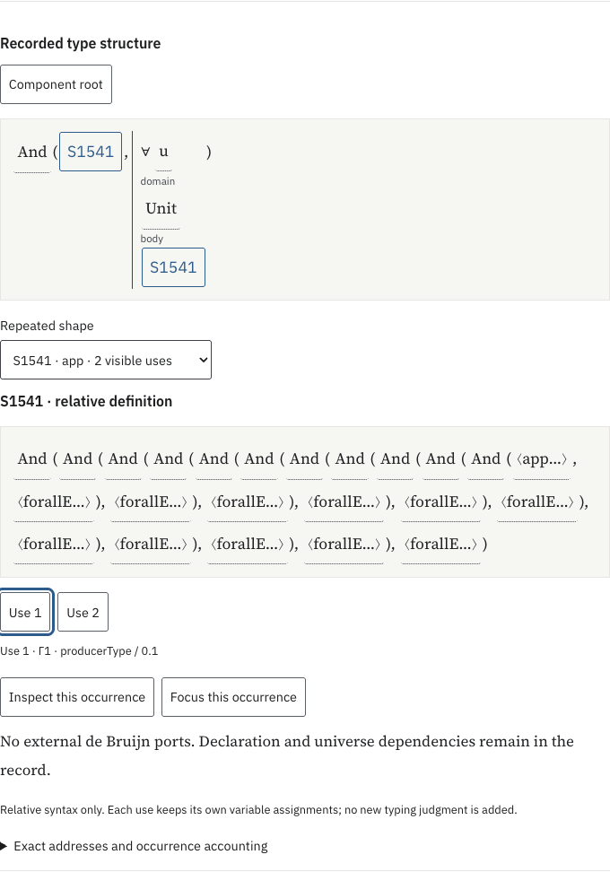
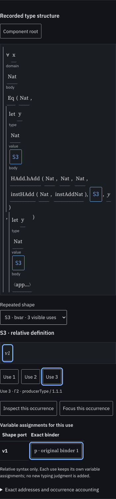
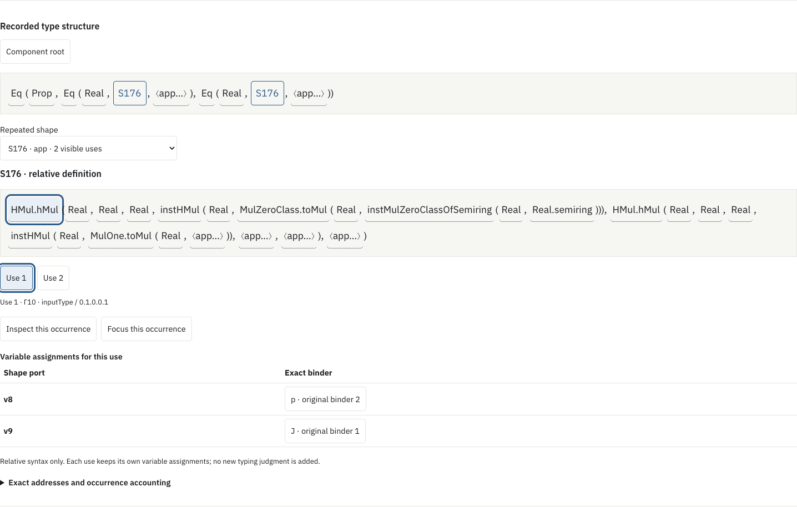

# Parameterized sharing in recorded type notation

This experiment addresses repeated structure in the recorded-type reader. It
reuses the [recoverable type grammar](../type-notation/README.md) and its paged
implementation. It adds one visual rule: an explicit use of a relative syntax
shape, accompanied by the variable assignments at that occurrence.

The implementation and the checks in this directory are research-branch work.
They do not establish deployment, improved comprehension or semantic compression.
No new native typing query is introduced.

## Rule

A notation cut belongs to one native evidence owner, one source identity, one
call/input, one component and one type table. Equal stored row identifiers are
considered for sharing only inside that qualified component. Different rows are
not identified by their printed text, mathematical meaning or kernel conversion.

For a selected row, compute its exact free de Bruijn indices using the existing
[formal-support scan](../formal-support/README.md). These are relative ports:
under a binder, locally bound index zero is removed and the other indices are
decremented. Gaps are preserved. A shape with ports `v0` and `v2` does not acquire
a `v1` port.

Each visible use retains its full original component path. Walking that path
from the component root reconstructs its lexical environment. Port `vi` maps
to position `context.length - 1 - i`. The endpoint is either a qualified
original-source binder or a binder at an exact computed-type occurrence. Binder
names are display labels. Equal names, and even equal stored binder rows, do not
merge different binder occurrences.

The relative definition has its own `application-type-shape` namespace.
Selecting a relative field at path `q` through use `p` resolves the existing
computed address at `p ++ q`. It is never represented as an original proof
occurrence. Original producer types use the producer's context; lifted producer
and expected types use the consumer's context.

A shape-use portal accounts for zero retained constructor occurrences and hides
the entire original occurrence count at that use. The relative definition is a
separate preview, not another original occurrence. The display carries the
removed notation subcuts. `recover(fold(cut, family))` reconstructs the cut,
including its addresses, residuals and exact retained/hidden counts. This is a
reversible display codec, not independent authentication of arbitrary input
objects or a proof of mathematical equivalence.

## Bounds and unavailable cases

- The initial grammar cut has at most 48 objects (24 by default). At most two
  existing frontier-refinement operations expose repetition; the resulting cut
  is capped at 192 objects. Discovery is local to that cut, not a global use index.
- One active shared-type session per application window retains two decoded-row
  maps, each capped at 4,096 rows and 2 MiB. It does not allocate arrays sized to
  the complete recorded type table.
- One intrinsic-support scan uses the existing 65,536-row, 262,144-state and
  262,144-support-entry limits. It retains support summaries, not fetched tuples.
- At most four use assignments and 512 relative ports are retained per page.
  Paths and reconstructed contexts are capped at 512. The serialized session
  scene, including recovery images, is capped at 8 MiB.
- The caller owns the separate hash-checked type-page cache, source paths and
  native metadata. Complete binding-probe graphs, where present in native
  metadata, remain separately counted. These are component bounds, not a bound
  on total browser/process memory.
- Unresolved free/metavariable identifiers, excessive interfaces and exhausted
  resource limits remain unavailable. A cut without exposed repetition retains
  ordinary notation. An empty de Bruijn interface does not imply absence of
  declaration or universe dependencies.

## Finite checks

`check-model.cjs` uses a separate depth-sensitive occurrence oracle for free
indices and reconstructs lexical environments independently of the runtime.
It checks gapped ports, five-use pagination, identical-name/stored-row binder
shadowing, all twelve constructor kinds as syntax data, unavailable unresolved
identifiers, cancellation, disposal and damaged recovery records. Arbitrary
syntax controls are not claimed to be kernel-typed.

The same script exercises the actual hash-checked paged application provider
on all 27 original/lifted/expected roots of the nine recorded inputs in the
three existing authored kernel controls. Their native owners and kernel checks
are unchanged. The dependent-let control contains a shared variable row whose
uses refer respectively to an original binder and a local type binder. The
shared-type control has a 69-object notation cut, a five-object display and a
separate 23-object relative definition. Its two displayed uses have context
lengths one and two. The expanded occurrence count is preserved at both uses.

`check-corpus.cjs` selects the argument with the largest expanded original
producer type in each existing native profile, with inventory order breaking
ties. It checks original, lifted and expected roots: 126 selected roots from
42 profiles. This is not every one of the 877 recorded inputs. The initial
run found available repeated-shape interfaces in 48 cuts, with no unavailable
selected roots; all 48 display codecs reconstructed exactly. Full graphs are
independent verifier inputs, not runtime allocations. Runtime requests for the
original whole source/native archives are refused by the test fetcher.

`check-browser.cjs` checks the served production build, exact served file bytes,
keyboard selections, relative-field instantiation, both binder namespaces,
focus/root navigation, four viewport/theme combinations and scoped axe audits.
Its report is separate from the model reports; a model pass does not establish
a browser pass. No source or data substitution is used.

The production-browser run passed nine control type roots, four use switches,
four relative selections, three binder selections and two focus/root
transitions. A separate case checks all three type stages of the selected
Riccati argument in the actual proof explorer. Computed selections preserve the
original proof position; the `p` port navigates the graph to its exact original
binder. Sixteen axe audits cover the four control/Riccati cases in both themes
at desktop and phone widths. The screenshots below are captured from that run.







The Riccati expected-type example starts with 22 objects. The folded main cut
has ten objects, with a separate 23-object definition preview. That preview
exposes more structure than the removed frontiers. Folding therefore does not
guarantee fewer total displayed objects. Long declaration names and implicit
arguments also remain. The current rule conserves syntax and lexical targets;
preview allocation and readable mathematical notation still require work.

Reproduce the model checks from the repository root:

```sh
node --max-old-space-size=256 research/proof-atlas/type-sharing/check-model.cjs /tmp/type-sharing-model.json
node --max-old-space-size=256 research/proof-atlas/type-sharing/check-corpus.cjs /tmp/type-sharing-corpus.json
```

After a production build, using the project's installed Playwright and browser:

```sh
ATLAS_TYPE_SHARING_MODEL=/tmp/type-sharing-model.json ATLAS_TYPE_SHARING_CORPUS=/tmp/type-sharing-corpus.json node research/proof-atlas/type-sharing/check-browser.cjs /tmp/type-sharing-browser
```

The JavaScript codec has finite checks, not a general Lean refinement proof.
It shares relative syntax, not typing judgments, semantic proof steps or proof
premise necessity. The AI/source provenance of each existing profile remains
separate; this experiment does not establish performance on massive AI proofs.
