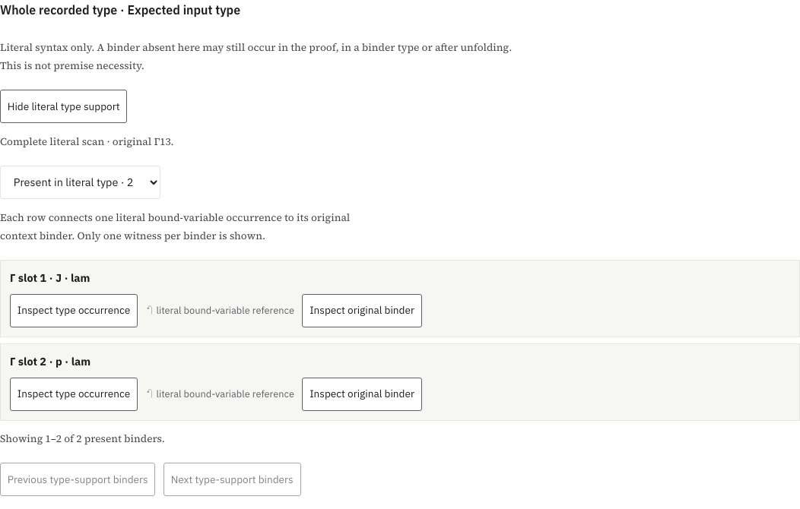
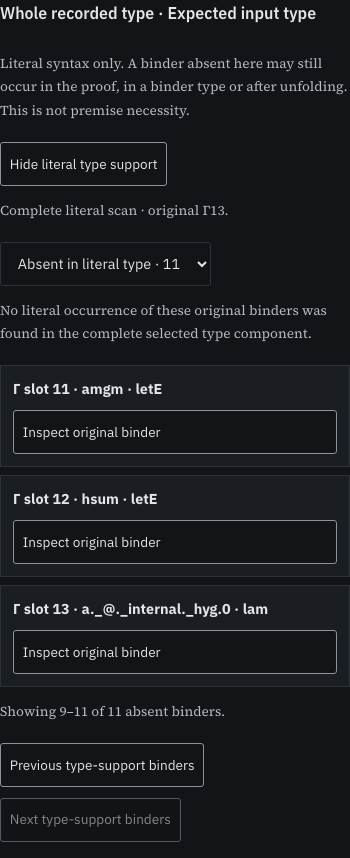

# Literal context support of a recorded type

This rule separates an application's lexical context from the original binders that occur in one recorded type component. It does not classify necessary premises or uses in the proof term. It is available inside the existing paged application inspector; it creates no new proof viewer.

## Rule and provenance

The scanner follows the ordered expression fields of the pinned recorded type table. At a bound variable with index `i`, beneath `d` type-local binders, an ambient reference exists exactly when `i >= d`. Its original context ordinal is `|Γ| - 1 - (i - d)`. Lambda and forall bodies add a local binder; their domains do not. A let body adds a binder; its type and value do not. Other expression fields keep the same depth. Universe levels and constant names are not term-context binders. Unresolved free/metavariable expressions produce an unavailable result.

The independent complete-table oracle computes relative free-index sets bottom-up: unions for ordinary fields, and removal of index zero followed by decrement for binder bodies. The paged scanner instead visits `(stored node, local binder depth)` states. A shared node can have different ambient meaning at different depths, so deduplicating by node alone is invalid. Its bounded memo may evict entries; eviction allows recomputation and cannot justify absence. A work or frontier limit produces no absent-binder rows.

The output retains the original native owner, source packet, call query, input identifier and component root. Original `producerType` belongs to the producer context; lifted, expected and consumer components belong to the consumer context. Each present binder keeps one exact computed bound-variable occurrence and its qualified original source binder. Context/source metadata use the existing source-witness checks. The scanner does not perform unfolding, reduction, conversion or transitive closure through binder types. A component may itself be a separately recorded normalized type; that remains a distinct input component.

## Riccati distinction

At input `25:4`, the producer type in Γ10, its lifted version in Γ13 and the consumer type all mention only the original `J` and `p` binders. The actual proof input resolves through the `amgm` local definition, whose binder is absent from this literal type. This is a recorded source-use counterexample to treating literal type support as proof-term use. It does not decide whether a premise is mathematically necessary.

In the [paged application reader](/projects/proof-atlas/manual/paged-network/#ns-lab), inspect an input, select a recorded type and choose **Show literal type support**. Four rows at a time connect type occurrences to original binders. The absent list is enabled only after a complete scan. Source and witness selections preserve that support view; selecting another type component creates a separate view. Changing the input or proof retires it. Source-only profiles have no inferred type support.

## Bounds and evidence

The scanner accepts a recorded table of at most 65,536 stored nodes and an ambient context of at most 512 binders. It retains at most 4,096 memo keys and 4,096 pending frames, with at most 128 packed path bytes per frame. It stops after 262,144 processed states. The type cursor keeps its independent 64-row page cache; the scanner retains no complete graph array. These are component bounds, not a measured total heap. Known support can survive a witness deeper than the existing 512-field selection limit; that witness is explicitly unselectable rather than assigned a truncated occurrence.

The [model check](check-model.cjs) compares all six type roots at 877 inputs in 42 installed native profiles: 5,262 component scans, 4,719 present-binder appearances and 49,295 absent-binder appearances. These are repeated context positions across recorded components, not unique mathematical premises. Every present native witness is checked against the original complete table and source binder; the runtime requests only paged records. The finite check also covers foreign owner/query/component addresses, captured queries, exhausted budgets, cancellation and disposal.

Authored syntax controls separately test a shared node at distinct depths, binder domains, let values, unresolved objects and memo eviction. A 32,001-node metadata chain completes with a 4,096-key memo and one pending frame; its depth-32,000 witness remains outside the selection bound. An 81-node shared expression represents `2^81 - 1` expanded occurrences and is scanned in 81 states. These authored expressions carry no native typing or AI-generation claim.

The original recorded type tables remain producer attestations with hash-checked fetched pages and existing source witnesses. This rule adds a structural scan, not a new Lean kernel typing judgment. Improved proof comprehension remains unmeasured. The blog and earlier evidence records are unchanged.

The [browser record](browser-check.json.gz) checks exact computed/source selections, support preservation while following a witness, separate producer/consumer contexts, four-row absence pages, retired controls, corrupt type data, cancelled scans and explicit source-only/missing-component behavior. Failed scans expose no absent-binder rows. Four accessibility audits cover this widget on desktop/phone and both themes. The existing network, scope-band and input-scope suites contribute twelve further targeted audits. Their shared provider/inspector source hashes and normalized reader page are checked against the final build. These are finite interface checks, not a claim of complete browser coverage.





## Reproduction

```sh
node research/proof-atlas/type-support/check-model.cjs
# Build and serve the actual production site; Playwright/Chromium required.
ATLAS_ORIGIN=http://127.0.0.1:8866 node research/proof-atlas/type-support/check-browser.cjs /tmp/atlas-type-support-browser
ATLAS_ORIGIN=http://127.0.0.1:8866 ATLAS_NETWORK_STREAM_SCREENSHOTS=/tmp/atlas-type-support-network node scripts/test-proof-atlas-network-streaming-browser.cjs
ATLAS_ORIGIN=http://127.0.0.1:8866 node research/proof-atlas/scoped-applications/check-browser.cjs /tmp/atlas-type-support-scopes
ATLAS_ORIGIN=http://127.0.0.1:8866 node research/proof-atlas/input-contexts/check-browser.cjs /tmp/atlas-type-support-inputs
node research/proof-atlas/type-support/verify.cjs --check
```

Only compiled term metadata, structural controls and verification records are published. Original Lean/tactic scripts and private execution logs are excluded. The general geometric-language goal remains active; this iteration does not merge or deploy the feature branch.

Completed static reports, reproduction scripts and figures are copied to the local preview after verification. Application assets are tested from the actual production build without runtime overlays.
