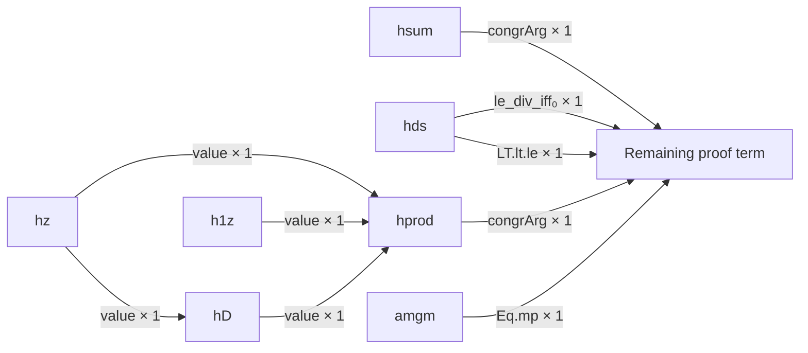

# Local definitions in the Riccati bound

Each arrow counts explicit references to a let-bound variable. Its destination is the innermost local definition whose type or value contains the reference. References outside those fields lead to the remaining proof term. Counts include implicit arguments and annotations.

| Definition | Destination | Receiving call | Compiled reference |
|---|---|---|---|
| [hz](https://moiseevigor.github.io/projects/proof-atlas/library/?edition=published-15&proof=JacobiData.slope_bound_abs&route=1%3A1.1.1.1.1.1#expr-3244) | [hD](https://moiseevigor.github.io/projects/proof-atlas/library/?edition=published-15&proof=JacobiData.slope_bound_abs&route=1%3A1.1.1.1.1.1.2#expr-3243) · value | [LT.lt.le](https://moiseevigor.github.io/projects/proof-atlas/library/?edition=published-15&proof=JacobiData.slope_bound_abs&route=1%3A1.1.1.1.1.1.2.1.1#expr-182) · argument 5 of 5 | [Use 1, row 28](https://moiseevigor.github.io/projects/proof-atlas/library/?edition=published-15&proof=JacobiData.slope_bound_abs&route=1%3A1.1.1.1.1.1.2.1.1.1#expr-28) |
| [hz](https://moiseevigor.github.io/projects/proof-atlas/library/?edition=published-15&proof=JacobiData.slope_bound_abs&route=1%3A1.1.1.1.1.1#expr-3244) | [hprod](https://moiseevigor.github.io/projects/proof-atlas/library/?edition=published-15&proof=JacobiData.slope_bound_abs&route=1%3A1.1.1.1.1.1.2.2.2#expr-3241) · value | [LT.lt.le](https://moiseevigor.github.io/projects/proof-atlas/library/?edition=published-15&proof=JacobiData.slope_bound_abs&route=1%3A1.1.1.1.1.1.2.2.2.1.2.1.1.0.1.1.1.1.1.0.1.0.1#expr-1037) · argument 5 of 5 | [Use 2, row 50](https://moiseevigor.github.io/projects/proof-atlas/library/?edition=published-15&proof=JacobiData.slope_bound_abs&route=1%3A1.1.1.1.1.1.2.2.2.1.2.1.1.0.1.1.1.1.1.0.1.0.1.1#expr-50) |
| [h1z](https://moiseevigor.github.io/projects/proof-atlas/library/?edition=published-15&proof=JacobiData.slope_bound_abs&route=1%3A1.1.1.1.1.1.2.2.2.1#expr-1193) | [hprod](https://moiseevigor.github.io/projects/proof-atlas/library/?edition=published-15&proof=JacobiData.slope_bound_abs&route=1%3A1.1.1.1.1.1.2.2.2#expr-3241) · value | [LT.lt.le](https://moiseevigor.github.io/projects/proof-atlas/library/?edition=published-15&proof=JacobiData.slope_bound_abs&route=1%3A1.1.1.1.1.1.2.2.2.1.2.1.1.0.1.1.1.1.1.0.1.1#expr-1040) · argument 5 of 5 | [Use 3, row 28](https://moiseevigor.github.io/projects/proof-atlas/library/?edition=published-15&proof=JacobiData.slope_bound_abs&route=1%3A1.1.1.1.1.1.2.2.2.1.2.1.1.0.1.1.1.1.1.0.1.1.1#expr-28) |
| [hD](https://moiseevigor.github.io/projects/proof-atlas/library/?edition=published-15&proof=JacobiData.slope_bound_abs&route=1%3A1.1.1.1.1.1.2#expr-3243) | [hprod](https://moiseevigor.github.io/projects/proof-atlas/library/?edition=published-15&proof=JacobiData.slope_bound_abs&route=1%3A1.1.1.1.1.1.2.2.2#expr-3241) · value | [LT.lt.le](https://moiseevigor.github.io/projects/proof-atlas/library/?edition=published-15&proof=JacobiData.slope_bound_abs&route=1%3A1.1.1.1.1.1.2.2.2.1.2.1.1.0.1.1.1.1.1.1#expr-1044) · argument 5 of 5 | [Use 4, row 37](https://moiseevigor.github.io/projects/proof-atlas/library/?edition=published-15&proof=JacobiData.slope_bound_abs&route=1%3A1.1.1.1.1.1.2.2.2.1.2.1.1.0.1.1.1.1.1.1.1#expr-37) |
| [hsum](https://moiseevigor.github.io/projects/proof-atlas/library/?edition=published-15&proof=JacobiData.slope_bound_abs&route=1%3A1.1.1.1.1.1.2.2.2.2.2#expr-3239) | Remaining proof term | [congrArg](https://moiseevigor.github.io/projects/proof-atlas/library/?edition=published-15&proof=JacobiData.slope_bound_abs&route=1%3A1.1.1.1.1.1.2.2.2.2.2.2.1.1.1.0.1.1#expr-2358) · argument 6 of 6 | [Use 5, row 28](https://moiseevigor.github.io/projects/proof-atlas/library/?edition=published-15&proof=JacobiData.slope_bound_abs&route=1%3A1.1.1.1.1.1.2.2.2.2.2.2.1.1.1.0.1.1.1#expr-28) |
| [hds](https://moiseevigor.github.io/projects/proof-atlas/library/?edition=published-15&proof=JacobiData.slope_bound_abs&route=1%3A1.1.1.1.1.1.2.2#expr-3242) | Remaining proof term | [le_div_iff₀](https://moiseevigor.github.io/projects/proof-atlas/library/?edition=published-15&proof=JacobiData.slope_bound_abs&route=1%3A1.1.1.1.1.1.2.2.2.2.2.2.1.1.1.1.0.1.1.1.1#expr-2438) · argument 8 of 8 | [Use 6, row 50](https://moiseevigor.github.io/projects/proof-atlas/library/?edition=published-15&proof=JacobiData.slope_bound_abs&route=1%3A1.1.1.1.1.1.2.2.2.2.2.2.1.1.1.1.0.1.1.1.1.1#expr-50) |
| [hds](https://moiseevigor.github.io/projects/proof-atlas/library/?edition=published-15&proof=JacobiData.slope_bound_abs&route=1%3A1.1.1.1.1.1.2.2#expr-3242) | Remaining proof term | [LT.lt.le](https://moiseevigor.github.io/projects/proof-atlas/library/?edition=published-15&proof=JacobiData.slope_bound_abs&route=1%3A1.1.1.1.1.1.2.2.2.2.2.2.1.1.1.1.1.1.1.1.1.0.1.1.0.1.1.1#expr-3163) · argument 5 of 5 | [Use 7, row 57](https://moiseevigor.github.io/projects/proof-atlas/library/?edition=published-15&proof=JacobiData.slope_bound_abs&route=1%3A1.1.1.1.1.1.2.2.2.2.2.2.1.1.1.1.1.1.1.1.1.0.1.1.0.1.1.1.1#expr-57) |
| [hprod](https://moiseevigor.github.io/projects/proof-atlas/library/?edition=published-15&proof=JacobiData.slope_bound_abs&route=1%3A1.1.1.1.1.1.2.2.2#expr-3241) | Remaining proof term | [congrArg](https://moiseevigor.github.io/projects/proof-atlas/library/?edition=published-15&proof=JacobiData.slope_bound_abs&route=1%3A1.1.1.1.1.1.2.2.2.2.2.2.1.1.1.1.1.1.1.1.1.0.1.1.1.1.0.1#expr-3219) · argument 6 of 6 | [Use 8, row 50](https://moiseevigor.github.io/projects/proof-atlas/library/?edition=published-15&proof=JacobiData.slope_bound_abs&route=1%3A1.1.1.1.1.1.2.2.2.2.2.2.1.1.1.1.1.1.1.1.1.0.1.1.1.1.0.1.1#expr-50) |
| [amgm](https://moiseevigor.github.io/projects/proof-atlas/library/?edition=published-15&proof=JacobiData.slope_bound_abs&route=1%3A1.1.1.1.1.1.2.2.2.2#expr-3240) | Remaining proof term | [Eq.mp](https://moiseevigor.github.io/projects/proof-atlas/library/?edition=published-15&proof=JacobiData.slope_bound_abs&route=1%3A1.1.1.1.1.1.2.2.2.2.2.2.1.1.1.1.1.1.1.1.1.0.1.1.1.1#expr-3221) · argument 4 of 4 | [Use 9, row 37](https://moiseevigor.github.io/projects/proof-atlas/library/?edition=published-15&proof=JacobiData.slope_bound_abs&route=1%3A1.1.1.1.1.1.2.2.2.2.2.2.1.1.1.1.1.1.1.1.1.0.1.1.1.1.1#expr-37) |

Compiled index SHA-256: `0dec5212099b579b1f2c3a0411d7b9e2fcd827f19142a595da0dbf13401779aa`. The diagram covers references to local definitions. Other binders, constant dependencies and the mathematical interpretation require separate views.
